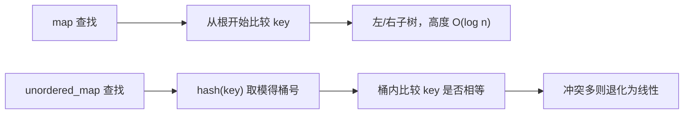

# map/set 底层为什么是红黑树，unordered 又为什么要哈希

← [[学习/学习导航/2026-10-26-学习导航|今日导航]] · [[八股测试/2026-10-26#STL-MAP-001|回到测试题]]

## 先把词说清楚

**二叉搜索树（BST）**：左子树键小于根、右子树键大于根，查找沿一条路径走。

**平衡树**：通过旋转维持高度为 O(log n)，避免退化成链表。

**红黑树**：一种自平衡 BST，用颜色约束保证最长路径不超过最短路径的两倍，插入删除最多常数次旋转。

**哈希表**：用哈希函数把键映射到桶；桶冲突时常见做法是链地址法或开放定址。

**负载因子（load factor）**：元素数 / 桶数。超过阈值就 `rehash`。

## 它解决什么问题

`map` 需要同时满足：按 key 快速查找、按 key 有序遍历、支持范围查询（`lower_bound`）。哈希表不保序，BST 保序但可能退化，红黑树在“平衡”和“修改成本”之间取了一个工程上很划算的点。

## 为什么是红黑树，不是 AVL

| 维度 | 红黑树 | AVL 树 |
| --- | --- | --- |
| 平衡程度 | 近似平衡（高度差 ≤ 2 倍） | 严格平衡 |
| 查找 | O(log n)，常数略大 | 略快 |
| 插入删除 | 旋转少，修改成本低 | 旋转多，修改成本高 |
| STL 选择 | `map`/`set` 常用 | 未采用 |

STL 容器要兼顾读写混合场景，红黑树的“查找稍慢一点、修改便宜很多”更合适。

## 红黑树的节点长什么样

```text
struct Node {
    Color  color;      // 红 / 黑
    Node*  parent;
    Node*  left;
    Node*  right;
    value_type value;  // pair<const Key, T>
};
```

常见实现里一个 `map` 节点要额外存 3 个指针 + 颜色，比 `vector` 里一个元素重得多。数据量大时，`map` 的内存开销和缓存未命中会很明显。

## unordered_map 的结构

```text
桶数组：[0] -> 节点 -> 节点
        [1] -> 空
        [2] -> 节点
        ...
```

- 插入：算哈希 → 定位桶 → 桶内比较键是否相等；
- 查找：同样两步，平均 O(1)；
- 冲突多时退化为桶内线性查找，最坏 O(n)；
- 元素数 / 桶数超过 `max_load_factor`（默认常见为 1.0）触发 `rehash`。

## 图示



## 选择的判断标准

- **要按 key 排序遍历、要范围查询** → `map` / `set`；
- **只做单点查找，键分布均匀** → `unordered_map`；
- **键是连续整数且范围小** → 直接 `vector` 当索引表，比两者都快；
- **数据量大且在意内存/缓存** → 考虑 `vector` + 排序 + 二分，或开放定址的自研哈希表。

## 边界与常见误解

**“unordered_map 遍历顺序是插入顺序？”** 不是，标准不保证任何顺序。

**“map 的查找一定比 unordered_map 慢？”** 小数据量时 `map` 可能因为缓存友好而不差；`unordered_map` 有哈希计算和指针跳转开销。要实测。

**“自定义 key 只需要提供 `<`？”** `map` 需要比较器；`unordered_map` 需要 `hash` 与 `==`。两者都漏写会编译失败。

**“rehash 会让元素地址变化？”** 标准保证引用和指针不失效，失效的是迭代器。

## 使用场景

- **订单簿价位**：`map<Price, Level>`，需要按价格顺序遍历相邻档位。
- **订单号索引**：`unordered_map<OrderId, OrderRef>`，单点查找。
- **配置表**：数据量小、需要有序输出 → `map`。

## 变式与口述总结

> map/set 用红黑树，保证 O(log n) 的最坏查找，同时支持有序遍历和范围查询；选它而不是 AVL，是因为修改时旋转少。unordered_map 用哈希桶，平均 O(1)，但不保序、最坏 O(n)，还要处理 rehash。选择看是否需要有序与范围查询，以及键的分布和内存预算。

**变式：**

1. 为什么 `map` 不选 AVL 或 B 树？
2. `unordered_map` 的最坏复杂度什么时候出现？
3. 键是 0~100 万连续整数，最合适的“映射”是什么？

## 来源

- 题型来源：[滴滴 C++ 岗面经](https://www.iamshuaidi.com/4432.html) 原问“map 和 unordered_map 的底层数据结构、各自优缺点”；[阿里云 C++ 三轮面](https://www.iamshuaidi.com/3818.html) 记有“set 和 map 底层数据结构实现，为什么用红黑树”。镜像页未标发布日期，本次访问 2026-10-30。
- 标准依据：[N4659 associative.reqmts](https://timsong-cpp.github.io/cppwp/n4659/associative.reqmts)、[unord.req](https://timsong-cpp.github.io/cppwp/n4659/unord.req)。标准不规定必须用红黑树，这是常见实现。
