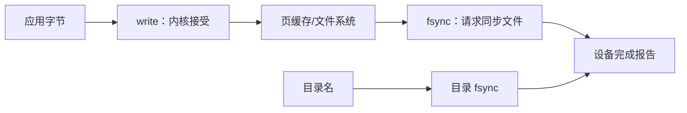

# write 返回与 fsync：数据何时算持久

← [[学习/学习导航/2026-10-26-学习导航|今日导航]] · [[八股测试/2026-10-26|今日自测]]

> [!abstract] 今天要弄懂什么
> 写日志时 write 已成功返回，进程或机器突然崩溃会怎样？fsync 与 fdatasync 的作用有什么区别？

## 先把名词说清楚

页缓存是内核用内存暂存文件页的机制。‘脏页’是已改写但尚未按持久化要求同步到设备的页。应用看到 write 返回与重启后还在，是两个不同的问题。

## 为什么会遇到这个问题

订单或成交日志若先告知上游‘已成功’，却没有定义何时确认为持久，故障后的恢复范围会变得含糊。先约定成功语义，再决定同步时机。

## 用一个具体过程理解

把一次写入拆成三层：应用自己的缓冲区、内核页缓存、设备上的持久介质。`std::ofstream::flush` 或 `fflush` 只要求把用户空间缓冲送往内核；普通 `write` 成功说明该调用完成了相应字节的内核接收；`fsync` 再请求文件数据及相关元数据同步到存储设备。`fdatasync` 可省去不影响后续正确读取的部分元数据同步，因此可能减少工作，但它不是‘总比 fsync 快’的标准保证。新建文件时还有第四件事：目录里出现这个名字。文件本身 fsync 后，名字仍可能没有稳定写入，故要在需要路径恢复保证时再同步父目录。业务上的‘已接收’、‘已入内核’和‘已持久确认’应分别命名；如果批量 fsync，就要说明批中哪些记录在故障后可能消失，不能只写‘日志已写入’。

## 从代码看执行顺序

完整源码如下；同一份代码也在阅读版和 `.cpp` 中，改动时须三处同步。

```cpp
// 目的：演示普通写入后显式同步文件的调用顺序（Linux/POSIX）。
// 步骤：建临时文件 → 写数据 → fsync → 删除临时文件；不做掉电实验。
// 观察：成功打印表示本机调用返回成功，不证明任意硬件故障下零丢失。
#include <cerrno>       // errno、EINTR
#include <cstdlib>      // mkstemp
#include <iostream>     // cout
#include <stdexcept>    // runtime_error
#include <unistd.h>     // write、fsync、close、unlink

int main() {
    char path[] = "/tmp/bagu_sync_XXXXXX";
    const int fd = ::mkstemp(path);
    if (fd == -1) throw std::runtime_error("mkstemp failed");
    const char record[] = "order=42\n";
    std::size_t done = 0;
    constexpr std::size_t size = sizeof(record) - 1; // 不写末尾 NUL。
    while (done < size) {
        const ssize_t n = ::write(fd, record + done, size - done);
        if (n > 0) { done += static_cast<std::size_t>(n); continue; }
        if (n == -1 && errno == EINTR) continue;
        throw std::runtime_error("write failed");
    }
    if (::fsync(fd) == -1) throw std::runtime_error("fsync failed");
    std::cout << "file fsync returned successfully\n";
    if (::close(fd) == -1) throw std::runtime_error("close failed");
    if (::unlink(path) == -1) throw std::runtime_error("unlink failed");
}
```

逐步追踪：

1. `write_all` 负责把业务字节全部提交给内核；这一步只解决短写。
2. `fsync(fd)` 同步该打开文件对应的数据和元数据，并检查返回值。
3. 若文件是刚创建且要保证路径名可恢复，还要打开父目录并对目录 fd 做 fsync。
4. 示例删除临时路径，仅演示调用顺序，不宣称验证了断电恢复。

**输出与保证：**预期打印 `file fsync returned successfully`。示例随后主动删除文件，目的只是看调用边界。

## 把关系画出来



图中箭头表示本节讨论的状态或依赖；它不是硬件时序图。

## 在项目里什么时候用

交易日志常把持久化确认点与业务确认消息绑定；如果可容忍最近一小段数据丢失，可采用批量策略，但需明确窗口和恢复行为。

## 易错边界与反例

- `fsync` 不会自动同步父目录项。
- `close` 成功或程序正常退出不应被当作可证明的掉电持久保证。
- `fsync` 失败时不能向业务层报告持久成功；文件系统、网络存储和设备都可能有额外语义。

## 换一个条件自己试

假设 write 返回成功后断电、fsync 返回后断电、rename 后未同步目录时断电，分别写出能确定和不能确定的部分。

## 30 秒口述

> write 完成内核接收，不等于持久；fsync 同步文件，目录名需要目录 fsync；确认时机由业务的丢失容忍度决定。

## 来源与适用范围

**题型来源：**[字节跳动 C++ 数据库开发实习 ByteHouse 面经](https://www.nowcoder.com/discuss/572859889337335808)明确记录了‘fsync 怎么处理’和‘是否有丢失数据风险’；崩溃情境为本库改写。

**技术核对（2026-10-26 访问）：**
- [Linux fsync(2)](https://man7.org/linux/man-pages/man2/fsync.2.html)
- [Linux write(2)](https://man7.org/linux/man-pages/man2/write.2.html)

本节代码面向 Linux/POSIX，语言基线为 C++17；涉及文件系统与设备的结论需以运行环境为准。
