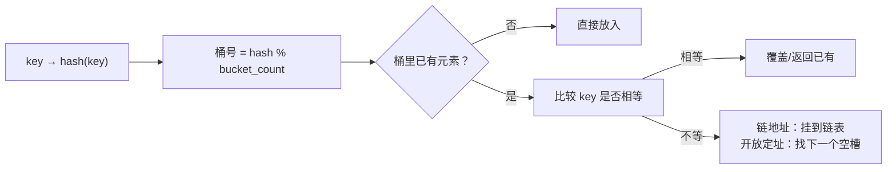

# 哈希冲突：桶装不下的键去哪

← [[学习/学习导航/2026-10-26-学习导航|今日导航]] · [[八股测试/2026-10-26#STL-HASH-001|回到测试题]]

## 先把词说清楚

**哈希函数**：把任意键映射成一个整数的函数，`std::hash<Key>`。

**桶（bucket）**：哈希值取模后对应的槽位。

**哈希冲突**：不同的键得到同一个桶。

**链地址法（separate chaining）**：每个桶挂一条链表（或树），冲突的键都挂上去。常见 `unordered_map` 实现用它。

**开放定址法（open addressing）**：冲突时按规则找下一个空槽（线性探测、二次探测、双重哈希）。

**负载因子**：元素数 / 桶数。

**rehash**：重新分配更多桶，把所有元素重新分布。

## 它解决什么问题

哈希函数把“比较键”变成“算一个下标”，平均 O(1)；但键空间通常远大于桶数，冲突不可避免。冲突处理决定了最坏情况和实现细节。

## 两种主流冲突处理

| 方式 | 优点 | 缺点 |
| --- | --- | --- |
| 链地址法 | 删除简单；负载因子可以 > 1；实现直观 | 节点分散，缓存不友好；每个元素额外指针 |
| 开放定址法 | 连续内存，缓存友好；无额外指针 | 删除要用墓碑；负载因子高时性能骤降；对哈希质量更敏感 |

`std::unordered_map` 标准只规定接口与复杂度，不规定实现；主流实现（libstdc++、libc++）用链地址法。

## rehash 什么时候发生

```cpp
std::unordered_map<int, int> m;
m.max_load_factor(0.7f);   // 请求更高的空间换更低的冲突率
```

当 `size() / bucket_count()` 超过 `max_load_factor()`，插入会触发 rehash：分配新桶数组、重新计算每个元素的位置。

复杂度：单次 rehash 是 O(n)，但摊还到每次插入仍是平均 O(1)。

## 图示



## 工程上的三个坑

**1. 自定义类型要提供 hash 与相等**

```cpp
struct OrderKey {
    std::int64_t account;
    std::int64_t order_id;
    bool operator==(const OrderKey& other) const {
        return account == other.account && order_id == other.order_id;
    }
};

struct OrderKeyHash {
    std::size_t operator()(const OrderKey& key) const noexcept {
        const auto h1 = std::hash<std::int64_t>{}(key.account);
        const auto h2 = std::hash<std::int64_t>{}(key.order_id);
        return h1 ^ (h2 + 0x9e3779b97f4a7c15ULL + (h1 << 6) + (h1 >> 2));
    }
};
```

只写 `==` 不写 `hash`，编译失败；只写 `hash` 不写 `==`，同样失败。哈希要稳定，不能依赖地址或未初始化内存。

**2. 恶意键构造会让哈希退化**

如果哈希函数可预测，攻击者可以构造大量同桶键，让查找退化成 O(n)。这就是“哈希洪水”。工程上可用带随机种子的哈希（如 `std::hash<std::string>` 在部分实现中加了随机化）。

**3. 迭代器与引用的失效不一样**

`rehash` 之后，**迭代器全部失效**，但**指向元素的指针和引用仍然有效**（元素本身没有搬动）。删除某个元素只失效指向它的迭代器。

## 边界与常见误解

**“冲突了会不会覆盖？”** 不会。容器用 `==` 区分不同的键，冲突只影响性能。

**“桶越多越好？”** 桶越多内存越大，缓存局部性越差；负载因子是权衡，不是越小越好。

**“自定义哈希随便异或一下就行？”** 简单异或容易产生规律性碰撞（比如 `(a,b)` 与 `(b,a)` 同哈希）。用成熟的组合方式或现成库。

**“rehash 后还能用之前的引用？”** 能，但别依赖——这是标准保证的细节，写代码时按“失效”处理更安全。

## 使用场景

- **订单号/会话 ID 索引**：`unordered_map`，注意键分布。
- **自定义复合键**：提供稳定的 `hash` 与 `==`。
- **延迟敏感**：预留 `reserve(n)` 避免运行期 rehash 抖动。

## 变式与口述总结

> 哈希冲突指不同键落到同一个桶，主流处理是链地址法和开放定址法。负载因子超过阈值就 rehash：重新分配桶、重新分布元素，单次 O(n)、摊还 O(1)。rehash 会让迭代器失效，但元素引用不变。自定义键必须同时提供 hash 和相等比较，哈希质量直接决定最坏情况。

**变式：**

1. 链地址法和开放定址法各自适合什么场景？
2. `reserve` 能避免什么问题？
3. 为什么 `(a,b)` 和 `(b,a)` 用简单异或会冲突？

## 来源

- 题型来源：[阿里云 C++ 三轮面](https://www.iamshuaidi.com/3818.html) 记有“hash 冲突解决”。镜像页未标发布日期，本次访问 2026-10-30。
- 标准依据：[N4659 unord.req](https://timsong-cpp.github.io/cppwp/n4659/unord.req)、[unord.hash](https://timsong-cpp.github.io/cppwp/n4659/unord.hash)。
