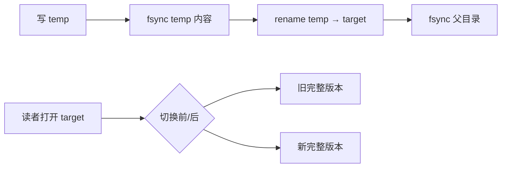

# 临时文件、rename 与目录 fsync

← [[学习/学习导航/2026-10-26-学习导航|今日导航]] · [[八股测试/2026-10-26|今日自测]]

> [!abstract] 今天要弄懂什么
> 更新一个快照文件时，怎样避免读者看到只写了一半的文件？rename 成功就等于断电可恢复吗？

## 先把名词说清楚

‘原子替换’讲的是外界看到名字指向旧文件或新文件，不看到半个名字。‘持久化’讲的是断电后还在。这两个词经常被混用；读者当前看见新文件，并不能证明机器重启后一定还能找到它。

## 为什么会遇到这个问题

回放索引、配置和状态快照可能有读者同时打开。直接 `O_TRUNC` 改正式文件会出现可见的空文件或前半段，因而需要先写新版本，再切换路径名。

## 用一个具体过程理解

假设正式文件原有完整版本 V1，程序要发布 V2。若直接打开正式文件并截断，再逐段写入，读者可能在截断后、写完前打开，只看到空内容或 V2 的前半段。改用同一目录中的临时文件：V2 未写完时读者仍打开 V1；V2 写完并完成文件同步后，`rename` 把正式名字切到 V2；此后新打开路径的读者看到 V2，原先已经打开 V1 的 fd 继续指向 V1。这里‘切换名字’是可见性边界，不自动等于掉电持久边界，故还要同步目录。若程序在 rename 前崩溃，可能留下临时文件；若在 rename 后、目录同步前崩溃，重启后名字的结果不能仅凭本次可见性推断。实际代码还要限制临时文件权限、检查每一步错误，并确保不会跨文件系统移动。

## 从代码看执行顺序

完整源码如下；同一份代码也在阅读版和 `.cpp` 中，改动时须三处同步。

```cpp
// 目的：演示快照文件的“先写新版本 → 同步 → 切换名字”顺序。
// 前提：Linux/POSIX；演示目录在 /tmp；不声明任意存储设备上的绝对掉电保证。
// 观察：target 最终包含 new-snapshot；临时目录会被清理。
#include <cerrno>       // errno、EINTR
#include <cstdlib>      // mkdtemp
#include <fcntl.h>      // open、O_DIRECTORY、O_RDONLY、O_WRONLY
#include <iostream>     // cout
#include <stdexcept>    // runtime_error
#include <string>       // string
#include <unistd.h>     // write、fsync、close、read、rmdir
#include <cstdio>       // rename

int main() {
    char dir_template[] = "/tmp/bagu_replace_XXXXXX";
    char* dir = ::mkdtemp(dir_template); // 唯一演示目录，避免覆盖真实文件。
    if (!dir) throw std::runtime_error("mkdtemp failed");
    const std::string temp = std::string(dir) + "/snapshot.tmp";
    const std::string target = std::string(dir) + "/snapshot.dat";
    const int fd = ::open(temp.c_str(), O_WRONLY | O_CREAT | O_EXCL, 0600);
    if (fd == -1) throw std::runtime_error("open temp failed");
    const std::string body = "new-snapshot";
    std::size_t done = 0;
    while (done < body.size()) {
        const ssize_t n = ::write(fd, body.data() + done, body.size() - done);
        if (n > 0) { done += static_cast<std::size_t>(n); continue; }
        if (n == -1 && errno == EINTR) continue;
        throw std::runtime_error("write failed");
    }
    if (::fsync(fd) == -1 || ::close(fd) == -1)
        throw std::runtime_error("file sync/close failed");
    if (::rename(temp.c_str(), target.c_str()) == -1)
        throw std::runtime_error("rename failed");
    const int dir_fd = ::open(dir, O_RDONLY | O_DIRECTORY);
    if (dir_fd == -1 || ::fsync(dir_fd) == -1 || ::close(dir_fd) == -1)
        throw std::runtime_error("directory sync failed");
    const int read_fd = ::open(target.c_str(), O_RDONLY);
    if (read_fd == -1) throw std::runtime_error("open target failed");
    char buffer[32]{};
    const ssize_t n = ::read(read_fd, buffer, sizeof(buffer));
    if (n < 0) throw std::runtime_error("read target failed");
    std::cout.write(buffer, n);
    std::cout << '\n';
    ::close(read_fd);
    ::unlink(target.c_str());
    ::rmdir(dir);
}
```

逐步追踪：

1. `mkdtemp` 建私有演示目录；实际程序应选择目标文件的同一文件系统。
2. 写临时文件并 `fsync(temp_fd)`，先让新内容达到文件同步点。
3. `rename(temp, target)` 切换路径可见对象。
4. 打开目录后 `fsync(dir_fd)`，处理目录项持久化；最后读取 target 验证正常路径。

**输出与保证：**预期输出 `new-snapshot`。目标文件最初不存在，示例演示可见切换的 API 次序；实际替换旧文件时还要考虑并发写者。

## 把关系画出来



图中箭头表示本节讨论的状态或依赖；它不是硬件时序图。

## 在项目里什么时候用

周期性生成订单簿快照、索引和配置文件可按此模式。追求低延迟时把昂贵同步放在快照后台流程，但确认语义仍要明确。

## 易错边界与反例

- 跨文件系统 rename 可能以 EXDEV 失败，不能退化成随意 copy 覆盖还声称原子。
- 在 rename 前已经打开旧文件的读者继续读旧对象，不会自动跳到新内容。
- 示例运行只检查系统调用返回，不模拟掉电；网络文件系统或特殊挂载要核对自己的语义。

## 换一个条件自己试

若把 fsync(temp) 移到 rename 后、或者只 fsync 文件不 fsync 目录，指出哪一种保证失去依据。

## 30 秒口述

> 先写同目录临时文件并同步，再 rename 原子切名，最后同步父目录；可见原子性与断电持久性分别讨论。

## 来源与适用范围

**题型来源：**[字节跳动 C++ 数据库开发实习 ByteHouse 面经](https://www.nowcoder.com/discuss/572859889337335808)问到日志持久化和数据丢失风险；具体‘快照临时文件 + rename’场景是本库自行设计的工程变式。

**技术核对（2026-10-26 访问）：**
- [Linux rename(2)](https://man7.org/linux/man-pages/man2/rename.2.html)
- [Linux fsync(2)](https://man7.org/linux/man-pages/man2/fsync.2.html)

本节代码面向 Linux/POSIX，语言基线为 C++17；涉及文件系统与设备的结论需以运行环境为准。
