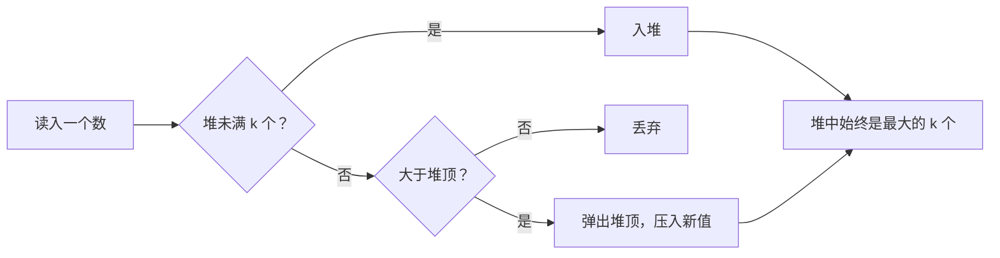

# TopK：为什么求“最大的一百个”要用小根堆

← [[学习/学习导航/2026-10-26-学习导航|今日导航]] · [[八股测试/2026-10-26#STL-HEAP-001|回到测试题]] · 代码：[[学习/2026-10-26/示例代码/01_topk|01_topk 阅读版]]

## 先把词说清楚

**堆（heap）**：完全二叉树形状的数组，父节点不小于（大根堆）或不大于（小根堆）子节点。

**`std::priority_queue`**：容器适配器，默认用 `vector` 存数据、`less` 比较，**默认是大根堆**。

**`std::make_heap` / `push_heap` / `pop_heap`**：直接在一段随机访问区间上维护堆的算法。

**`std::nth_element`**：平均 O(n) 把第 k 个元素放到正确位置，左边都不大于它。

## 它解决什么问题

“从 n 个数里找最大的 k 个”如果全排序要 O(n log n)；维护一个大小为 k 的堆，只需 O(n log k)。当 n 远大于 k（比如一亿取一百）时，差距非常明显。

## 关键反转：求最大 k 个，要用小根堆

直觉上求最大应该用大根堆，但实际做法相反：

- 小根堆的**堆顶是当前 k 个候选里最小的**；
- 新元素若大于堆顶，就替换堆顶并下沉；
- 这样堆里始终保存“目前最大的 k 个”，堆顶是它们的下限。

```cpp
std::priority_queue<int, std::vector<int>, std::greater<int>> top;  // 小根堆

for (int value : data) {
    if (top.size() < k) {
        top.push(value);
    } else if (value > top.top()) {
        top.pop();
        top.push(value);
    }
}
```

复杂度：每个元素最多一次 O(log k) 的调整，总计 O(n log k)，额外空间 O(k)。

## 另一种做法：nth_element

```cpp
std::nth_element(data.begin(), data.begin() + k, data.end(), std::greater<int>());
// 前 k 个就是最大的 k 个（顺序不保证）
```

平均 O(n)，最坏 O(n²)（实现会做一定缓解）。适合“只需要前 k 个、不要求有序、数据可以打乱”的场景。

## 图示



## 实测对比

见 [[学习/2026-10-26/示例代码/01_topk|01_topk]]：同一批随机数据上，分别用“全排序取前 k”“小根堆”“nth_element”三种方式，打印各自的结果与耗时。结论通常是：

- k 很小时小根堆明显优于全排序；
- k 接近 n 时，全排序或 `nth_element` 更划算；
- 具体倍率随数据规模与 k 变化，不要背数字。

## 边界与常见误解

**“priority_queue 默认是大根堆还是小根堆？”** 大根堆。要小根堆得传 `std::greater<T>`。

**“堆里存的是指针还是值？”** 看模板参数；存指针时要提供比较器按指向的值比较，否则比的是地址。

**“TopK 一定要用堆？”** 不。数据能全部放下且只做一次，`nth_element` 更快；数据是流式的、k 固定，堆更合适。

**“堆排序稳定吗？”** 不稳定。

## 使用场景

- **实时行情**：维护“最近 N 笔最大成交量”。
- **延迟统计**：维护 p99 近似值（配合分桶或 t-digest）。
- **调度**：按到期时间取最早的任务，`priority_queue` + 自定义比较。

## 变式与口述总结

> 求最大的 k 个用大小为 k 的小根堆：堆顶是候选里最小的，新元素比它大就替换。时间 O(n log k)，空间 O(k)，适合 n 很大、k 很小或是流式数据。只做一次且数据能放下时，`nth_element` 平均 O(n) 更合适。`priority_queue` 默认是大根堆，小根堆要传 `greater`。

**变式：**

1. 一亿个整数取前 100 大，选哪种方法？为什么？
2. `nth_element` 的最坏复杂度是多少？
3. 堆里存 `const Order*`，比较器该怎么写？

## 来源

- 题型来源：[滴滴 C++ 岗面经](https://www.iamshuaidi.com/4432.html) 二面原问“一亿个整数，拿前一百个大数，如何让效率最高”；[阿里云 C++ 面经](https://www.iamshuaidi.com/3818.html) 记有“TOPk 的问题”；[美团 C++ 面经](https://www.iamshuaidi.com/4313.html) 记有“第 k 大数（快排）”。镜像页均未标日期，本次访问 2026-10-30。
- 标准依据：[N4659 priority.queue](https://timsong-cpp.github.io/cppwp/n4659/priority.queue)、[alg.heap.operations](https://timsong-cpp.github.io/cppwp/n4659/alg.heap.operations)、[alg.nth.element](https://timsong-cpp.github.io/cppwp/n4659/alg.nth.element)。
