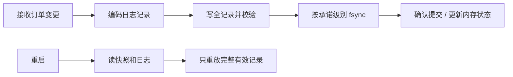

# 预写日志 WAL、提交点与恢复

← [[学习/学习导航/2026-10-26-学习导航|今日导航]] · [[八股测试/2026-10-26|今日自测]]

> [!abstract] 今天要弄懂什么
> 若系统先把新的订单状态写回主文件，再将对应日志持久化，崩溃后可能出什么问题？WAL 的写入、同步、应用与重放顺序怎样设计？

## 先把名词说清楚

WAL 的字面意思是‘预先写日志’。你可以把日志看成可追溯的操作单，把主状态看成操作后的账本；先保留足够可靠的操作单，账本坏了才有依据重新计算。‘恢复’是重启后重新读日志并重建状态。

## 为什么会遇到这个问题

订单处理流程若给上游回复持久成功，却仅修改内存且没有可恢复记录，进程崩溃会丢掉这笔确认过的变化；若主文件先持久化而日志尚未完整，也会破坏恢复判断。设计时把‘已收到’、‘已写内核’、‘已持久’、‘已应用’分开。

## 用一个具体过程理解

用一个简化订单 `order=42` 看时间线：先收到请求，但此时只在网络和进程内；编码成日志记录并调用 write 后，内核可能已接收，仍未到声明的持久点；同步成功后，系统才可以按约定给出‘已持久’确认；最后把变更反映到可查询状态。若崩在同步之前，不应对上游声称该记录已持久。若崩在同步之后但主状态尚未更新，重启扫描日志可以重新应用。关键不变量是日志先于它保护的主文件页持久化，内存中的计算可以更早发生。真正的日志还要有事务提交标记或等价机制，让恢复者能区分已提交与只写了一部分；快照要记录对应的日志位置，避免漏播或重复播。对外部发单等不可随意重放的副作用，还需要唯一 ID 与幂等/对账协议。

## 从代码看执行顺序

完整源码如下；同一份代码也在阅读版和 `.cpp` 中，改动时须三处同步。

```cpp
// 目的：演示一个教学版“先写日志并同步，再应用内存状态”的顺序。
// 限制：无校验、序号、版本与并发控制；不能当成真实订单 WAL。
// 观察：打印应用后的状态；本次正常运行不等于验证了崩溃恢复。
#include <cerrno>       // errno、EINTR
#include <cstdint>      // uint32_t
#include <cstdlib>      // mkstemp
#include <iostream>     // cout
#include <stdexcept>    // runtime_error
#include <string>       // string
#include <unistd.h>     // write、fsync、close、unlink

void append_all(int fd, const char* bytes, std::size_t size) {
    std::size_t done = 0;
    while (done < size) {
        const ssize_t n = ::write(fd, bytes + done, size - done);
        if (n > 0) { done += static_cast<std::size_t>(n); continue; }
        if (n == -1 && errno == EINTR) continue;
        throw std::runtime_error("append failed");
    }
}

int main() {
    char path[] = "/tmp/bagu_wal_XXXXXX";
    const int fd = ::mkstemp(path);
    if (fd == -1) throw std::runtime_error("mkstemp failed");
    const std::string command = "order=42";
    const std::uint32_t length = static_cast<std::uint32_t>(command.size());
    // 明确写出小端长度；跨机器格式不能直接写本机整数内存布局。
    const char header[4] = {static_cast<char>(length & 0xffu),
                            static_cast<char>((length >> 8) & 0xffu),
                            static_cast<char>((length >> 16) & 0xffu),
                            static_cast<char>((length >> 24) & 0xffu)};
    append_all(fd, header, 4);
    append_all(fd, command.data(), command.size());
    if (::fsync(fd) == -1) throw std::runtime_error("fsync failed");
    // 教学模型：同步成功后才改变内存中的可查询状态。
    std::string in_memory_order = command;
    std::cout << "applied " << in_memory_order << '\n';
    if (::close(fd) == -1 || ::unlink(path) == -1)
        throw std::runtime_error("cleanup failed");
}
```

逐步追踪：

1. 把操作编码成记录，示例写 4 字节长度 + `order=42`。
2. 写完记录调用 `fsync(fd)`，教学示例把它作为本机同步确认点。
3. 同步成功后更新内存状态并打印；重启时读出头和正文才可重放。
4. 生产格式需要校验、版本、序号及截断尾部处理；07 练习专门处理不完整尾部。

**输出与保证：**预期输出 `applied order=42`。示例不真正模拟重启；恢复扫描在下一练习中实现。

## 把关系画出来



图中箭头表示本节讨论的状态或依赖；它不是硬件时序图。

## 在项目里什么时候用

撮合、风控和行情录制都可能需要重启回放。先定义业务确认点与可丢失窗口，再决定同步频率；吞吐与尾延迟的测量沿用 10/25 的方法。

## 易错边界与反例

- 示例没有校验码、版本、并发写者或真正的掉电测试，不能直接拿去保存资金或交易订单。
- `fsync` 不自动保证新建日志文件的目录项持久；见 03。
- 重放副作用可能执行两次；实际系统需唯一 ID、幂等处理或去重。

## 换一个条件自己试

在‘写日志前、写了一半、写全但未 fsync、fsync 成功后’四个点崩溃，分别说明允许确认什么。

## 30 秒口述

> WAL 先保留可重放的完整变更，再推进主状态；业务确认点要与持久化承诺一致；重启只重放有效记录。

## 来源与适用范围

**题型来源：**[字节跳动 C++ 数据库开发实习 ByteHouse 面经](https://www.nowcoder.com/discuss/572859889337335808)明确记录了日志格式、fsync、redo log 与 commit 顺序、WAL 格式的追问；本题按简化订单状态改写。

**技术核对（2026-10-26 访问）：**
- [SQLite WAL 官方说明](https://www.sqlite.org/wal.html)
- [SQLite Atomic Commit](https://www.sqlite.org/atomiccommit.html)
- [Linux fsync(2)](https://man7.org/linux/man-pages/man2/fsync.2.html)

本节代码面向 Linux/POSIX，语言基线为 C++17；涉及文件系统与设备的结论需以运行环境为准。
