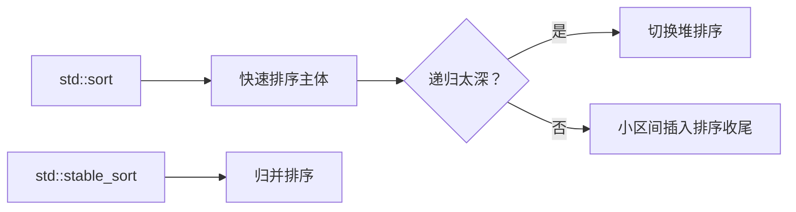

# 排序：复杂度、稳定性，以及 std::sort 到底是什么

← [[学习/学习导航/2026-10-26-学习导航|今日导航]] · [[八股测试/2026-10-26#STL-SORT-001|回到测试题]] · 代码：[[学习/2026-10-26/示例代码/03_sort_stability|03_sort_stability 阅读版]]

## 先把词说清楚

**比较排序**：只通过“比较两个元素大小”决定顺序，理论下界 O(n log n)。

**稳定性**：键相等的元素，排序后是否保持原来的相对顺序。

**原地排序**：额外空间 O(1)（不计递归栈）。

**内省排序（introsort）**：快速排序 + 堆排序 + 插入排序的组合，避免快排最坏退化。

## 它解决什么问题

同一组数据，不同算法在时间、空间、稳定性上取舍不同。面试问排序，通常是想听你说清“复杂度从哪来、什么时候退化、稳定意味着什么”。

## 常见排序对照

| 算法 | 平均 | 最坏 | 空间 | 稳定 |
| --- | --- | --- | --- | --- |
| 冒泡 | O(n²) | O(n²) | O(1) | 是（只在严格大于时交换） |
| 插入 | O(n²) | O(n²) | O(1) | 是 |
| 选择 | O(n²) | O(n²) | O(1) | 否（远处交换会打乱相等元素） |
| 归并 | O(n log n) | O(n log n) | O(n) | 是 |
| 快速 | O(n log n) | O(n²) | O(log n) 栈 | 否 |
| 堆 | O(n log n) | O(n log n) | O(1) | 否 |

**快排为什么最坏 O(n²)：** 每次分区只把区间缩小一个元素（比如固定取末元素作基准，输入已经有序），递归层数变成 n，每层 O(n)。

## 稳定性的直观例子

```text
输入：[(2,A), (1,B), (2,C)]
按 key 排序后：
稳定：[(1,B), (2,A), (2,C)]   // A 仍在 C 前
不稳定：[(1,B), (2,C), (2,A)] // 两个 2 的相对顺序可能被换掉
```

业务上“同价格按到达时间先后”这类规则，需要稳定性；排序算法本身不知道业务规则。

## std::sort 到底是什么

标准只规定：`std::sort` 的比较次数是 O(n log n)（[alg.sort]），**不保证稳定**。常见实现用 introsort：

1. 主体是快速排序；
2. 递归深度超过阈值时切换堆排序，避免最坏 O(n²)；
3. 小区间用插入排序收尾。

`std::stable_sort` 保证稳定，常见实现是归并排序（需要额外空间，分配失败时可能退化为原地版本，复杂度变差）。

`std::list::sort` 是成员函数，做的是链表结点重排，不搬元素。

## 图示



## 实测

见 [[学习/2026-10-26/示例代码/03_sort_stability|03_sort_stability]]：对含重复 key 的记录分别调用 `std::sort` 与 `std::stable_sort`，打印结果验证稳定性差异。注意：**不能据此断言某个实现的 `std::sort` 一定打乱顺序**——它只是“不保证”，具体结果依实现与数据而定。

## 边界与常见误解

**“快排一定比归并快？”** 常数小、缓存友好，多数情况更快；但它不稳定，最坏会退化。

**“std::sort 是快排？”** 常见实现是 introsort，标准不规定算法。

**“复杂度 O(n log n) 就一定快？”** 还要看常数、内存访问模式、数据是否接近有序。

**“归并排序只能用于链表？”** 不是，数组也能用，代价是 O(n) 额外空间。

## 使用场景

- **行情记录排序**：相同价格需保留到达顺序 → `stable_sort`。
- **一般业务**：`std::sort`，除非有稳定性要求。
- **只需要前 k 个**：`nth_element`（见 [[学习/2026-10-26/05-优先级队列与TopK|TopK]]）。

## 变式与口述总结

> 比较排序下界是 O(n log n)。快排平均 O(n log n)、最坏 O(n²)、不稳定、原地；归并稳定但要多 O(n) 空间；堆排序 O(n log n)、原地、不稳定。std::sort 只保证 O(n log n) 次比较且不保证稳定，常见实现是 introsort；要稳定就用 stable_sort。

**变式：**

1. 固定取末元素作基准，输入已升序会怎样？
2. 为什么选择排序不稳定？
3. 业务要求“同价按时间先后”，该用哪个函数？

## 来源

- 题型来源：[宽德投资 C++ 开发一面](https://www.nowcoder.com/discuss/410581749674098688)（2022-10-14，候选人自述）记有快排复杂度、稳定性、冒泡与选择复杂度；[美团 C++ 面经](https://www.iamshuaidi.com/4313.html) 记有“知道的排序算法有哪些”。镜像页未标日期，本次访问 2026-10-30。
- 标准依据：[N4659 alg.sort](https://timsong-cpp.github.io/cppwp/n4659/alg.sort)、[stable.sort](https://timsong-cpp.github.io/cppwp/n4659/stable.sort)。
