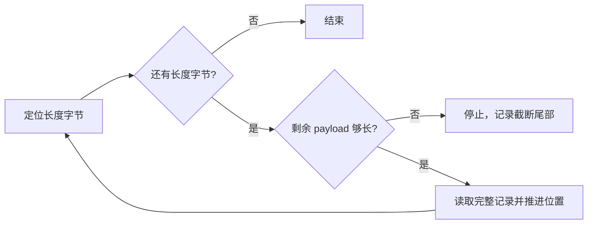

# 练习：遇到不完整日志尾部怎样恢复

← [[学习/学习导航/2026-10-26-学习导航|今日导航]] · [[八股测试/2026-10-26|今日自测]]

> [!abstract] 今天要弄懂什么
> 日志格式为 1 字节 payload 长度 + payload。字节序列 `[3,'A','B','C',4,'D','E']` 中，恢复程序应输出哪些完整记录？怎样避免访问越界？

## 先把名词说清楚

写日志时，一次业务记录可能变成若干字节。崩溃常发生在尾部，恢复者不能因为文件里‘有一些字节’就当作一条完整业务指令。长度前缀像快递单标记本包应有多少字节。

## 为什么会遇到这个问题

如果长度为 4 但只剩 2 字节，直接按 4 读取可能越界；如果把残片当新记录，恢复后的订单状态会被污染。

## 用一个具体过程理解

手工走一遍数组：位置 0 是长度 3，读完长度后位置为 1，剩余 6 字节，足够取 `A B C`，于是位置变成 4。位置 4 是下一条长度 4，读完后位置为 5，但数组总长 7，只剩 2 字节 `D E`。因为 `4 > 7 - 5`，这条不完整，恢复停止，只留下 `ABC`。判断写成 `length > size - position`，前提是刚才已确认 `position <= size`，可避开 `position + length` 在大整数下可能溢出的写法。练习只检查‘够不够长’；若长度字段自身被损坏为较小数字，仍可能把垃圾当有效记录，因此正式日志要增加最大长度、版本、校验和或校验码，还要有事务提交边界与重复应用处理。

## 从代码看执行顺序

完整源码如下；同一份代码也在阅读版和 `.cpp` 中，改动时须三处同步。

```cpp
// 目的：从“长度 1 字节 + payload”教学格式中只恢复完整记录。
// 前置：理解下标从 0 开始、vector::size 和 string(begin,end)。
// 观察：第二条声明 4 字节但只有 DE 两字节，因此只恢复 ABC。
#include <cstddef>      // size_t
#include <cstdint>      // uint8_t
#include <iostream>     // cout
#include <string>       // string
#include <vector>       // vector

std::vector<std::string> recover(const std::vector<std::uint8_t>& log) {
    std::vector<std::string> records;
    std::size_t position = 0; // 下一条记录长度字段的位置。
    while (position < log.size()) { // 至少还有一个长度字节。
        const std::size_t length = log[position++]; // 读取后移动到 payload 起点。
        if (length > log.size() - position) break; // 先检验，再访问；右侧无溢出。
        const auto begin = log.begin() + static_cast<std::ptrdiff_t>(position);
        const auto end = begin + static_cast<std::ptrdiff_t>(length);
        records.emplace_back(begin, end); // 只把完整 payload 加入结果。
        position += length; // 指向下一条的长度字节。
    }
    return records; // 返回值优化/移动由编译器与语言规则处理。
}

int main() {
    const std::vector<std::uint8_t> log = {3, 'A', 'B', 'C', 4, 'D', 'E'};
    for (const auto& record : recover(log)) // const & 避免复制每条字符串。
        std::cout << record << '\n';
}
```

逐步追踪：

1. `position` 指向下一条记录的长度字节。
2. 先取 `length`，然后用 `length > log.size() - position` 判断尾部是否不足。
3. 够长才构造 `std::string` 并移动 position；不足立即停止。
4. 测试同时覆盖完整首条、残缺尾条和空输入。

**输出与保证：**预期只打印一行 `ABC`。这是解析测试，不是崩溃注入或校验和测试。

## 把关系画出来



图中箭头表示本节讨论的状态或依赖；它不是硬件时序图。

## 在项目里什么时候用

行情回放与本地日志恢复先保证不会误读残片；若业务需要崩溃一致性，结合 06 的提交顺序以及真实持久化策略。

## 易错边界与反例

- 单字节长度最多表达 255；真实协议要最大长度、版本、校验和与容量限制。
- 停止读取尾部不代表可无条件删除原文件；先定义恢复与修复流程。
- 示例仅解析内存字节串，没有访问磁盘或声明断电安全。

## 换一个条件自己试

把第二个长度改成 2，预测输出；再把首字节改成 250，解释为什么必须有最大长度和剩余量检查。

## 30 秒口述

> 恢复先验证边界再接受记录；本序列只接受 ABC，DE 是不完整尾部；生产协议还需要校验与去重。

## 来源与适用范围

**题型来源：**[字节跳动 C++ 数据库开发实习 ByteHouse 面经](https://www.nowcoder.com/discuss/572859889337335808)明确问过 WAL 格式；本练习的格式、字节和答案由本库自行设计。

**技术核对（2026-10-26 访问）：**
- [SQLite WAL 文件说明](https://www.sqlite.org/wal.html)
- [Linux read(2)](https://man7.org/linux/man-pages/man2/read.2.html)

本节代码面向 Linux/POSIX，语言基线为 C++17；涉及文件系统与设备的结论需以运行环境为准。
