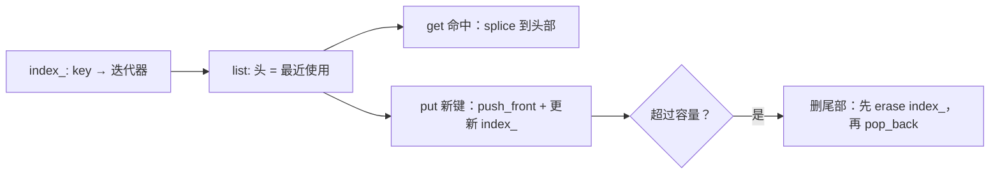

# 练习：手写 LRU，并把该测的边界都测到

← [[学习/学习导航/2026-10-26-学习导航|今日导航]] · [[八股测试/2026-10-26#EX-20261026-001|回到练习题]] · 参考答案：[[学习/2026-10-26/示例代码/02_lru|02_lru 阅读版]]

## 题目

实现一个容量固定的 LRU 缓存：

- `std::optional<int> get(int key)`：命中返回 value 并把它标记为最近使用；未命中返回 `std::nullopt`；
- `void put(int key, int value)`：写入或更新，容量满时淘汰最久未使用的键；
- 两个操作都要求平均 O(1)。

再设计测试用例，至少覆盖：

1. 经典容量 2 的序列：`put(1,1) put(2,2) get(1)=1 put(3,3) get(2)=无 put(4,4) get(1)=无 get(3)=3 get(4)=4`；
2. 同一个键写入两次，容量不应增加；
3. 容量为 0 的行为；
4. 访问顺序影响淘汰：访问过的键不应先被淘汰。

## 为什么是“链表 + 哈希表”

- 需要 O(1) 找到某个 key → 哈希表；
- 需要 O(1) 把结点移到头部、O(1) 删除尾部 → 双向链表；
- 哈希表里存**链表迭代器**，就能在 O(1) 内完成定位与移动。

单用一个哈希表做不到“按最近使用排序”，单用一个链表做不到 O(1) 定位。

## 关键代码

```cpp
std::optional<int> get(int key) {
    auto found = index_.find(key);
    if (found == index_.end()) return std::nullopt;
    items_.splice(items_.begin(), items_, found->second);   // O(1) 前移
    return found->second->value;
}

void put(int key, int value) {
    if (capacity_ == 0) return;
    auto found = index_.find(key);
    if (found != index_.end()) {
        found->second->value = value;
        items_.splice(items_.begin(), items_, found->second);
        return;
    }
    if (items_.size() == capacity_) {
        const int victim = items_.back().key;
        index_.erase(victim);      // 先清理索引
        items_.pop_back();         // 再删结点
    }
    items_.push_front(Entry{key, value});
    index_[key] = items_.begin();
}
```

`std::list::splice` 只改指针、不复制元素，迭代器保持有效——这是能 O(1) 前移的关键。如果改用 `vector`，移动元素就是 O(n)。

## 图示



## 常见的三个错误

1. **淘汰时忘记删索引**：链表结点删了，`index_` 还留着指向它的迭代器，下次 `get` 是 use-after-free。
2. **用 `vector` 当前移手段**：`erase` + `insert` 是 O(n)，整体退化成 O(n)。
3. **忘记“更新已有键也算使用”**：`put` 已有键时也要前移，否则淘汰顺序错误。

## 测试结果

参考答案在本机跑通全部用例，见 [[学习/2026-10-26/示例代码/02_lru|02_lru]] 的运行输出：经典序列、重复写入、容量 0、访问顺序四种场景均通过。

## 检查清单

- [ ] 能说清为什么必须“链表 + 哈希表”。
- [ ] 能解释 `splice` 为什么是 O(1)、为什么迭代器不失效。
- [ ] 能指出淘汰时必须同时维护两份结构。
- [ ] 能设计出至少三个边界用例（容量 0、重复键、访问后淘汰顺序）。

## 来源

- 题型来源：[九坤投资量化实现工程师凉经](https://www.nowcoder.com/discuss/798223058384191488)（2025-09-18）一面记有手撕 LRU 并“设计测试”的要求；本次仅见索引与摘要。具体测试序列由本库设计。
- 标准依据：[N4659 list.ops](https://timsong-cpp.github.io/cppwp/n4659/list.ops)（`splice` 复杂度与迭代器有效性）、[unord.map](https://timsong-cpp.github.io/cppwp/n4659/unord.map)。
