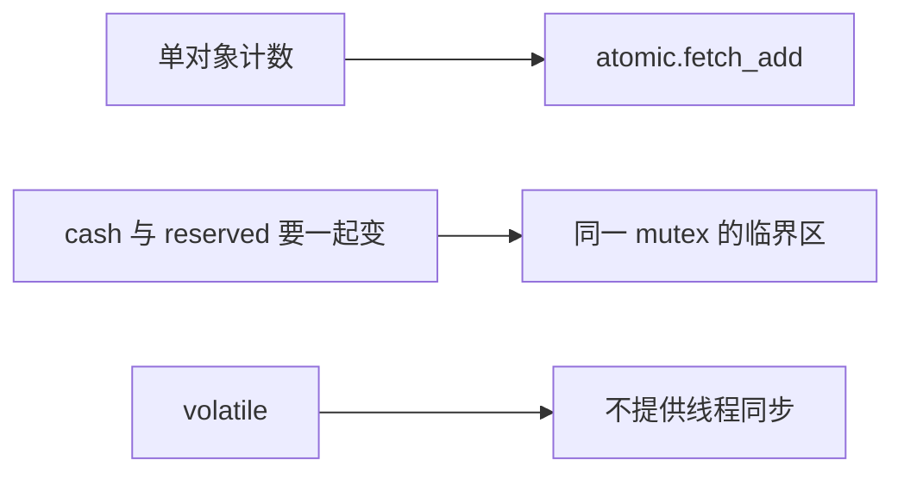

# 原子操作、互斥锁与 volatile 的边界

← [[学习/学习导航/2026-10-27-学习导航|今日导航]] · [[八股测试/2026-10-27|今日自测]]

> [!abstract] 学完应能回答
> 一个共享计数器和一组需要一起更新的业务字段，何时选 atomic，何时选 mutex？volatile 能替代它们吗？

## 名词先说清楚

原子操作可理解为对**某一个对象的一次规定操作**，其他线程不会看见它执行到一半。互斥锁像房门钥匙：参与者都拿同一把钥匙进入，临界区内可安全完成多步操作。`volatile` 告诉编译器某些对象访问不能按普通方式省略或合并，它不是线程协作协议。

## 要解决的实际问题

10/20 已讲普通 `int` 无同步并发读写会形成数据竞争，也讲了 mutex 入门；本节新增判断是：何时一个原子对象就足够，何时业务不变量跨多个对象必须用临界区。交易系统里的订单总数可单独计数，资金可用与冻结金额则常要协同更新。

## 机制：按时间线追踪

`fetch_add(1)` 是原子读改写：取得旧值并把值加一，竞争的线程不会各自覆盖同一旧值。相比之下，`load` 后自己算、再 `store` 是两次独立原子操作，组合起来仍可能丢更新。`lock_guard` 在构造时加锁、析构时解锁，`cash` 与 `reserved` 在同一临界区修改。示例不把正常输出当作任何硬件性能结论。

## 完整可运行代码

与同名 `.cpp`、Markdown 阅读版源码逐字一致。先看注释，再按下方步骤手推；危险的无同步/UAF 反例只作文字讨论，不运行。

```cpp
// 目的：区分单个计数的原子更新与多字段不变量的加锁更新。
// 前置：std::thread 运行任务；join 等待任务结束；不运行数据竞争反例。
// 观察：计数为 2000，cash + reserved 始终由锁保护。
#include <atomic>     // std::atomic：单个共享计数器的读改写。
#include <iostream>   // std::cout：打印结束后的结果。
#include <mutex>      // std::mutex、std::lock_guard：保护多字段约束。
#include <thread>     // std::thread：启动两个工作线程。

struct Account {
    int cash{10};       // 普通字段：只能在同一锁的保护下并发访问。
    int reserved{0};    // 两字段总和应保持 10。
    std::mutex guard;   // 所有参与者必须使用这个对象的同一把锁。

    void move_one() {
        std::lock_guard<std::mutex> lock(guard); // 退出函数时自动解锁。
        if (cash > 0) { --cash; ++reserved; }    // 判断与两次修改属于一个临界区。
    }
};

int main() {
    std::atomic<int> count{0}; // atomic 默认操作采用 seq_cst；下一节讨论内存序。
    Account account;
    auto work = [&] { // 按引用捕获；join 保证对象在任务完成前一直存活。
        for (int i = 0; i < 1000; ++i) count.fetch_add(1);
        for (int i = 0; i < 5; ++i) account.move_one();
    };
    std::thread a(work), b(work);
    a.join(); b.join(); // 两线程完成后，主线程才读结果。
    std::cout << "count=" << count.load()
              << " total=" << account.cash + account.reserved << '\n';
}
```

### 逐步读代码

1. `std::atomic<int> count{0}` 只为单个计数提供线程间安全访问。
2. 两个工作线程各执行 1000 次 `fetch_add`；`join` 后再读最终值。
3. `Account::move_one` 用同一把 `mutex` 包住判断与两个字段修改。
4. 主线程在两个工作线程结束后读取两个普通字段；整个运行期间没有并发读它们。

**输出范围：**正常运行预期 `count=2000 total=10`。这是功能示例，不是吞吐 benchmark。

## 对象与先后关系图



图中箭头表示本节的逻辑依赖或可见性链，不代表 CPU 必须逐条执行图中的机器指令。

## 项目里如何选择

监控计数、单个状态位可先考虑 atomic；账户约束、多个队列字段一致性和较长操作序列优先用 mutex 清楚表达边界。选择依据先是正确性，再测争用、延迟与代码复杂度。

## 反例与边界

- 普通共享 `int` 的无同步并发自增是数据竞争，不能按‘可能少加一’预测固定结果。
- 两个 atomic 字段分别读写，不自动构成多字段原子快照。
- `is_lock_free()` 为具体对象/实现的性质；无锁不等于更快，也不等于等待时间有上界。

## 换条件自己推演

把 `fetch_add` 改成 `count.store(count.load()+1)`，说明为什么即使两次单独访问都是 atomic，组合仍会丢逻辑更新。

## 面试口述版

> 单个值的一次操作用 atomic，跨字段不变量用同一把锁；volatile 不是同步手段，atomic 也不保证一定无锁。

## 来源与版本边界

**题型来源：**[FUNPLUS 趣加面经](https://www.nowcoder.com/discuss/666390918777290752)明确记录了‘原子变量底层实现’与‘volatile 有什么用’，候选人发布于 2024-09-19；本题加入两字段约束，为自行设计的变式。

**技术核对（2026-10-27 访问）：**
- [C++17 草案 [atomics.types.generic]](https://timsong-cpp.github.io/cppwp/n4659/atomics.types.generic)
- [C++17 草案 [intro.races]](https://timsong-cpp.github.io/cppwp/n4659/intro.races)
- [C++17 草案 [dcl.type.cv]](https://timsong-cpp.github.io/cppwp/n4659/dcl.type.cv)
- [C++17 草案 [atomics.lockfree]](https://timsong-cpp.github.io/cppwp/n4659/atomics.lockfree)

语言规则按 C++17 对应草案 N4659 解释；该在线草案是工作稿，真实实现的硬件路径与性能须另测。
