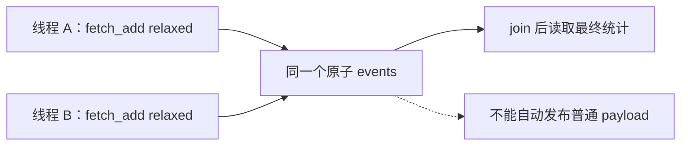

# relaxed 计数能保证什么，不能保证什么

← [[学习/学习导航/2026-10-27-学习导航|今日导航]] · [[八股测试/2026-10-27|今日自测]]

> [!abstract] 学完应能回答
> 多个线程只给统计计数器加一，可以用 relaxed 吗？为什么不能用同样的计数器顺便通知另一个线程读取普通数据？

## 名词先说清楚

`relaxed` 可以理解成‘只给这个原子对象安排安全的访问，不替周围普通数据建立交接关系’。`fetch_add` 是一次读改写（read-modify-write），把‘读旧值、加一、写回’做成一个原子操作。‘发布’是让另一线程在观察到信号后，能安全地读取之前准备好的数据。

## 要解决的实际问题

监控日志每处理一条消息就加一，是一个与消息内容无关的计数；它不需要告诉消费者哪条消息已准备好。若把它误当 ready 标志，消费者读到计数变化后直接访问普通消息，会把统计功能和同步功能混淆。

## 机制：按时间线追踪

两个线程都对同一 `std::atomic<int>` 调用 `fetch_add(relaxed)`；每次加法都参与该对象的修改顺序。由于最终读取发生在两个 `join()` 返回之后，主线程可以核对总计数。若改成 `load(relaxed)`、算加一、`store(relaxed)` 三步，就算每一步分别原子，整个组合仍可能覆盖另一线程的更新。本节不运行错误发布反例，以免制造数据竞争。

## 完整可运行代码

与同名 `.cpp`、Markdown 阅读版源码逐字一致。先看注释，再按下方步骤手推；危险的无同步/UAF 反例只作文字讨论，不运行。

```cpp
// 目的：展示 relaxed 适合不承担消息发布职责的独立统计量。
// 前提：每次加一都是 fetch_add；主线程在 join 后读最终结果。
// 观察：两个线程共执行 2000 次原子加一。
#include <atomic>     // std::atomic 与 memory_order_relaxed。
#include <iostream>   // std::cout。
#include <thread>     // std::thread、join。

int main() {
    std::atomic<int> events{0}; // 只统计次数，不保护别的普通字段。
    auto count = [&events] { // 引用捕获，主线程保证 events 寿命覆盖两任务。
        for (int i = 0; i < 1000; ++i)
            events.fetch_add(1, std::memory_order_relaxed);
    };
    std::thread left(count), right(count);
    left.join();  // 工作线程的完成与成功返回 join 建立同步。
    right.join(); // 两边完成后才观察最终计数。
    std::cout << "events=" << events.load(std::memory_order_relaxed) << '\n';
}
```

### 逐步读代码

1. 定义唯一的原子 `events`；没有普通 payload 被它发布。
2. 两个线程分别做 1000 次 `fetch_add(1, relaxed)`。
3. 主线程等待两个 `join()`，再调用 `load(relaxed)`。
4. 最终值用于功能核对，不用于推断运行中每一时刻观察顺序。

**输出范围：**正常运行预期 `events=2000`；这不演示 relaxed 发布任何普通数据。

## 对象与先后关系图



图中箭头表示本节的逻辑依赖或可见性链，不代表 CPU 必须逐条执行图中的机器指令。

## 项目里如何选择

纯监控计数、丢包累计、采样次数可以考虑 relaxed；队列槽位就绪、对象寿命交接等需要跨线程访问普通数据的地方，应证明 acquire/release 或其他同步。

## 反例与边界

- relaxed 仍有原子性，不等于普通 `int` 的无同步并发访问。
- 运行中一个 load 读到的瞬时值不是全系统所有字段的一致快照。
- 不能因为本机 x86 的一次测试看着正常就把 relaxed 当发布机制。

## 换条件自己推演

假设生产者先写 `payload=7` 后 relaxed 增加 `events`，消费者看到 `events>0` 就读普通 `payload`，指出缺失的同步边。

## 面试口述版

> relaxed 适合只关心计数本身的原子性；它不发布周围普通数据；最终结果在 join 后读取。

## 来源与版本边界

**题型来源：**[FUNPLUS 趣加面经](https://www.nowcoder.com/discuss/666390918777290752)明确问‘用过哪些内存序’，2024-09-19；统计计数器与发布标志的对比为本库自行增加的训练条件。

**技术核对（2026-10-27 访问）：**
- [C++17 草案 [atomics.order]](https://timsong-cpp.github.io/cppwp/n4659/atomics.order)
- [C++17 草案 [intro.races]](https://timsong-cpp.github.io/cppwp/n4659/intro.races)

语言规则按 C++17 对应草案 N4659 解释；该在线草案是工作稿，真实实现的硬件路径与性能须另测。
