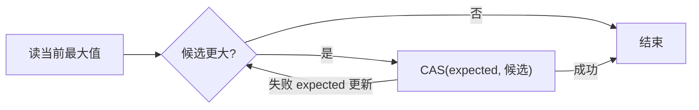

# compare_exchange、失败重试与竞争

← [[学习/学习导航/2026-10-27-学习导航|今日导航]] · [[八股测试/2026-10-27|今日自测]]

> [!abstract] 学完应能回答
> 多线程维护一个‘已见最大值’，怎样用 CAS 更新？compare_exchange_weak 返回 false 后 expected 会怎样？

## 名词先说清楚

CAS 是 compare-and-swap/compare-and-exchange：‘如果当前值仍等于我刚观察到的旧值，才把它改成新值’。`expected` 是**引用参数**，失败后会被函数改写成当前观察值。‘虚假失败’是 weak 版本在值相等时也允许报告失败，所以必须允许重试。

## 要解决的实际问题

多个行情处理线程都可能得到新的最大价格。如果只做普通 load 和 store，较小候选可能覆盖较大值；若只想维护这一个最大值，CAS 循环可以表达‘看到当前值后再决定是否替换’。

## 机制：按时间线追踪

令当前 max 为 10，线程 A 想写 42，线程 B 想写 30；两边都可能先读到 10。B 如果先 CAS 成功，把 max 改为 30，A 的 CAS 会失败并使 expected 更新成 30，然后再尝试 42。反过来 A 先成功，B 失败后 expected=42，发现自己的 30 不再更大，就直接结束。weak 的虚假失败也会回到同一循环，不会错误返回。

## 完整可运行代码

与同名 `.cpp`、Markdown 阅读版源码逐字一致。先看注释，再按下方步骤手推；危险的无同步/UAF 反例只作文字讨论，不运行。

```cpp
// 目的：用 compare_exchange_weak 维护单个原子的最大值。
// 前提：只维护整数本身，不借它发布别的非原子对象。
// 观察：候选 17、42、30、8 中最终最大值为 42。
#include <atomic>     // std::atomic<int>、CAS、relaxed。
#include <iostream>   // std::cout。
#include <thread>     // std::thread、join。

void update_max(std::atomic<int>& peak, int candidate) {
    int observed = peak.load(std::memory_order_relaxed); // 本次看到的旧值。
    while (observed < candidate &&
           !peak.compare_exchange_weak(observed, candidate,
                                       std::memory_order_relaxed,
                                       std::memory_order_relaxed)) {
        // 失败时 observed 已被写成当前值；weak 也可能虚假失败。
        // 回到条件重新判断；不需要在循环体里手工 load。
    }
}

int main() {
    std::atomic<int> peak{0};
    std::thread a([&] { update_max(peak, 17); update_max(peak, 42); });
    std::thread b([&] { update_max(peak, 30); update_max(peak, 8); });
    a.join(); b.join();
    std::cout << "peak=" << peak.load(std::memory_order_relaxed) << '\n';
}
```

### 逐步读代码

1. `observed = peak.load(relaxed)` 得到初始候选比较基准。
2. 只在 `observed < candidate` 时进入 CAS 循环。
3. CAS 成功写入 candidate；失败会更新 observed，循环重新判断。
4. 两个工作线程 join 后打印最大值，示例没有把它当消息发布标志。

**输出范围：**正常运行预期 `peak=42`；线程执行先后不固定。

## 对象与先后关系图



图中箭头表示本节的逻辑依赖或可见性链，不代表 CPU 必须逐条执行图中的机器指令。

## 项目里如何选择

单个最高序号、水位、最大采样值可评估 CAS；账户余额等跨字段不变量或复杂对象生命周期，用锁通常更容易证明。竞争严重时要看重试开销与公平性，不承诺 CAS 一定快。

## 反例与边界

- weak 可能虚假失败；只尝试一次就结束会漏更新。
- 失败后的 expected 被覆盖，再循环时不能假装它仍是最初旧值。
- CAS 成功只说明这次单个原子对象的条件更新成功，不自动解决 ABA 或被指向对象的内存回收。

## 换条件自己推演

若两个线程先后尝试写入 42 与 30，分别从 10 起步，画出两种先成功顺序并解释最终为何都是 42。

## 面试口述版

> CAS 条件替换一个原子值；weak 可能虚假失败，失败会更新 expected，循环必须重新判断条件。

## 来源与版本边界

**题型来源：**[快手 C++ 一面候选人复盘](https://www.nowcoder.com/discuss/353155337010225152)明确记录了 CAS、ABA 和高并发重试追问，2019-09-01；‘维护最大值’是本库增加的安全练习。

**技术核对（2026-10-27 访问）：**
- [C++17 草案 [atomics.types.generic]](https://timsong-cpp.github.io/cppwp/n4659/atomics.types.generic)
- [C++17 草案 [atomics.order]](https://timsong-cpp.github.io/cppwp/n4659/atomics.order)

语言规则按 C++17 对应草案 N4659 解释；该在线草案是工作稿，真实实现的硬件路径与性能须另测。
