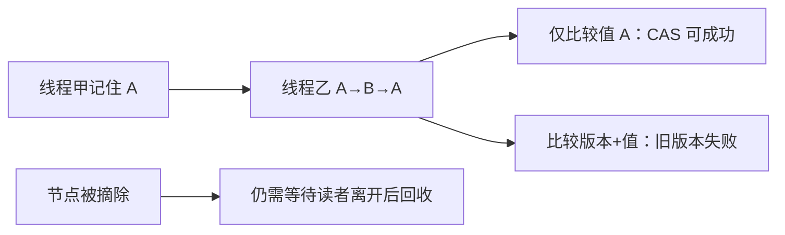

# ABA 与节点内存回收为什么棘手

← [[学习/学习导航/2026-10-27-学习导航|今日导航]] · [[八股测试/2026-10-27|今日自测]]

> [!abstract] 学完应能回答
> 无锁栈的头指针先是 A，别人改成 B 又改回 A，CAS 为什么可能误判？给指针加版本号是否已经解决节点释放问题？

## 名词先说清楚

ABA 是‘看起来还是 A，但中间经历过 B’。CAS 检查的是此刻参与比较的值，不自动记住历史。‘内存回收’是把从数据结构摘掉的节点何时真正释放或复用；摘掉不代表所有并发读者都已离开。

## 要解决的实际问题

无锁链表或栈需要线程先读头节点、再尝试替换头指针。如果另一个线程在此间把节点摘掉并释放，前者保存的旧指针即使数值看似合理，也可能已悬垂。10/20 的对象寿命概念和本日 CAS 结合后，才能理解无锁容器为何比一个原子整数复杂。

## 机制：按时间线追踪

示例先用普通原子整数模拟：线程甲记住 1，另一步把共享值改成 2 又改回 1；甲的 CAS(1→3) 仍成功。接着把‘版本、值’打包进 64 位：甲记住 `(版本0,值1)`，状态经过 `(1,2)` 到 `(2,1)`，第二次 CAS 会失败。这里只演示标签识别变化，没有指针解引用、释放或并发调度。真实版本号有回绕、打包布局和原子实现约束；标签也不替代安全回收。

## 完整可运行代码

与同名 `.cpp`、Markdown 阅读版源码逐字一致。先看注释，再按下方步骤手推；危险的无同步/UAF 反例只作文字讨论，不运行。

```cpp
// 目的：安全模拟 ABA 的“值回来了，版本却变了”。
// 限制：只操作整数；不分配或释放无锁链表节点，不模拟 UAF。
// 观察：只比较值可成功；比较版本和值会拒绝旧观察。
#include <atomic>     // std::atomic 与 compare_exchange_strong。
#include <cstdint>    // uint32_t、uint64_t：明确打包宽度。
#include <iostream>   // std::cout。

std::uint64_t pack(std::uint32_t version, std::uint32_t value) {
    return (static_cast<std::uint64_t>(version) << 32) | value;
}

int main() {
    std::atomic<int> plain{1};
    int old_plain = plain.load(); // 模拟线程甲记住 A=1。
    plain.store(2);               // 模拟其他操作改成 B。
    plain.store(1);               // 又回到同一个整数 A。
    const bool plain_ok = plain.compare_exchange_strong(old_plain, 3);

    std::atomic<std::uint64_t> tagged{pack(0, 1)};
    auto old_tagged = tagged.load(); // 线程甲记住 (版本0, A)。
    tagged.store(pack(1, 2));        // B，版本递增。
    tagged.store(pack(2, 1));        // 值回 A，但版本再次递增。
    const bool tagged_ok = tagged.compare_exchange_strong(old_tagged, pack(1, 3));
    std::cout << "plain=" << plain_ok << " tagged=" << tagged_ok << '\n';
}
```

### 逐步读代码

1. `plain` 依次经历 1→2→1，旧的 expected=1 仍能 CAS 成功。
2. `pack(version,value)` 将两段 32 位值组合成一个原子 64 位整数。
3. `tagged` 回到 value=1 时 version 已是 2，旧期望 `(0,1)` 不再匹配。
4. 本代码没有分配/释放动态节点，因此可以安全运行；回收仅在正文说明。

**输出范围：**正常运行预期 `plain=1 tagged=0`。顺序模拟只证明比较值的行为，不证明真正无锁算法安全。

## 对象与先后关系图



图中箭头表示本节的逻辑依赖或可见性链，不代表 CPU 必须逐条执行图中的机器指令。

## 项目里如何选择

读项目中的无锁栈、无锁 hash map 时，先找节点寿命协议，再看 CAS 版本设计和进度保证。若业务无需这些复杂性，mutex 版本更容易审计，也可能在实际负载下足够快。

## 反例与边界

- 同一地址重新出现不代表还是同一个对象，直接解引用旧指针可能 UAF。
- 版本标签会回绕；打包后的原子类型未必在目标平台总是 lock-free。
- 本例不是 lock-free stack，不能据此宣称生产级回收安全。

## 换条件自己推演

状态 `(版本0,A)` 经 `(版本1,B)` 回到 `(版本2,A)`；分别写出只比较 A 和比较整个二元组时 CAS 结果。

## 面试口述版

> ABA 是值恢复但历史已变；版本可帮助识别，节点寿命还要安全回收协议，不能只靠 CAS。

## 来源与版本边界

**题型来源：**[快手 C++ 一面候选人复盘](https://www.nowcoder.com/discuss/353155337010225152)明确问 CAS 与 ABA，2019-09-01；本题增加‘版本号与回收是两层问题’的追问。

**技术核对（2026-10-27 访问）：**
- [C++17 草案 [atomics.types.generic]](https://timsong-cpp.github.io/cppwp/n4659/atomics.types.generic)
- [Maged Michael 原始回收论文](https://research.ibm.com/publications/safe-memory-reclamation-for-dynamic-lock-free-objects-using-atomic-reads-and-writes)

语言规则按 C++17 对应草案 N4659 解释；该在线草案是工作稿，真实实现的硬件路径与性能须另测。
