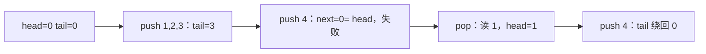

# 练习：手推容量 4 的环形队列

← [[学习/学习导航/2026-10-27-学习导航|今日导航]] · [[八股测试/2026-10-27|今日自测]]

> [!abstract] 学完应能回答
> 物理数组 4 格，留一格区分空满。初始 head=tail=0，依次 push(1)、push(2)、push(3)、push(4)、pop()、push(4)。每步是否成功，head/tail 是多少？

## 名词先说清楚

物理容量是数组槽位数；‘可用容量’是这个具体方案最多能放多少件。`next(i)` 把位置加一并在末尾绕回零。空/满判定是队列协议的一部分，不是数组自动提供的性质。

## 要解决的实际问题

只背‘tail release/head acquire’容易忽略最基本的空满边界。先在单线程纸上推演固定小数组，确认索引含义，再进入并发顺序分析，更容易发现错误。

## 机制：按时间线追踪

采用数组长度 4 和留一格约定：`head==tail` 为空；`next(tail)==head` 为满。成功 push 先写当前 tail 槽，再把 tail 移到 next；成功 pop 先读当前 head 槽，再把 head 移到 next。失败操作不改变任何位置。把这一确定性状态机扩展到两个线程时，槽位访问还要由两个原子索引建立发布和回收顺序。

## 完整可运行代码

与同名 `.cpp`、Markdown 阅读版源码逐字一致。先看注释，再按下方步骤手推；危险的无同步/UAF 反例只作文字讨论，不运行。

```cpp
// 目的：单线程推演物理 4 格、可用 3 格的环形队列边界。
// 前置：本程序不含并发；并发内存序见 05_spsc_ring.cpp。
// 观察：前三次 push 成功，第四次失败；pop 1 后 push 4 成功。
#include <array>      // std::array：固定槽位。
#include <cstddef>    // std::size_t：数组位置。
#include <iostream>   // std::cout：打印操作结果。

int main() {
    std::array<int, 4> slots{};
    std::size_t head = 0, tail = 0;
    auto next = [](std::size_t i) { return (i + 1) % 4; };
    auto push = [&](int value) { // 按引用捕获数组和两个位置。
        const auto after = next(tail);
        if (after == head) return false; // 留一格，不能覆盖未读槽。
        slots[tail] = value; // 先写当前 tail 所指的槽。
        tail = after;        // 再移动到下一可写位置。
        return true;
    };
    auto pop = [&](int& value) {
        if (head == tail) return false; // 空时不读槽。
        value = slots[head];
        head = next(head);
        return true;
    };
    std::cout << push(1) << push(2) << push(3) << push(4) << '\n';
    int first = 0;
    if (pop(first)) std::cout << "popped=" << first << '\n';
    std::cout << "push4again=" << push(4)
              << " head=" << head << " tail=" << tail << '\n';
}
```

### 逐步读代码

1. 初始 `(0,0)` 为空。
2. push 1、2、3 后 tail 到 3；下一位置 0 与 head 相等，push 4 失败。
3. pop 读槽 0，head 变 1；此时槽 3 可写。
4. 再次 push 4 后 tail 从 3 绕回 0，逻辑顺序为 2、3、4。

**输出范围：**正常运行预期三行：`1110`、`popped=1`、`push4again=1 head=1 tail=0`。

## 对象与先后关系图



图中箭头表示本节的逻辑依赖或可见性链，不代表 CPU 必须逐条执行图中的机器指令。

## 项目里如何选择

面试写队列时先给出这个边界表，再讨论并发发布；代码评审中也先核对容量定义、失败返回和绕回条件。

## 反例与边界

- 失败的 push 不推进 tail，否则会覆盖尚未消费的数据。
- 物理容量 4 在本方案中只可存 3 件，不能把 `size_` 直接当业务可用容量。
- 下面的单线程程序不能证明并发 SPSC 的内存序正确。

## 换条件自己推演

在最终 `(head=1,tail=0)` 之后连续 pop 三次，写出每次取出的值和最终空状态。

## 面试口述版

> 留一格时 head==tail 为空，next(tail)==head 为满；该序列第四次 push 失败，pop 1 后再 push 4 成功。

## 来源与版本边界

**题型来源：**[腾讯 C++ 后端 WXG 二面候选人复盘](https://www.nowcoder.com/feed/main/detail/321db23766b94e739d092c126b832d29)明确追问 SPSC 并发安全；本练习的容量、操作序列和答案全部自行设计。

**技术核对（2026-10-27 访问）：**
- [folly 官方 SPSC 队列说明](https://github.com/facebook/folly/blob/main/folly/docs/ProducerConsumerQueue.md)
- [C++17 草案 [atomics.order]](https://timsong-cpp.github.io/cppwp/n4659/atomics.order)

语言规则按 C++17 对应草案 N4659 解释；该在线草案是工作稿，真实实现的硬件路径与性能须另测。
