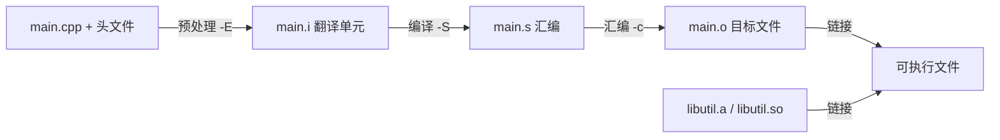

# 一段 .cpp 要经过什么才变成程序

← [[学习/学习导航/2026-10-28-学习导航|今日导航]] · [[八股测试/2026-10-28#BUILD-STAGE-001|回到测试题]] · 代码：[[学习/2026-10-28/示例代码/01_link_error|01_link_error 阅读版]]

## 先把词说清楚

**预处理（preprocessing）**：处理 `#include`、`#define`、条件编译，产出“翻译单元”的纯文本。

**编译（compilation）**：词法、语法、语义分析 + 优化，生成汇编代码。

**汇编（assembly）**：把汇编翻译成机器码，产出目标文件 `.o`（含代码、数据、符号表、重定位信息）。

**链接（linking）**：把多个目标文件和库合成可执行文件，做符号解析与地址重定位。

**翻译单元（translation unit）**：一个 `.cpp` 加它包含的所有头文件，预处理后的整体。

## 它解决什么问题

理解这四个阶段，才能定位三类最常见的问题：

- 编译错误：语法/类型问题（阶段 2）；
- 链接错误：`undefined reference`、`multiple definition`（阶段 4）；
- 运行错误：地址、生命周期、并发（阶段 4 之后）。

## 四个阶段与命令

```bash
g++ -E main.cpp -o main.i      # 1. 预处理：只展开，不编译
g++ -S main.i -o main.s        # 2. 编译：生成汇编
g++ -c main.s -o main.o        # 3. 汇编：生成目标文件
g++ main.o util.o -o app       # 4. 链接：合成可执行文件
```

平时一条 `g++ main.cpp util.cpp -o app` 就是把四步串起来。

## 看图



## 每个阶段的“产物”长什么样

**预处理后**：`#include` 被展开成几千行，`#define` 被替换，`#ifdef` 分支被剪掉。所以宏出错时，看 `.i` 文件最直接。

**编译后**：得到汇编，能看到函数调用、栈帧、常量折叠的结果。

**目标文件**：包含 `.text`（代码）、`.data`/`.bss`（已初始化/未初始化全局）、符号表、重定位表。`nm` 可以看符号：

```bash
nm -C main.o        # -C 还原 C++ 名字
```

`U` 表示未定义（等着链接时补上），`T` 表示在代码段有定义。

**链接后**：所有符号有确定地址；如果是动态链接，外部符号留到运行期由动态装载器解析。

## 常见追问

**“编译期能做什么？”** `sizeof`、`constexpr` 计算、模板实例化、`if constexpr` 分支选择、`static_assert` 检查。

**“`inline` 是什么阶段生效？”** 是给编译器的建议（现代编译器自行决定），但它还有一个语言层面的作用：允许函数在多个翻译单元中定义而不违反 ODR。

**“头文件里定义函数会怎样？”** 被多个 `.cpp` include 后，每个翻译单元都有一份定义，链接时可能 `multiple definition`；解决办法是 `inline`、放 .cpp、或匿名命名空间（内部链接）。

**“模板为什么常放头文件？”** 实例化需要看到定义；只声明的话，链接时找不到具体实例（除非显式实例化）。

## 边界与常见误解

**“预处理只是复制粘贴？”** 还包括条件编译、宏展开、`#include` 递归展开；宏是文本替换，不做类型检查。

**“编译通过就等于没问题？”** 只说明语法和类型正确；链接错误、运行期错误都在后面。

**“`-O2` 会改变语义？”** 标准允许的优化不应改变可观察行为；但依赖未定义行为的程序在优化后表现可能不同——这恰恰说明 UB 不能碰。

## 使用场景

- **排查编译错误**：看第一条错误，后面的常是连锁反应。
- **排查链接错误**：`nm` 看符号有没有、`ldd` 看动态依赖。
- **理解构建时间**：模板重的项目编译慢，是因为每个翻译单元都要实例化。

## 变式与口述总结

> C++ 从源码到程序分四步：预处理展开头文件和宏，编译生成汇编，汇编生成目标文件，链接把目标文件和库合成可执行文件。编译错误在前两步，链接错误在最后一步，运行错误要靠调试和工具。`nm`、`ldd`、`objdump` 是看中间产物的常用工具。

**变式：**

1. `undefined reference` 出现在哪个阶段？常见原因有哪些？
2. 为什么模板定义通常放在头文件？
3. `inline` 除了“建议内联”，还有什么语言层面的作用？

## 来源

- 题型来源：[字节跳动 C++ 客户端实习面经](https://www.nowcoder.com/discuss/353156251678875648)（2020-04-01，候选人自述）记有“源码到程序四阶段”与 `extern "C"`、静动态库。
- 技术依据：GCC 手册 `-E/-S/-c` 选项说明；[N4659 basic.link](https://timsong-cpp.github.io/cppwp/n4659/basic.link)（链接与 ODR）。
