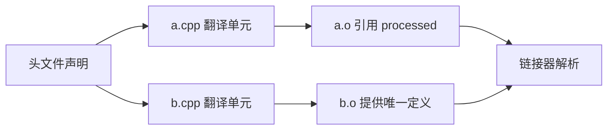

# 声明、定义、翻译单元与 ODR

← [[学习/2026-10-28/01-编译四阶段|上一节]] · [[学习/2026-10-28/03-模板实例化|下一节]] · [[八股测试/2026-10-28|今日自测]]

> [!abstract] 这一节要解决的问题
> 头文件中写 int counter = 0，两个 .cpp 都包含它，会出什么问题？如何组织声明与定义？C++17 inline 变量何时有用？

## 先把词讲清楚

项目常把接口放头文件、实现放源文件。头文件会被各个 `.cpp` 独立包含，所以一处看似只写一次的普通变量定义，在最终程序里可能被复制成多份。

| 术语 | 用普通话先理解 |
| --- | --- |
| 声明 | 告诉编译器某名字和类型存在，未必分配实体。 |
| 定义 | 提供该实体，函数体或变量存储通常在这里。 |
| ODR | 单一定义规则，约束同一程序中定义的数量与一致性。 |

## 从具体故障理解机制

编译 `a.cpp` 时只看到它的翻译单元，编译 `b.cpp` 同理。若两者都包含定义 `int counter = 0;` 的头文件，各自目标文件便有同名外部符号。链接器通常会指出重复。反过来，只有 `extern` 声明却忘记把实现文件加进构建，则调用处类型检查通过，链接器找不到定义。



图里的箭头表示因果或构建顺序，不代表所有工具链内部必须分成完全相同的进程。回到问题：`extern int counter;` 是变量声明；`int counter = 0;` 是定义。把普通定义放进被两个 .cpp 包含的头文件，会让两个翻译单元都产生定义，通常链接报告 multiple definition。典型做法是头文件声明、一个 .cpp 定义；C++17 可用 `inline int counter = 0;` 在头文件提供满足相应条件的多翻译单元定义。未定义引用则通常是声明能见到，但最终没有可链接的定义或相关目标文件未进链接。

## 完整可运行代码

下面是 [[学习/2026-10-28/示例代码/02_declaration_odr|代码阅读版]] 的完整源码；保存的 `.cpp` 文件是编译验证对象。先按默认方式运行，再按场景修改宏或构建参数。每个语法点的作用也写在源码中文注释里。

```cpp
// 目的：用一个可运行文件分辨声明、普通定义与 C++17 inline 变量。
// 前置：理解每个 .cpp 独立编译；跨文件重复定义实验见专题正文。
// 步骤：声明 processed，提供唯一定义，修改后观察输出。
#include <iostream>  // std::cout 用于打印三个实体的值。

extern int processed;      // 仅声明：本句不创建另一个 processed 对象。
int processed = 0;         // 定义：本程序在这个翻译单元提供存储。
inline int per_program = 7; // C++17 内联变量可按规则放入多个翻译单元。
static int local_only = 1; // 内部链接；若放头文件，各翻译单元会各有一份。

int main() {
    ++processed;  // 修改前面定义的同一个对象。
    std::cout << processed << ',' << per_program << ',' << local_only << '\n';
}
```

### 按代码逐步读

1. 示例先写 `extern int processed;`，随后在同一源文件写唯一的 `int processed = 0;`，让声明与定义的区别可见。
2. `inline int per_program = 7` 模拟 C++17 头文件内联变量语义；这个单文件示例只展示语法，跨翻译单元特性要用下方双文件实验验证。
3. `static int local_only = 1` 具有内部链接；若放头文件，多个翻译单元会各有一份，不能拿来实现全局共享计数。

## 在真实项目里怎样用

在仓库看到 `include/` 和 `src/` 分离时，先找头文件声明，再追对应 `.cpp` 定义与 CMake target。若报 multiple definition，检查头文件非 inline 函数体、全局变量和 `#include` 链；若报 undefined reference，检查源文件是否加入 target、签名是否一致、库是否链接。

### 常见反例与边界

头文件保护（`#pragma once` 或 include guard）只限制单个翻译单元内重复展开；不能把跨翻译单元的普通定义变合法。类定义与模板定义在头文件有特殊允许条件，但多份定义必须一致。不要把“链接通过”当作任意 ODR 用法都正确的证明。

ODR 违规不总会被诊断；不同翻译单元的宏配置让 inline 定义不一致，也可能落入无诊断要求的错误。

## 再做一个项目实验

### 把单文件概念放进两个翻译单元

假设 `counter.h` 写 `int counter = 0;`，`a.cpp` 与 `b.cpp` 都包含该头，两个目标文件都会提供同名定义。把头文件改成 `extern int counter;`，在 `a.cpp` 留下 `int counter = 0;`，再链接两个目标文件，便只有一个普通定义。注意：函数也类似，头文件中直接写普通非 `inline` 函数体并被多处包含，通常会重复定义。

```cpp
// counter.h：仅声明，不创建存储
extern int counter;
// a.cpp：包含 counter.h 后，提供唯一普通定义
int counter = 0;
// b.cpp：包含 counter.h 后，使用 counter，不再定义
```

另一方案是 C++17 的 `inline int counter = 0;` 放在头文件，各翻译单元看到的定义必须满足 ODR 条件。把 `static int counter = 0;` 放头文件虽然可能链接成功，但每个翻译单元拿到自己的对象，计数会分裂。选择哪种写法，先问“我们希望整个程序共享一个状态吗”。

## 30–90 秒口述与自检

**可以这样说：**头文件放声明或允许多翻译单元定义的 inline/模板，普通共享变量只在一个源文件定义。ODR 约束的不只是名字出现次数，还要求特定多定义场景保持一致。

**自己再推一遍：**两份 `.cpp` 各自包含同一个头文件，头文件里 `static int counter=0;`，最终是一个共享 counter 还是两份？把 `extern` 声明写了却没定义，会在哪一步失败？

**再追问：**追问：头文件保护能解决跨两个 .cpp 的重复定义吗？不能，它只防同一翻译单元重复包含。`static` 放头文件会形成各翻译单元自己的内部链接实体，不是共享同一变量。

技术依据：[C++17 [basic.def]](https://timsong-cpp.github.io/cppwp/n4659/basic.def)；[C++17 [basic.def.odr]](https://timsong-cpp.github.io/cppwp/n4659/basic.def.odr)。面经只用于确定题型，不把候选人的临场回答当作技术权威；资料访问于 2026-10-28。
