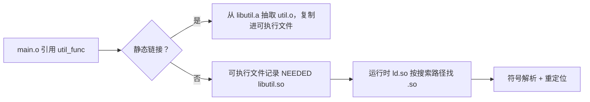

# 静态库与动态库：什么时候复制，什么时候查找

← [[学习/学习导航/2026-10-28-学习导航|今日导航]] · [[八股测试/2026-10-28#BUILD-LIB-001|回到测试题]]

## 先把词说清楚

**静态库（`.a` / `.lib`）**：一组目标文件打成的归档包，链接时按需抽取并**复制**进可执行文件。

**动态库（`.so` / `.dll`）**：运行时才装载的共享对象；可执行文件里只留依赖记录和符号引用。

**PIC（位置无关代码）**：编译选项 `-fPIC`，让代码能在任意地址加载，动态库必须这样编。

**符号修饰（name mangling）**：C++ 把命名空间、参数类型编进符号名，用来支持重载。

**`extern "C"`**：按 C 规则生成符号名，不做修饰，供 C 代码或其他语言调用。

## 它解决什么问题

- 静态库：希望“交付一个完整程序”，不依赖外部文件，部署简单。
- 动态库：多个程序共享同一份代码，节省内存和磁盘，可以单独升级。

## 对比

| 维度 | 静态库 | 动态库 |
| --- | --- | --- |
| 链接时机 | 链接期复制进程序 | 链接期只记录依赖，运行期装载 |
| 可执行文件大小 | 大 | 小 |
| 部署 | 单文件即可 | 需要库文件在搜索路径里 |
| 升级 | 要重新链接 | 替换 `.so` 即可（ABI 兼容前提下） |
| 内存 | 每个进程各一份 | 代码段可共享 |
| 编译要求 | 普通目标文件 | 通常要 `-fPIC` |

## 命令对照

```bash
# 静态库
g++ -c util.cpp -o util.o
ar rcs libutil.a util.o
g++ main.o -L. -lutil -o app_static      # 注意 -lutil 在 main.o 之后

# 动态库
g++ -fPIC -c util.cpp -o util.o
g++ -shared -o libutil.so util.o
g++ main.o -L. -lutil -o app_shared
ldd app_shared                            # 查看运行期依赖能否找到
```

## 链接顺序为什么重要

GNU ld 处理静态库时**从左到右**扫描：遇到 `-lutil` 时，只抽取“当前尚未解析的符号”所需的成员。如果 `main.o` 在 `-lutil` 后面，`main` 对 `util_func` 的引用还没出现，归档里的成员就不会被抽取，最终 `undefined reference`。

```text
g++ -lutil main.o -o app    # 可能失败：扫描 -lutil 时还没有未定义符号
g++ main.o -lutil -o app    # 正确：先有引用，再抽成员
```

循环依赖时可以用 `--start-group ... --end-group` 让链接器反复扫描。

## `extern "C"` 与名字修饰

```cpp
extern "C" int compute(int value);   // 符号名就是 compute
int compute(int value);              // C++ 里符号名类似 _Z7computei
```

被 C 调用、或者通过 `dlsym` 按名字查找时，必须用 `extern "C"`，否则符号名对不上。头文件里通常写成：

```cpp
#ifdef __cplusplus
extern "C" {
#endif
int compute(int value);
#ifdef __cplusplus
}
#endif
```

## 运行期找不到 `.so`

可执行文件启动时报 `error while loading shared libraries: libutil.so: cannot open shared object file`，排查顺序：

1. `ldd ./app` 看有没有 `not found`；
2. 搜索路径：`DT_RPATH`/`DT_RUNPATH`（链接时 `-Wl,-rpath,/path`）、`LD_LIBRARY_PATH`、`/etc/ld.so.conf` 缓存（`ldconfig`）、系统默认目录；
3. 用 `readelf -d ./app | grep -i path` 看程序自己写了什么 rpath。

## 图示



## 边界与常见误解

**“动态库一定省内存？”** 代码段可共享，但每个进程仍有自己的数据段和重定位开销。

**“换了 `.so` 就一定生效？”** 只有 ABI 兼容时才行；改了类布局、虚函数顺序、函数签名，就可能崩溃。

**“静态库没有依赖问题？”** 静态库可能依赖其他库，链接时仍要按顺序给出。

**“`.so` 就是 `.a` 加个后缀？”** 不是。`.so` 是完整的共享对象，支持符号导出表、构造/析构段、版本脚本等。

## 使用场景

- **交付给客户的小工具**：静态链接，避免环境差异。
- **插件系统**：动态库 + `dlopen`/`dlsym`，按需加载。
- **量化系统**：策略/适配器做成动态库，热更新；核心撮合静态链接，减少运行期不确定性。

## 变式与口述总结

> 静态库在链接时把用到的目标文件复制进程序，部署简单但文件大；动态库在运行期装载，节省空间、可单独升级，但需要处理搜索路径和 ABI 兼容。动态库要 `-fPIC`；静态库链接顺序要从引用方到被引用方。跨语言接口用 `extern "C"` 避免名字修饰。

**变式：**

1. 为什么 `-lutil` 要放在 `main.o` 后面？
2. `extern "C"` 解决什么问题？
3. `ldd` 显示 `not found`，怎么排查？

## 来源

- 题型来源：[字节跳动 C++ 客户端实习面经](https://www.nowcoder.com/discuss/353156251678875648)（2020-04-01）记有 `extern "C"`、静态库与动态库区别；[趋势科技 C++ 开发面经](https://www.nowcoder.com/feed/main/detail/0c8a660a2aed49fdbf9bc695a4fa705b)（2022-08-11）搜索索引列有动态库查找问题。
- 技术依据：GNU `ar`/`ld` 手册；[Linux man-pages ld.so(8)](https://man7.org/linux/man-pages/man8/ld.so.8.html)、[dlopen(3)](https://man7.org/linux/man-pages/man3/dlopen.3.html)。
