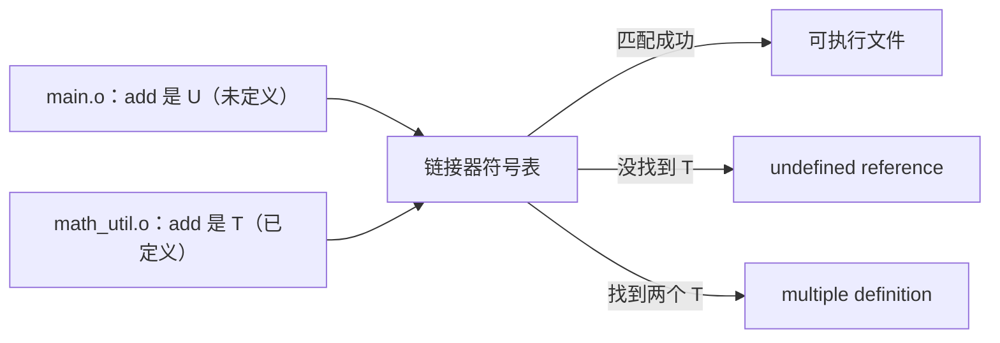

# undefined reference 到底在说什么

← [[学习/学习导航/2026-10-28-学习导航|今日导航]] · [[八股测试/2026-10-28#BUILD-ODR-001|回到测试题]] · 代码：[[学习/2026-10-28/示例代码/01_link_error|01_link_error 阅读版]]

## 先把词说清楚

**声明（declaration）**：告诉编译器“有这么个名字，类型是什么”。

**定义（definition）**：真正提供实体——函数体、变量存储、类定义。

**ODR（One Definition Rule，单一定义规则）**：一个实体在整个程序中只能有一份定义；类、模板、`inline` 函数允许在每个翻译单元各有一份，但内容必须完全相同。

**翻译单元（TU）**：一个 `.cpp` 加它包含的头文件。

## 它解决什么问题

链接器的工作是“把每个未定义符号补上地址”。它不看类型、不看语义，只看符号名。所以：

- 你有声明、没定义 → `undefined reference`；
- 你有两份定义 → `multiple definition`；
- 两边符号名对不上（比如 C/C++ 混用）→ 链接器认为“没定义”。

## 两类错误的对照

| 错误 | 出现阶段 | 典型原因 |
| --- | --- | --- |
| `undefined reference to 'foo'` | 链接 | 忘了编译某个 `.cpp`、库里没有、链接顺序错、C/C++ 名字修饰不一致、模板没实例化 |
| `multiple definition of 'foo'` | 链接 | 函数/全局变量直接写在头文件里，被多个 `.cpp` 包含 |
| `redefinition of 'foo'` | 编译 | 同一个翻译单元里定义了两次（常是重复 include 且没有 include guard） |

## 一个最小复现

```cpp
// math_util.h
int add(int a, int b);      // 只有声明

// main.cpp
#include "math_util.h"
int main() { return add(1, 2); }
```

只编译 `main.cpp` 再链接：

```bash
g++ -c main.cpp -o main.o
g++ main.o -o app
```

链接器会报 `undefined reference to 'add(int, int)'`——声明让编译通过，但没人提供函数体。

补上定义并一起链接：

```bash
g++ -c math_util.cpp -o math_util.o
g++ main.o math_util.o -o app
```

## 图示



`nm` 可以看符号状态：`U` 未定义，`T` 代码段已定义，`W` 弱符号。

## 常见原因逐个说

**1. 头文件里写函数体**

```cpp
// bad.h
int add(int a, int b) { return a + b; }   // 被两个 .cpp 包含 → 两份定义
```

解决：放 `.cpp`；或加 `inline`；或用匿名命名空间（内部链接，每个 TU 一份，语义不同，慎用）。

**2. 头文件里定义全局变量**

```cpp
// bad.h
int g_counter = 0;          // 每个包含它的 TU 都定义了一份
// good.h（C++17）
inline int g_counter = 0;   // 允许多份相同定义，链接器合并
```

**3. 模板只声明没定义**

模板实例化需要看到定义；定义放在 `.cpp` 里而只留声明在头文件，链接时找不到实例。解决：定义放头文件，或显式实例化。

**4. C 与 C++ 混用**

C 编译器不修饰符号名，C++ 会。C++ 调用 C 函数要 `extern "C"`，否则找的是 `_Z3addii` 而库里只有 `add`。

**5. 链接顺序**

静态库按从左到右扫描，引用方要放在被引用库前面（见 [[学习/2026-10-28/02-静态库与动态库|静态库与动态库]]）。

## 边界与常见误解

**“头文件加 include guard 就不违反 ODR？”** include guard 只防同一翻译单元重复包含；多个翻译单元仍各有一份定义。

**“`const` 全局变量放头文件没事？”** 命名空间作用域的 `const` 默认内部链接，每个 TU 一份，通常不报错——但地址不同，别依赖“同一个对象”。

**“编译通过 = 可用？”** 不。链接错误在编译之后。

**“ODR 违反一定有报错？”** 不一定。内联函数内容不一致这类 ODR 违反是未定义行为，可能悄悄错。

## 使用场景

- **拆分项目**：声明放头文件，定义放 `.cpp`，是最稳的组织方式。
- **C++17 头文件库**：用 `inline` 函数和 `inline` 变量，避免 ODR 问题。
- **排查链接问题**：先 `nm` 看符号，再查链接命令和库路径。

## 变式与口述总结

> 声明只告诉编译器名字和类型，定义才提供实体。ODR 要求一个实体在程序里只有一份定义。`undefined reference` 是链接器找不到定义，常见原因是漏编译、库缺失、链接顺序、C/C++ 名字修饰、模板没实例化；`multiple definition` 是头文件里放了定义。修法是声明放头、定义放源文件，或者用 inline。

**变式：**

1. 头文件里写 `int f() { return 1; }` 被两个源文件包含，会报什么？
2. 为什么 C++ 调用 C 库要 `extern "C"`？
3. 模板定义放在 `.cpp` 里，为什么链接会失败？

## 来源

- 题型来源：[秋招历程（面经+感悟）](https://www.nowcoder.com/discuss/353154167852179456)（2017-09-25）搜索索引列有预处理、编译链接与 `undefined reference` 相关问题；本页按其方向重新组织，具体代码是本库设计。
- 技术依据：[N4659 basic.def.odr](https://timsong-cpp.github.io/cppwp/n4659/basic.def.odr)、[dcl.inline](https://timsong-cpp.github.io/cppwp/n4659/dcl.inline)。
