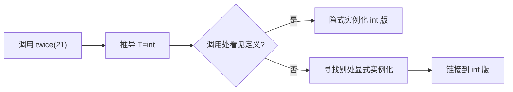

# 模板实例化与“头文件看得到定义”

← [[学习/2026-10-28/02-声明定义与ODR|上一节]] · [[学习/2026-10-28/04-静态库与链接顺序|下一节]] · [[八股测试/2026-10-28|今日自测]]

> [!abstract] 这一节要解决的问题
> 模板函数在头文件只有声明，实现在 .cpp，另一个 .cpp 调用时为何常出现 undefined reference？显式实例化怎样改变布局？

## 先把词讲清楚

读大型 C++ 项目时，常在 `.h` 看见一整个模板函数，却在普通类里只看见声明。这不是单纯的编码习惯，而是模板在调用处生成具体类型代码时需要定义可见。

| 术语 | 用普通话先理解 |
| --- | --- |
| 模板 | 把类型留成参数的代码模式，不是单独能处理所有类型的机器函数。 |
| 实例化 | 按具体实参生成或要求一个特化，例如 twice<int>。 |
| 显式实例化 | 在指定翻译单元要求生成某个特化。 |

## 从具体故障理解机制

编译器看到 `twice(21)` 会推导 `T=int`。若定义可见，可隐式实例化 `twice<int>`。若只见声明，某些调用仍能完成类型检查，却没有可生成的函数体，最终需要其他目标文件提供该特化。`template int twice<int>(int);` 是显式实例化定义；`extern template int twice<int>(int);` 是声明，告诉当前翻译单元不要在这里生成。



图里的箭头表示因果或构建顺序，不代表所有工具链内部必须分成完全相同的进程。回到问题：模板是生成具体特化的模式。对 `twice<int>` 的隐式实例化通常要在实例化点看到定义，所以常把模板定义放头文件。另一种布局是在实现 `.cpp` 中定义模板并显式实例化所需类型，在调用处只给声明，必要时用 `extern template` 抑制重复隐式实例化。此时只支持已显式实例化的类型，漏一个类型会造成链接失败。

## 完整可运行代码

下面是 [[学习/2026-10-28/示例代码/03_template_instantiation|代码阅读版]] 的完整源码；保存的 `.cpp` 文件是编译验证对象。先按默认方式运行，再按场景修改宏或构建参数。每个语法点的作用也写在源码中文注释里。

```cpp
// 目的：展示模板定义、extern template 声明和显式实例化定义。
// 前置：理解函数声明与定义；本文件可独立运行。
// 步骤：推导 T=int 并调用已生成的特化，观察结果。
#include <iostream>  // std::cout 打印结果。

// T 是类型参数；编译器按使用的具体 T 处理模板特化。
template <class T>
T twice(T value) { return value + value; }

// 此句是显式实例化声明，不生成 int 版本的函数体。
extern template int twice<int>(int);
// 此句是显式实例化定义，要求在此生成 int 版本。
template int twice<int>(int);

int main() {
    const int input = 21;  // const 限定这个局部变量不可改。
    std::cout << twice(input) << '\n';  // T 被推导为 int，预期输出 42。
}
```

### 按代码逐步读

1. 示例的 `template <class T>` 表示 T 是类型参数，`T value` 是一个该类型的值。
2. `extern template int twice<int>(int);` 不产生函数体；文件后面的 `template int twice<int>(int);` 才要求生成 int 版本。
3. 示例在同一翻译单元展示语法，跨文件布局需按正文中 header、implementation、client 的位置拆开。
4. `twice(21)` 的类型推导得到 int；不要把它误认为运行时动态分派。

## 在真实项目里怎样用

头文件库如泛型容器通常保留模板定义以便任意支持类型实例化。若希望稳定接口、减少特定特化的编译工作，可在 `.cpp` 显式实例化有限集合；新增类型需同步库构建和导出。遇到模板的 undefined reference，先检查“定义可见吗、特化生成了吗、目标文件链接了吗”。

### 常见反例与边界

模板定义放头文件是常见做法，不是“语法强制所有模板只能在头文件”。显式实例化与模块机制提供其他方案。这里按 C++17 常规多翻译单元项目解释，不把 C++20 modules 混入。

`extern template` 本身不生成实现，必须在程序别处提供匹配的显式实例化定义；是否真正“重复生成”也受实现与链接器合并策略影响。

## 再做一个项目实验

### 三个文件该怎样摆放

最容易理解的是将**完整模板定义**写入 `twice.h`，调用者包含它后可实例化 `int`、`double` 等满足操作要求的类型。若只想提供 `int`，可把函数声明放头文件，函数模板定义放 `twice.cpp`，并在实现文件末尾写 `template int twice<int>(int);`。调用者只看到声明，链接时从 `twice.o` 取得 int 版本。改变 `client.cpp` 为 `twice(2.5)` 前，必须决定是否支持 double，并在库中新增对应显式实例化，或改成头文件定义。

```cpp
// twice.h 中的声明（示意）
template<class T> T twice(T value);
extern template int twice<int>(int);
// twice.cpp 需要包含上面的声明，并写完整定义与实例化定义
template<class T> T twice(T value) { return value + value; }
template int twice<int>(int);
```

真实工程遇到 `undefined reference to twice<double>`，先别改 `-I`：`-I` 只解决头文件可见性，无法凭空生成 double 特化。

## 30–90 秒口述与自检

**可以这样说：**调用具体模板特化时要有可用实现：要么调用处能看到定义并实例化，要么库里已显式实例化该类型。排查模板链接错误先核对具体特化签名。

**自己再推一遍：**把调用改成 `twice(2.5)`，只有 int 的显式实例化时会发生什么？如果把模板完整定义移到头文件呢？

**再追问：**追问：`twice<double>` 可否自动调用只显式实例化 int 的库？不能假定可以；若调用点看不到模板定义且库里也无 double 实例，链接将缺实现。

技术依据：[C++17 [temp.inst]](https://timsong-cpp.github.io/cppwp/n4659/temp.inst)；[C++17 [temp.explicit]](https://timsong-cpp.github.io/cppwp/n4659/temp.explicit)。面经只用于确定题型，不把候选人的临场回答当作技术权威；资料访问于 2026-10-28。
