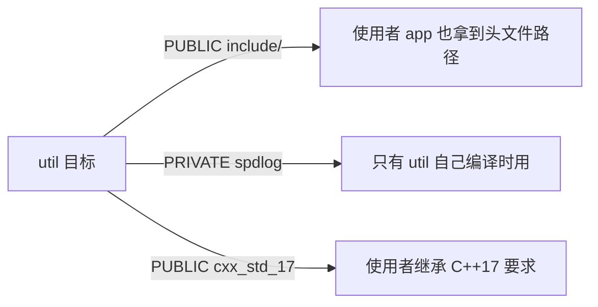

# CMake：为什么该用 target_* 而不是全局命令

← [[学习/学习导航/2026-10-28-学习导航|今日导航]] · [[八股测试/2026-10-28#BUILD-CMAKE-001|回到测试题]]

## 先把词说清楚

**CMake**：构建系统生成器。你写 `CMakeLists.txt` 描述“有哪些目标、依赖什么”，它生成 Makefile 或 Ninja 文件。

**目标（target）**：一个可执行文件或库，是 CMake 的核心单位。`add_executable(app ...)`、`add_library(util ...)`。

**属性（property）**：挂在目标上的配置，比如头文件目录、编译选项、C++ 标准。

**传播（propagation）**：目标和它的依赖之间，哪些属性会传递给使用者。关键字是 `PUBLIC`、`PRIVATE`、`INTERFACE`。

## 它解决什么问题

老式写法是全局命令：

```cmake
include_directories(${PROJECT_SOURCE_DIR}/include)
link_libraries(util)
add_executable(app main.cpp)
```

问题：目录和库对**所有**目标生效，项目一大就互相污染；依赖关系也看不出来。

现代写法把配置挂在目标上，谁依赖谁就自动继承：

```cmake
add_library(util src/util.cpp)
target_include_directories(util PUBLIC include)     # 使用 util 的人也能找到头文件
target_compile_features(util PUBLIC cxx_std_17)

add_executable(app src/main.cpp)
target_link_libraries(app PRIVATE util)              # app 依赖 util
```

## PUBLIC / PRIVATE / INTERFACE

| 关键字 | 自己编译时用 | 传递给使用者 | 典型场景 |
| --- | --- | --- | --- |
| `PRIVATE` | 是 | 否 | 内部实现细节 |
| `PUBLIC` | 是 | 是 | 公共头文件目录、公共依赖 |
| `INTERFACE` | 否 | 是 | 纯头文件库（header-only） |

理解方式：**“这个需求是我自己需要，还是别人用我也需要？”**

- `util` 的 `include/` 里有对外头文件 → `PUBLIC`；
- `util` 内部用了 `spdlog`，但对外接口不暴露 → `PRIVATE`；
- 一个 header-only 的 `mathx` 库 → `INTERFACE`。

## 一个完整的最小工程

```cmake
cmake_minimum_required(VERSION 3.16)
project(trade_demo LANGUAGES CXX)

set(CMAKE_CXX_STANDARD 17)
set(CMAKE_CXX_STANDARD_REQUIRED ON)
set(CMAKE_CXX_EXTENSIONS OFF)          # 用 -std=c++17，而不是 gnu++17

add_library(quote src/quote.cpp)
target_include_directories(quote PUBLIC ${CMAKE_CURRENT_SOURCE_DIR}/include)
target_compile_options(quote PRIVATE -Wall -Wextra)

add_executable(app src/main.cpp)
target_link_libraries(app PRIVATE quote)
```

## 图示



## 常见追问

**“CMake 和 Make 的关系？”** CMake 生成 Makefile/Ninja，再由它们调用编译器；CMake 本身不编译。

**“`CMAKE_CXX_FLAGS` 和 `target_compile_options` 有什么区别？”** 前者是全局变量，影响所有目标；后者挂在目标上，可精确控制并随依赖传播。

**“怎么引入第三方库？”** 优先 `find_package(...)` + `target_link_libraries(app PRIVATE Pkg::Pkg)`，让包自己声明依赖；`FetchContent` 可以在配置阶段拉取源码。

**“为什么构建目录要分开？”** 源码树外构建（out-of-source build）避免生成文件污染仓库，也方便同时维护多个构建配置。

## 边界与常见误解

**“用了 CMake 就不用手写编译命令？”** CMake 负责生成，具体命令由生成的构建系统执行；排查问题时仍要会看编译命令行（`make VERBOSE=1`）。

**“PUBLIC 一定更好？”** 不。把内部依赖写成 `PUBLIC` 会强制使用者一起链接，增加耦合。

**“CMake 版本随便写？”** `cmake_minimum_required` 影响策略行为，写太低会有兼容告警，写太高会拒绝老环境。

## 使用场景

- **多模块 C++ 项目**：库 + 可执行 + 测试，各自是目标，依赖显式。
- **跨平台**：同一份 `CMakeLists.txt` 生成 Makefile、Ninja、Visual Studio 工程。
- **量化系统**：核心库 `PRIVATE` 链接高性能依赖，接口层只暴露稳定头文件。

## 变式与口述总结

> CMake 以目标为中心：每个库或可执行是一个 target，属性挂在 target 上。`PRIVATE` 只自己用，`PUBLIC` 自己用也传给使用者，`INTERFACE` 只传给使用者。`target_link_libraries` 表达依赖，构建系统据此决定编译顺序和链接参数。相比全局的 `include_directories`、`link_libraries`，target 写法隔离性好、依赖清晰。

**变式：**

1. 一个库的公共头文件目录该用哪个关键字？
2. header-only 库用哪个关键字？
3. `-std=c++17` 与 `gnu++17` 的区别怎么在 CMake 里控制？

## 来源

- 题型来源：[影石 Insta360 C++ 一面](https://www.nowcoder.com/feed/main/detail/753bcacd2c7c45b0aa5ba80af8b7fe3c)（2025-07-15，候选人自述）搜索索引列有 CMake target 与非 target 命令的对比；本次未加载全文。本页的传播规则说明按 CMake 官方文档核对。
- 技术依据：[CMake 官方文档：target_link_libraries](https://cmake.org/cmake/help/latest/command/target_link_libraries.html)、[target_include_directories](https://cmake.org/cmake/help/latest/command/target_include_directories.html)。
