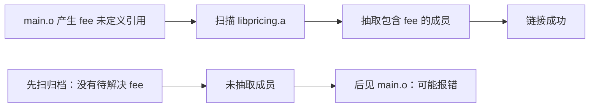

# 静态库、归档抽取与链接顺序

← [[学习/2026-10-28/03-模板实例化|上一节]] · [[学习/2026-10-28/05-动态库与ABI|下一节]] · [[八股测试/2026-10-28|今日自测]]

> [!abstract] 这一节要解决的问题
> Linux 上 libmath.a 与 main.o 链接时，为什么 `g++ libmath.a main.o` 可能找不到符号，而 `g++ main.o libmath.a` 可以？静态库与普通 .o 有何区别？

## 先把词讲清楚

构建大型项目时常把模块打包成库。`.a` 并不是把所有代码无条件复制进程序；常见 GNU 链接器按尚未解决的引用挑成员。理解这个差异，能解释看似“明明加了库还报 undefined reference”。

| 术语 | 用普通话先理解 |
| --- | --- |
| 静态库归档 | 把若干 .o 装进一个 .a 文件，链接时按需要提取。 |
| 未定义符号 | 当前输入引用了名字，但还没遇到提供它的定义。 |
| 链接顺序 | 链接命令里目标文件与库出现的先后，可能影响归档抽取。 |

## 从具体故障理解机制

链接器读取 `main.o` 后记录需要 `fee`。之后扫描 `libpricing.a`，找到定义 `fee` 的成员并抽取。若先扫描归档再看到 `main.o`，前面没有待解决的 `fee`，归档可能不抽取任何东西。普通 `.o` 一般作为直接输入整体参与链接。CMake target 关系通常能帮你生成正确顺序，但手工命令仍值得会看。



图里的箭头表示因果或构建顺序，不代表所有工具链内部必须分成完全相同的进程。回到问题：静态库 `.a` 是目标文件归档，不是运行时独立加载的库。GNU ld 通常按命令行位置扫描归档：先出现引用 `main.o`，再出现 `libmath.a`，归档成员才能被需要的未定义符号拉入；反过来先扫描归档，当时尚无对应未定义引用，就可能不抽取该成员，之后不自动回头。直接给出的普通 `.o` 与按需求抽取的归档不同。

## 完整可运行代码

下面是 [[学习/2026-10-28/示例代码/04_static_archive|代码阅读版]] 的完整源码；保存的 `.cpp` 文件是编译验证对象。先按默认方式运行，再按场景修改宏或构建参数。每个语法点的作用也写在源码中文注释里。

```cpp
// 目的：提供一个可打包进静态库的函数，同时保持默认独立可运行。
// 前置：知道 .o 是目标文件、.a 是目标文件归档。
// 步骤：默认直接运行；定义 ARCHIVE_LIBRARY_ONLY 时仅编译库函数。
#ifndef ARCHIVE_LIBRARY_ONLY
#include <iostream>  // 默认演示模式使用 std::cout；库模式不需要它。
#endif

// fee 的定义可被另一个目标文件引用；这里用小整数避免溢出。
int fee(int quantity) { return quantity * 2; }

#ifndef ARCHIVE_LIBRARY_ONLY
int main() {
    const int quantity = 3;  // 教学输入，预期 fee 返回 6。
    std::cout << fee(quantity) << '\n';
}
#endif
```

### 按代码逐步读

1. 示例中的 `fee` 是可供其他翻译单元调用的实现。
2. `#ifndef ARCHIVE_LIBRARY_ONLY` 让同一文件默认可独立运行；定义该宏时只留下库函数，可编译为 `pricing.o` 并放进 `.a`。
3. 练习命令另外生成调用者 `client.cpp`，可以实际比较两种链接顺序；不用让教学源码默认故意无法链接。

## 在真实项目里怎样用

看到 `undefined reference to fee` 时，先 `nm -C libpricing.a` 确认符号是否存在，再看调用者对象是否在库前、库是否匹配架构及编译配置。若是两个归档互相引用，先考虑消除循环依赖，确有必要才用 `--start-group/--end-group`。

### 常见反例与边界

`-static` 意味着尽量静态链接可用库，但系统发行版未必提供所有静态库。静态链接并不自动消除 ABI、许可证、升级等工程约束；也不能从可执行文件大小推断运行性能。

这是 GNU ld 典型规则，不是 C++ 标准；其他链接器及参数可能不同。循环依赖可用重排、重复库或 group 解决，但应先理清依赖。

## 再做一个项目实验

### 在临时目录复现归档顺序

先进入本日示例代码目录。下列命令从本页源码构建一个静态库，再生成最小调用者，产物均放临时目录。`ar rcs` 将目标文件加入归档；第一条链接命令先看到调用者，再看到库；第二条故意把库放前面，在 GNU ld 的常规规则下预期失败。失败命令不运行。

```bash
d=$(mktemp -d)
g++ -std=c++17 -DARCHIVE_LIBRARY_ONLY -c 04_static_archive.cpp -o "$d/pricing.o"
ar rcs "$d/libpricing.a" "$d/pricing.o"
printf 'int fee(int); int main(){return fee(3)!=6;}
' > "$d/client.cpp"
g++ "$d/client.cpp" "$d/libpricing.a" -o "$d/good"
"$d/good"
g++ "$d/libpricing.a" "$d/client.cpp" -o "$d/bad"
```

最后可用 `nm -C "$d/libpricing.a"` 查看库里有没有 `fee(int)`。若好顺序仍失败，继续查签名、库架构与是否实际生成 `.a`；不要只会交换顺序。

## 30–90 秒口述与自检

**可以这样说：**先说 `.a` 是目标文件归档；再说 GNU ld 扫描归档时只抽取当下所需成员；最后用“引用者在前、提供库在后”解释顺序问题。

**自己再推一遍：**若 `liba.a` 里的成员引用 `libb.a`，通常哪个放后面？`-L./build` 能让运行中的动态链接器找到 `./build/libx.so` 吗？

**再追问：**追问：`-L` 和 `-l` 分别做什么？`-L` 增加链接时库搜索目录，`-lname` 请求库；两者均不能保证程序运行时找到共享库。

技术依据：[GNU ld Options: archives](https://sourceware.org/binutils/docs/ld/Options.html)；[GCC Link Options](https://gcc.gnu.org/onlinedocs/gcc/Link-Options.html)。面经只用于确定题型，不把候选人的临场回答当作技术权威；资料访问于 2026-10-28。
