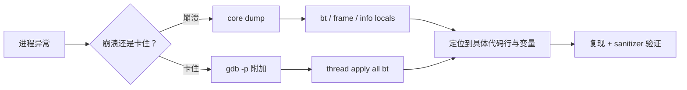

# 线上炸了，拿什么定位

← [[学习/学习导航/2026-10-28-学习导航|今日导航]] · [[八股测试/2026-10-28#DEBUG-GDB-001|回到测试题]]

## 先把词说清楚

**段错误（SIGSEGV）**：访问非法地址，通常是空指针解引用、越界、悬垂指针。

**core dump**：进程崩溃时把内存镜像写到磁盘，事后可以用 gdb 打开分析。

**gdb**：GNU 调试器，能启动程序、附加到进程、看调用栈与变量。

**sanitizer**：编译期插桩的检查工具，ASan 查内存、UBSan 查未定义行为、TSan 查数据竞争。

**死锁**：两个及以上线程互相等待对方持有的锁，谁也无法推进。

## 它解决什么问题

崩溃现场往往一闪而过；拿到调用栈、线程状态、关键变量，才能从“它崩了”走到“它为什么崩”。

## 先分清三类问题

| 现象 | 常见原因 | 第一手手段 |
| --- | --- | --- |
| 进程收到 SIGSEGV | 空指针、越界、悬垂、栈溢出 | core dump + gdb `bt` |
| 进程收到 SIGABRT | 断言失败、`std::terminate`、未捕获异常 | 看 `what()`、看栈 |
| 进程卡住不退出 | 死锁、条件变量没唤醒、无限循环 | `gdb -p` + `thread apply all bt` |

## core dump 与 gdb

```bash
ulimit -c unlimited                    # 允许生成 core
cat /proc/sys/kernel/core_pattern      # 看 core 文件写到哪里
gdb ./app core                         # 事后分析
```

常用命令：

```text
(gdb) bt                 # 调用栈
(gdb) bt full            # 带局部变量
(gdb) frame 3            # 切到第 3 帧
(gdb) info locals        # 当前帧局部变量
(gdb) p pointer          # 打印变量
(gdb) info registers     # 寄存器
```

线上进程卡住时：

```bash
gdb -p <pid>
(gdb) thread apply all bt   # 所有线程的栈
```

死锁的典型画面：多个线程都停在 `pthread_mutex_lock` 或 `std::mutex::lock`，第一个业务帧指向各自的加锁点，形成环。

**注意：** 发布版本要带 `-g`（保留调试符号），否则栈里全是地址；`-O2` 可能内联掉帧，必要时对关键模块降优化。

## sanitizer

```bash
g++ -std=c++17 -g -fsanitize=address,undefined -fno-omit-frame-pointer app.cpp -o app
g++ -std=c++17 -g -fsanitize=thread app.cpp -o app      # 数据竞争
```

- ASan：越界、use-after-free、double-free、泄漏；
- UBSan：有符号溢出、空指针解引用、越界移位等；
- TSan：数据竞争、锁顺序反转（能提前发现死锁风险）。

代价是性能下降与内存占用上升，适合测试环境。

## 图示



## 边界与常见误解

**“加了 `-g` 会很慢？”** 调试符号不参与运行，主要影响文件大小；真正影响性能的是优化级别。

**“core dump 一定会有？”** 受 `ulimit` 和 `core_pattern` 限制，容器里常被关掉；要提前确认。

**“gdb 能解决所有问题？”** 不能。数据竞争、偶发失效往往要靠 TSan、压测、日志。

**“看栈顶那行就够了？”** 崩溃点常常只是“受害者”，真正的问题在更上层或另一个线程。

## 使用场景

- **交易系统**：夜间复盘用 core + 完整日志；线上用 `perf`、`gdb` 附加。
- **测试环境**：ASan/UBSan/TSan 全开跑集成测试。
- **死锁**：先看所有线程栈，确认锁顺序，再改代码统一加锁顺序或用 `std::scoped_lock`。

## 变式与口述总结

> 崩溃先分清 SIGSEGV、SIGABRT 还是卡住。崩溃用 core dump + gdb 看 bt、帧、局部变量；卡住用 gdb 附加后 `thread apply all bt` 看所有线程，死锁通常表现为多个线程停在加锁处形成环。测试阶段用 ASan/UBSan/TSan 提前发现问题。发布带 `-g` 保留符号，优化级别可能影响栈的可读性。

**变式：**

1. 死锁怎么用 gdb 确认？
2. ASan 和 TSan 分别查什么？
3. 为什么线上 core dump 常常拿不到？

## 来源

- 题型来源：[美团 C++ 后端面经](https://www.iamshuaidi.com/4313.html) 二面记有“什么是死锁，出现死锁怎么定位、解决、发现”。镜像页未标发布日期，本次访问 2026-10-30。
- 技术依据：[GDB 官方文档](https://sourceware.org/gdb/documentation/)、[AddressSanitizer](https://clang.llvm.org/docs/AddressSanitizer.html)、[ThreadSanitizer](https://clang.llvm.org/docs/ThreadSanitizer.html)。
