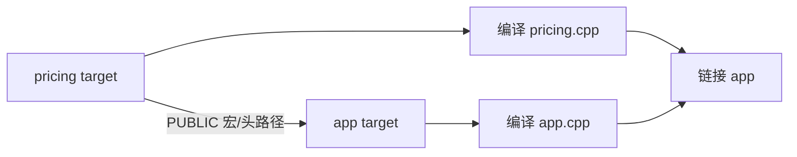

# CMake target 与依赖传播

← [[学习/2026-10-28/05-动态库与ABI|上一节]] · [[学习/2026-10-28/07-练习-链接错误诊断|下一节]] · [[八股测试/2026-10-28|今日自测]]

> [!abstract] 这一节要解决的问题
> 一个 CMake 项目里，头文件需要某宏，且调用者也需要看到它；target_compile_definitions 应用 PRIVATE、PUBLIC 还是 INTERFACE？target_link_libraries 的作用只是拼 -l 吗？

## 先把词讲清楚

真实 C++ 项目经常不是手写一行 g++，而是 CMake 管理多个模块。看到 `target_link_libraries` 和 `target_include_directories`，要把它们当成依赖图的边与接口契约，而非神秘咒语。

| 术语 | 用普通话先理解 |
| --- | --- |
| target | 构建图中的一个可执行文件、库或接口集合。 |
| 使用要求 | 依赖方为了编译/链接该 target 需要继承的 include、宏、库等属性。 |
| 作用域 | PRIVATE/PUBLIC/INTERFACE 决定属性给自己、给消费者或两者。 |

## 从具体故障理解机制

`add_library(pricing ...)` 定义库 target；`add_executable(app ...)` 定义程序 target；`target_link_libraries(app PRIVATE pricing)` 说明 app 依赖 pricing。`target_compile_definitions(pricing PUBLIC BOOK_SCALE=2)` 让库自己以及消费它的 target 编译时看到同样宏。若宏只用于库的 `.cpp`，改 PRIVATE；若是纯头文件接口库自身不编译，INTERFACE 适合提供消费者要求。



图里的箭头表示因果或构建顺序，不代表所有工具链内部必须分成完全相同的进程。回到问题：CMake 以 target 表达可执行文件、库及其使用要求。某宏若库自身编译和调用者头文件都要用，应使用 PUBLIC；仅库实现要用选 PRIVATE；只让使用者知道选 INTERFACE。`target_link_libraries` 不只是文本拼 `-l`，还表达目标之间的依赖及使用要求传播，具体传递由作用域决定。构建目录与源码目录分开，便于检查生成命令和重建。

## 完整可运行代码

下面是 [[学习/2026-10-28/示例代码/06_cmake_target|代码阅读版]] 的完整源码；保存的 `.cpp` 文件是编译验证对象。先按默认方式运行，再按场景修改宏或构建参数。每个语法点的作用也写在源码中文注释里。

```cpp
// 目的：观察构建系统传入的编译宏如何改变一个翻译单元。
// 前置：知道预处理宏和 target_compile_definitions 的关系。
// 步骤：默认编译输出 6；加入 -DBOOK_SCALE=2 后输出 12。
#include <iostream>  // std::cout 打印最终结果。

#ifndef BOOK_SCALE
#define BOOK_SCALE 1  // 没有构建系统参数时给独立运行提供默认值。
#endif

#if BOOK_SCALE < 1
#error BOOK_SCALE_must_be_positive  // 在预处理阶段直接拒绝无效配置。
#endif

int scaled_fee(int price, int quantity) {
    return price * quantity * BOOK_SCALE;  // 宏在编译前展开；教学输入很小。
}

int main() {
    std::cout << scaled_fee(2, 3) << '\n';  // 默认 6；传 -DBOOK_SCALE=2 则为 12。
}
```

### 按代码逐步读

1. 独立源码里 `#ifndef BOOK_SCALE` 提供默认值，所以 `g++ -std=c++17 06_cmake_target.cpp` 可运行。
2. 示例通过 `#if BOOK_SCALE < 1` 检查约束，这属于预处理阶段；CMake 属性可从命令行传入 `-DBOOK_SCALE=2`。
3. `price` 与 `quantity` 都是具体值，不涉及动态链接；本题重点是构建配置如何进入翻译单元。

## 在真实项目里怎样用

读开源仓库从顶层 `CMakeLists.txt` 找 `add_subdirectory`，再沿 target 追 `target_sources`、include、compile definitions、link libraries。碰到某个头文件在库自身能编译、消费者编译失败，优先检查接口所需目录/宏是否标成了 PRIVATE。开启 `CMAKE_EXPORT_COMPILE_COMMANDS` 可以查看每个源文件实际编译命令（生成器支持范围以官方文档为准）。

### 常见反例与边界

CMake 的 PUBLIC 不是“对互联网公开”，而是传递给依赖 target。某个依赖是否应该传递取决于头文件/API 是否暴露它。示例只讲 target 属性，不把 CMake 跨平台安装、导出包或生成器表达式混成今天的新题。

不要把所有 include 目录、宏和库都设 PUBLIC；泄露无关依赖会增加耦合和重编译范围。实际属性传播以所用 CMake 版本和 target 类型核对。

## 再做一个项目实验

### 最小 CMake 目标图

在临时目录放一份 `CMakeLists.txt`，把示例 `.cpp` 复制进去，用接口库传递编译定义。接口库本身没有待编译源码，因此这里恰好展示 `INTERFACE`；如果真实库自身 `.cpp` 与消费者都需要相同宏，就把属性放在真实库 target 上并改 `PUBLIC`。

```cmake
cmake_minimum_required(VERSION 3.16)
project(build_day LANGUAGES CXX)
add_library(build_settings INTERFACE)
target_compile_features(build_settings INTERFACE cxx_std_17)
target_compile_definitions(build_settings INTERFACE BOOK_SCALE=2)
add_executable(app 06_cmake_target.cpp)
target_link_libraries(app PRIVATE build_settings)
```

```bash
cmake -S . -B build
cmake --build build
./build/app
```

此时输出应是 `12`，因为消费者 app 通过接口 target 得到宏。若把定义改成只给别的库 `PRIVATE`，app 不会继承；这比盲目给整个目录加全局宏更容易追依赖。

## 30–90 秒口述与自检

**可以这样说：**先把 target 视为构建图节点，再说明 PUBLIC/PRIVATE/INTERFACE 的属性范围，最后用公共头文件是否需要该依赖来决定是否传播。

**自己再推一遍：**如果宏只在库内部 `.cpp` 使用，为什么应优先 PRIVATE？若公共头文件里的条件编译也依赖该宏，又该如何改？

**再追问：**追问：消费者引用头文件中出现的第三方类型时，库对第三方头文件依赖能否只标 PRIVATE？通常不够，消费者也需要相应使用要求。

技术依据：[CMake 官方教程：target 与作用域](https://cmake.org/cmake/help/latest/guide/tutorial/Getting%20Started%20with%20CMake.html)；[target_link_libraries](https://cmake.org/cmake/help/latest/command/target_link_libraries.html)。面经只用于确定题型，不把候选人的临场回答当作技术权威；资料访问于 2026-10-28。
