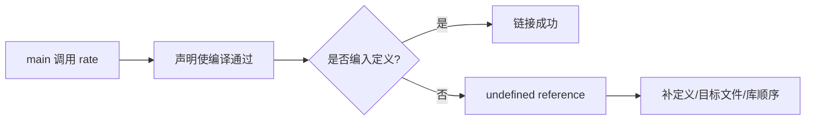

# 练习：诊断一次 undefined reference

← [[学习/2026-10-28/06-CMake目标与依赖|上一节]] · [[八股测试/2026-10-28|回到自测]] · [[八股测试/2026-10-28|今日自测]]

> [!abstract] 这一节要解决的问题
> 先运行默认源码；再用 `-DDEMO_MISSING_DEFINITION` 编译，记录报错属于哪个阶段。最后解释“补上声明”和“补上定义”哪个能修复它，并给出排查步骤。

## 先把词讲清楚

面试官常给一段小代码问“为什么报错”。真正有价值的是先确定错误阶段，再说明证据与最小修复，而不是碰到 undefined reference 就机械添加头文件。

| 术语 | 用普通话先理解 |
| --- | --- |
| 链接失败 | 目标文件已生成，但引用找不到可用定义。 |
| 符号签名 | C++ 名字及参数等影响链接名的部分；排查时可用 nm -C 解码。 |

## 从具体故障理解机制

源码里声明 `int rate(int)` 让 `main` 的调用完成类型检查。预处理宏决定 `rate` 定义是否保留。默认模式有定义，链接成功；开启故障宏后，目标文件仍记录对 `rate(int)` 的引用，但没有实现，链接器通常报错。



图里的箭头表示因果或构建顺序，不代表所有工具链内部必须分成完全相同的进程。回到问题：默认模式中 `rate(int)` 有定义，输出 10。加宏时依然有 `rate(int)` 声明，但定义被条件编译排除，所以通常在链接时报 undefined reference。再次增加声明不会创造实现；需要提供签名一致的定义、把对应 `.o`/库加入链接，或修正库顺序。先确认完整符号签名，再确认定义是否生成，最后确认目标文件和库路径/顺序。

## 完整可运行代码

下面是 [[学习/2026-10-28/示例代码/07_link_diagnosis|代码阅读版]] 的完整源码；保存的 `.cpp` 文件是编译验证对象。先按默认方式运行，再按场景修改宏或构建参数。每个语法点的作用也写在源码中文注释里。

```cpp
// 目的：复现“声明存在、定义缺失”导致的链接错误，默认模式安全可运行。
// 前置：知道 -D 宏影响条件编译；故障模式只用于观察链接诊断。
// 步骤：默认构建运行；再添加 -DDEMO_MISSING_DEFINITION 构建并查看错误。
#include <iostream>  // std::cout 用于默认模式输出。

int rate(int quantity);  // 声明让 main 知道参数与返回类型，但它不是实现。

#ifndef DEMO_MISSING_DEFINITION
int rate(int quantity) {  // 默认模式提供唯一定义。
    return quantity * 2;  // 输入 5 时返回 10。
}
#endif

int main() {
    std::cout << rate(5) << '\n';  // 故障宏开启后，这个引用没有定义可链接。
}
```

### 按代码逐步读

1. `#ifndef DEMO_MISSING_DEFINITION` 控制是否保留函数体；宏由编译命令传入。
2. `main` 中的 `rate(5)` 始终看得到前面的声明。
3. `nm -C` 对目标文件可检查未定义的 `rate(int)` 与定义是否存在。
4. 不要运行未成功链接的程序，也不要把故障模式当作源码默认行为。

## 在真实项目里怎样用

排查真实项目的 undefined reference：保存完整链接命令；核对函数或模板的具体类型签名；找实现源文件；看对应 target 是否包含源文件；看静态库顺序；最后检查不同宏/ABI/架构配置。每次只改一个条件再构建，才能知道修复了什么。

### 常见反例与边界

有时原因是 C/C++ 语言链接不匹配、模板特化缺失、ABI 不一致或库版本错，不能一概归因于“没写函数体”。本练习只模拟最小缺定义分支，并提醒把症状映射回今天六个专题。

诊断文本因工具链不同而变化；非 GNU 平台不能把报错文字和命令写成语言保证。

## 再做一个项目实验

### 先做再展开答案

先进入本日示例代码目录，产物放在临时目录：

```bash
d=$(mktemp -d)
g++ -std=c++17 07_link_diagnosis.cpp -o "$d/good"
"$d/good"
g++ -std=c++17 -DDEMO_MISSING_DEFINITION -c 07_link_diagnosis.cpp -o "$d/bad.o"
nm -C "$d/bad.o"
g++ "$d/bad.o" -o "$d/bad"
```

编译 `.o` 的命令仍可成功；最后一条按本题设定应链接失败。先自己说出 `nm` 中哪个符号未定义，再回答“只补声明是否有用”。所有产物放临时目录，别与正式源码混在一起。

## 30–90 秒口述与自检

**可以这样说：**先判断编译还是链接，再看调用处声明、实现处定义和链接输入；修复要让正确签名的定义进入最终链接，而非重复写声明。

**自己再推一遍：**如果 `nm -C good.o` 有 `T rate(int)` 而 `bad.o` 只有 `U rate(int)`，这两个字母在 GNU nm 输出里意味着什么？

**再追问：**追问：若函数定义在 `.so` 里，但启动时找不到 `.so`，这与本题的链接失败同一阶段吗？不是，前者属于运行时装载。

技术依据：[GCC Link Options](https://gcc.gnu.org/onlinedocs/gcc/Link-Options.html)；[GNU ld Options](https://sourceware.org/binutils/docs/ld/Options.html)。面经只用于确定题型，不把候选人的临场回答当作技术权威；资料访问于 2026-10-28。
