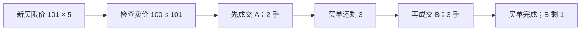

# 限价单、价格时间优先与部分成交

← [[学习/学习导航/2026-10-29-学习导航|返回导航]] · [[学习/2026-10-29/02-订单簿索引与撤单|下一节]] · [[八股测试/2026-10-29|今日自测]]

> [!abstract] 这节要回答
> 教学版连续撮合订单簿中，买限价 101、数量 5 到来；卖盘 100 价先后有 2 手与 4 手。按价格时间优先应怎样成交，剩余多少？限价与市价的约束各是什么？

## 先把业务和术语说清楚

假设你写交易所侧的教学版撮合器：买方愿意出到 101，卖盘目前有人报 100。买方可以和卖方成交，但不能因为自己愿意出 101 就强制按 101 结算。真实量化开发岗位更多是接行情、发订单与处理回报；撮合器练习帮助理解交易所返回的成交为什么可能拆成多笔。

| 术语 | 初学者先这样理解 |
| --- | --- |
| 限价单 | 买入最高价或卖出最低价由提交方设定，可能不成交。 |
| 市价单 | 希望立即按可得价格成交，仍受场所保护规则和流动性限制。 |
| 剩余量 leaves | 原委托量中还未成交也未取消的数量。 |
| 价格时间优先 | 先比较价格优劣，同价再比较交易所接收顺序。 |

## 从具体例子理解机制

订单簿分买卖两侧。买方最高报价叫 best bid，卖方最低报价叫 best ask。一个买限价只会在对手卖价不高于自己限价时尝试成交。对手侧先按更优价格，再在同价位按时间顺序。一次成交量是当前买方未成交数量与当前卖方未成交数量的较小者，双方都必须扣减。余额为零的一方离开；若新来的限价单还有余额，交易规则允许时可在自己的价位挂单。

**手推一遍：**手推：买单初始 leaves=5。先遇到卖单 A(100,2)，成交 2 后买剩 3、A 剩 0。再遇到卖单 B(100,4)，成交 3 后买剩 0、B 剩 1。成交记录是两笔而非一笔；不要把“成交笔数”和“成交总量”混淆。



图中是本题选择的单一路径。**完整回答：**买限价最高可接受 101；卖价 100 在范围内，按该价位时间顺序先吃 2 手，再从第二笔吃 3 手，买单累计成交 5、剩余 0；第二笔卖单余 1。市价单一般没有用户指定的限价，可能跨多个价位，且交易场所有保护限制，不能保证一定全成或固定价格。价格时间优先是本文引用的特定场所规则，先确认真实交易所的规则再实现。

## 带中文注释的完整 C++17 示例

代码阅读版：[[学习/2026-10-29/示例代码/01_price_time|01_price_time]]；保存的 `.cpp` 为实际编译对象。先读关键状态，再逐步追踪每一次更新。

```cpp
// 目的：按一个卖价位上的先后顺序演示部分成交和 leaves 扣减。
// 前置：限价买单只能接受不高于自己限价的卖价；本例不是完整交易所。
// 步骤：用 101×5 的买单依次消费 100×2 与 100×4 的卖单。
#include <algorithm> // std::min 取双方当前可成交数量的较小值。
#include <deque>     // 同价静置订单按进入顺序排队。
#include <iostream>  // 打印每笔成交和剩余量。

struct Resting {
    int id;      // 教学订单号，用来识别是哪一笔静置卖单。
    int price;   // 整数 tick；不要用浮点相等判断是否同价。
    int leaves;  // 该订单尚未成交的数量。
};

int main() {
    const int buy_limit = 101;  // 买方愿付的最高价，不等于必然成交价。
    int buy_leaves = 5;         // incoming 买单的未成交数量。
    std::deque<Resting> asks{{1, 100, 2}, {2, 100, 4}};

    while (buy_leaves > 0 && !asks.empty()) {
        Resting& best = asks.front();  // 同价先处理最早进入的卖单。
        if (best.price > buy_limit) break;  // 超出买方限价就停止。
        const int traded = std::min(buy_leaves, best.leaves);
        buy_leaves -= traded;  // 两方都要扣减，否则会凭空多成交。
        best.leaves -= traded;
        std::cout << "fill seller=" << best.id << " qty=" << traded
                  << " px=" << best.price << std::endl;
        if (best.leaves == 0) asks.pop_front();  // 只在完全成交后移走队首。
    }
    std::cout << "buy_leaves=" << buy_leaves
              << " seller2_leaves=" << (asks.empty() ? 0 : asks.front().leaves)
              << std::endl; // 防止另一组输入把卖盘全部吃空后访问空队列。
}
```

### 按源码顺序读

1. `std::deque<Resting>` 保留同一价格上原订单的进入顺序。
2. 每轮用 `min(incoming.leaves, resting.leaves)` 计算可成交量，并同步扣两方数量。
3. 前排订单剩余 0 才 `pop_front()`；不能跳过它提前打后排。
4. 示例仅有一个卖价位 100；多价位和取消索引放在下一篇。

## 与真实 C++ 项目怎样连接

问到“订单为什么有多次成交回报”时，可以用这个扣减过程解释。工程实现需要将每笔成交与订单状态关联，不能在收到第一笔成交时立即把整单标记 Filled。多市场、多订单类型和价格保护要以具体场所规则为准。

### 前提、边界与容易说错的地方

这里是连续竞价、单个价格层的教学模型；不是完整交易所。示例没有费用、隐藏单、拍卖、交易时段、自成交防护、撤改和价格保护。使用整数 tick 表示价格，避免让 `double` 比较误差干扰撮合判断；真实产品还需校验 tick size 与数量单位。

不能把“买限价 101”说成一定以 101 成交；示例以静置卖单价格 100 成交。不同场所可有保护价、自成交防护、拍卖等规则。

## 面试口述与自检

**30–90 秒口述：**先确认场所的撮合规则，再说买单从最优卖价开始、同价先进先出、每笔按双方剩余最小量成交，最后说明部分成交会留下余额和多条成交回报。

**自己再推一遍：**把 B 的价格改成 102，买限价 101 还能吃到 B 吗？如果 A 的数量改成 6，买单会留下多少？

**继续追问：**追问：同价两笔卖单，后到者能先成交吗？在本题 FIFO 规则下不能。若第一笔只剩 1，先成交 1 再分配给下一笔。

技术依据：[Coinbase Derivatives：Order Matching](https://help.coinbase.com/en/derivatives/features/order-matching)；[Coinbase Trading Rules](https://www.coinbase.com/legal/trading_rules)。题型来源见 [[八股测试/2026-10-29|今日测试]]，候选人/岗位材料只帮助定位练习目标，不替代协议或规则原文；本页资料访问于 2026-10-29。
