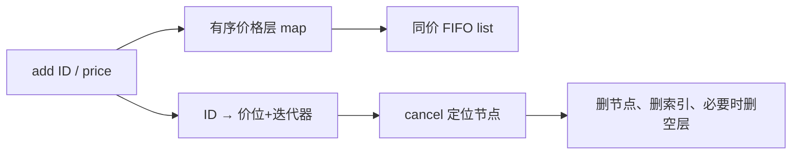

# 订单簿价格层、ID 索引与撤单

← [[学习/2026-10-29/01-价格时间优先与部分成交|上一节]] · [[学习/2026-10-29/03-快照增量与缺口恢复|下一节]] · [[八股测试/2026-10-29|今日自测]]

> [!abstract] 这节要回答
> 设计一个教学版限价订单簿，支持按价格找最优报价、同价保持先后、按订单 ID 撤单。为什么只用一个排序容器或只用哈希表都不方便？

## 先把业务和术语说清楚

交易所撮合用的订单簿需要订单粒度；而行情里有时只给某价格层的聚合数量。两者不能混为一谈。今天设计前者的简化数据结构，让“最优价、同价排队、撤单”三个要求同时可实现。

| 术语 | 初学者先这样理解 |
| --- | --- |
| 价格层 | 同一报价下多个订单组成的队列。 |
| 最优价 | 买侧最高报价或卖侧最低报价。 |
| 迭代器 | 指向容器元素的位置对象；使用前要考虑失效规则。 |
| ID 索引 | 从订单号快速找到所在位置的辅助映射。 |

## 从具体例子理解机制

有序 map 负责跨价格层的顺序；list 负责同价格层的 FIFO。只用哈希表查价格快，却不能直接得到最高买价或最低卖价；只用有序 map 存聚合量则找不到具体 ID。额外的 unordered_map 是“反向索引”。插入时必须拒绝重复 ID，避免索引覆盖后旧订单无法撤；撤单时先拿到位置，再同时删除节点和索引，空层最后清理。

**手推一遍：**例如买侧价 100 有 ID=7、ID=8，价 99 有 ID=9。最优买价为 100。撤 ID=7 后价 100 仍有 ID=8；撤 ID=8 后价 100 空，应删除该价格层，新的 best bid 才变为 99。若忘删空层，显示的最优报价就会错误。



图中是本题选择的单一路径。**完整回答：**一种清晰的教学方案是有序 `map<价格, list<订单>>` 维护价格层与同价顺序，再用 `unordered_map<ID, 价位+list迭代器>` 定位撤单对象。最好价从有序 map 端点取得，新增/删除价层是对数复杂度，同价插入尾部和已定位订单的 list erase 是常数级；ID 查找平均常数、最坏可能退化。撤单时先检查 ID、删除 list 节点、更新索引，价层空后再删除 map 节点；保持两个结构一致。

## 带中文注释的完整 C++17 示例

代码阅读版：[[学习/2026-10-29/示例代码/02_book_index|02_book_index]]；保存的 `.cpp` 为实际编译对象。先读关键状态，再逐步追踪每一次更新。

```cpp
// 目的：展示“有序价格层 + 同价队列 + ID 索引”的教学版买盘。
// 前置：只维护买侧，不做撮合；生产实现需另做并发和容量设计。
// 步骤：加三单、连续撤两单，观察最优买价何时改变。
#include <functional>    // std::greater 让买价从高到低排序。
#include <iostream>      // 打印检查结果。
#include <list>          // 同价订单保持先入先出的顺序。
#include <map>           // 有序价格层，begin 为最优买价。
#include <unordered_map> // ID 到订单位置的平均常数时间索引。

struct Order { int id; int leaves; }; // 同价层内仍保留逐订单 ID 与数量。

class BidBook {
    using Queue = std::list<Order>; // 一个价格层对应一条 FIFO 队列。
    std::map<int, Queue, std::greater<int>> levels_; // 高价在前。
    struct Location { int price; Queue::iterator it; }; // 撤单定位信息。
    std::unordered_map<int, Location> by_id_; // 不能覆盖活跃订单 ID。
public:
    bool add(int id, int price, int quantity) {
        if (quantity <= 0 || price <= 0 || by_id_.count(id)) return false;
        Queue& queue = levels_[price]; // 缺少价层时创建一个空队列。
        queue.push_back({id, quantity}); // 新订单排在同价队尾。
        auto it = queue.end(); --it;     // 指向刚插入的节点。
        by_id_.emplace(id, Location{price, it}); // 建立反向索引。
        return true;
    }
    bool cancel(int id) {
        auto found = by_id_.find(id);
        if (found == by_id_.end()) return false; // 未知 ID 不能乱扣数量。
        auto level = levels_.find(found->second.price); // 找所属价格层。
        level->second.erase(found->second.it); // list 擦除仅使该节点迭代器失效。
        by_id_.erase(found);              // 不能留下指向已删除节点的索引。
        if (level->second.empty()) levels_.erase(level); // 空层必须去掉。
        return true;
    }
    int best_bid() const { return levels_.empty() ? 0 : levels_.begin()->first; }
};

int main() {
    BidBook book;
    book.add(7, 100, 2); book.add(8, 100, 3); book.add(9, 99, 1);
    std::cout << book.best_bid() << std::endl; // 100。
    book.cancel(7); std::cout << book.best_bid() << std::endl; // 仍为 100。
    book.cancel(8); std::cout << book.best_bid() << std::endl; // 变为 99。
}
```

### 按源码顺序读

1. `std::map<int, std::list<Order>, std::greater<int>>` 让 `begin()` 指向最高买价。
2. `emplace_back` 追加同价订单，返回的末尾迭代器存入 ID 索引。
3. 撤单通过 ID 找到价位与 list 迭代器，先在 list 中擦除，再擦除索引。
4. 若 list 已空，再擦除 map 层；之后不能使用已失效的层迭代器。

## 与真实 C++ 项目怎样连接

看一个 C++ 开源撮合项目时，先问它维护的是逐订单 L3 还是聚合价位 L2，再看取消路径是否能从订单 ID 直接定位。不能拿本地缓存的行情价位簿去推断交易所逐订单时间优先；聚合快照通常不含每笔订单时间信息。

### 前提、边界与容易说错的地方

示例只维护买侧，不做真正匹配；卖侧可用升序 map。`unordered_map` 的平均复杂度依赖哈希质量；map/list 都有分配成本。示例只演示正常内存分配路径，若索引插入抛异常，生产实现还要回滚刚插入的 list 节点以保持两份结构一致。多线程写同一簿还需单写者或锁同步方案。

哈希表平均 O(1) 不等于所有操作都 O(1)；`list` 节点逐个分配、缓存局部性差，低延迟实现可按容量和负载换结构。

## 面试口述与自检

**30–90 秒口述：**价格有序用 map，同价顺序用队列或 list，按 ID 取消用反向索引；每次增删同时维护两份结构，讲清复杂度和迭代器失效。

**自己再推一遍：**价 100 层最后一个订单撤掉后，为什么要删价层？同一个 ID 再次 add 应允许覆盖吗？

**继续追问：**追问：若只用 `map<price, total_qty>` 能撤掉某个订单 ID 吗？不能，聚合数量已经丢失订单粒度和先后信息；若行情只有 price-level 聚合，则那是另一类数据。

技术依据：[C++17 associative containers](https://timsong-cpp.github.io/cppwp/n4659/associative.reqmts)；[C++17 std::list](https://timsong-cpp.github.io/cppwp/n4659/list)；[Coinbase 价格时间优先](https://help.coinbase.com/en/derivatives/features/order-matching)。题型来源见 [[八股测试/2026-10-29|今日测试]]，候选人/岗位材料只帮助定位练习目标，不替代协议或规则原文；本页资料访问于 2026-10-29。
