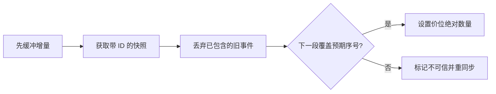

# 快照加增量：怎样恢复行情订单簿

← [[学习/2026-10-29/02-订单簿索引与撤单|上一节]] · [[学习/2026-10-29/04-下单前风控与重复请求|下一节]] · [[八股测试/2026-10-29|今日自测]]

> [!abstract] 这节要回答
> 订阅深度更新时先收到增量，再拉到 snapshot：该怎样处理旧增量、连续增量与序号缺口？为什么 gap 后不能继续把本地簿当作可信行情？

## 先把业务和术语说清楚

此前 10/23 的练习只识别 UDP 序号缺口；今天进一步解决“发现缺口后怎样让本地行情簿重新正确”。先分清两种簿：交易所逐订单簿用于撮合；策略本地价位簿通常由行情快照和增量维护，未必知道每一笔订单 ID。

| 术语 | 初学者先这样理解 |
| --- | --- |
| 快照 snapshot | 某个更新序号处的完整或限定深度基线。 |
| 增量 delta | 快照之后对价格层的修改消息；此协议给新绝对数量。 |
| U/u | 一个增量覆盖的首/末更新序号。 |
| 可信状态 | 已用连续事件重建、可用于业务决策的本地簿。 |

## 从具体例子理解机制

如果先拿快照再订阅流，中间会有时间窗口，可能漏事件；因此先订阅并缓存增量，再拉快照。用快照的 `lastUpdateId` 确认哪些缓存更新已包含在基线中。增量事件可能覆盖一个序号区间 `[U,u]`，应用前检查是否覆盖下一个期望序号。若有缺口，局部旧簿无法凭空恢复漏掉的价格变化；要丢弃可信标记、重抓快照和重新接续。

**手推一遍：**假设快照序号 100，价 100 的数量为 5。增量 [99,100] 已旧，忽略；[101,101] 把该价数量设为 3；[102,102] 把数量设为 0，删除该价层。若下一条是 [104,104]，103 不见了，停止按此簿决策并重同步。注意“设为 3”不是在 5 上加 3。



图中是本题选择的单一路径。**完整回答：**先开始缓冲增量，再取得带 `lastUpdateId` 的快照；丢弃完全不比快照新的更新。第一条可应用事件要覆盖快照之后的下一更新，之后按事件的序号区间连续推进。更新给的是价格层新绝对数量，不应当误当“加减量”；数量为零删该层。若下个事件的起始序号大于本地序号加一，说明缺数据，应标记簿不可信并重新同步，不能只跳到最新值继续让策略发单。具体边界以所接数据源协议为准。

## 带中文注释的完整 C++17 示例

代码阅读版：[[学习/2026-10-29/示例代码/03_snapshot_delta|03_snapshot_delta]]；保存的 `.cpp` 为实际编译对象。先读关键状态，再逐步追踪每一次更新。

```cpp
// 目的：用单价位教学模型演示快照基线、旧更新、连续更新与缺口。
// 前置：本例借用 Binance Spot 的 U/u 区间语义，不泛化到所有行情。
// 步骤：快照 100，应用 101 和 102，遇到缺失 103 时进入不可信状态。
#include <iostream> // 打印序号、数量和可信标记。

struct Delta { int first; int last; int price; int absolute_qty; };

class LocalLevel {
    int last_seq_ = -1;   // -1 表示尚未加载快照。
    int quantity_ = 0;    // 教学上只维护价格 100 这一层。
    bool trusted_ = false; // gap 后必须重新同步，不能继续发出可信信号。
public:
    void load_snapshot(int seq, int qty) {
        last_seq_ = seq; quantity_ = qty; trusted_ = true;
    }
    bool apply(const Delta& d) {
        if (!trusted_ || d.price != 100 || d.first > d.last || d.absolute_qty < 0)
            return false; // 校验失败或状态不可信，不修改本地簿。
        if (d.last <= last_seq_) return true; // 事件完全旧，忽略即可。
        if (d.first > last_seq_ + 1) {
            trusted_ = false; return false; // 缺少中间更新，必须重新同步。
        }
        quantity_ = d.absolute_qty; // 协议给的是新绝对量，0 即删除该层。
        last_seq_ = d.last;          // 成功应用后才推进本地序号。
        return true;
    }
    int seq() const { return last_seq_; }
    int qty() const { return quantity_; }
    bool trusted() const { return trusted_; }
};

int main() {
    LocalLevel level; level.load_snapshot(100, 5);
    level.apply({99, 100, 100, 9});  // 旧更新不能覆盖快照。
    level.apply({101, 101, 100, 3}); // 绝对数量变为 3。
    level.apply({102, 102, 100, 0}); // 数量 0 即该层消失。
    level.apply({104, 104, 100, 7}); // 103 缺失，停止信任。
    std::cout << level.seq() << ',' << level.qty() << ','
              << level.trusted() << std::endl; // 102,0,0。
}
```

### 按源码顺序读

1. `load_snapshot(100, 5)` 把本地序号和价层量一起设为基线。
2. `apply` 先跳过完全过期事件，再判断 `first > last_seq+1` 是否缺口。
3. 状态不可信时拒绝后续更新；重新取得快照才可恢复。
4. 价位数量 0 表示删除，而不是保留一个显示为 0 的最优价层。

## 与真实 C++ 项目怎样连接

真实行情网关在探测到 gap 时，策略可能要暂停依赖该簿的发单，另由已定义的恢复流程取得快照和重播缓存事件。暂停范围由产品和交易风险决定；不能把一个通道断档推广成全系统一定停机。记录 feed、symbol、前后序号和恢复次数，供排障与回放。

### 前提、边界与容易说错的地方

示例仅处理单价位、顺序到达的教学事件，不包含网络 I/O、缓存窗口并发、跨频道一致性、精度或快照深度截断。Binance 官方步骤中还有首次事件覆盖快照 ID 的要求，生产代码要完整遵循目标协议。这里用 `bool trusted` 表示状态，不代表链路安全性证明。

不同交易所序号字段语义不同；这里的 U/u 和 `lastUpdateId` 明确来自 Binance Spot 文档，不可直接套到所有行情。快照深度有限也可能使远端价层不可见。

## 面试口述与自检

**30–90 秒口述：**先缓冲流再抓快照，用快照 ID 划分旧/新增量；每条按序号连续性检查并把数量设置到价层，gap 就撤销可信状态并重新同步。

**自己再推一遍：**快照 ID 100，收到 [99,100]、[101,101]、[103,103]，哪一条触发 gap？若消息数量为 0，价层如何处理？

**继续追问：**追问：重复增量的 u 不大于当前序号怎么办？忽略；若跳到 U=104 而本地仅到 102，则 103 缺失，不能继续应用。

技术依据：[Binance Spot WebSocket：维护本地订单簿](https://developers.binance.com/en/docs/products/spot/web-socket-streams)。题型来源见 [[八股测试/2026-10-29|今日测试]]，候选人/岗位材料只帮助定位练习目标，不替代协议或规则原文；本页资料访问于 2026-10-29。
