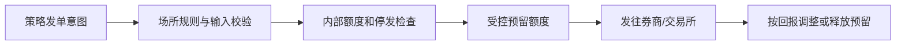

# 下单前风控、额度与重复请求

← [[学习/2026-10-29/03-快照增量与缺口恢复|上一节]] · [[学习/2026-10-29/05-订单回报与撤单竞态|下一节]] · [[八股测试/2026-10-29|今日自测]]

> [!abstract] 这节要回答
> 策略要发买单，交易网关至少应在发出前检查哪些基本条件？一笔请求超时后用同一 ID 重发或换新 ID，各有什么风险？

## 先把业务和术语说清楚

策略可以很快地生成信号，但交易网关不能把每个信号原样发出去。输入错误、数量过大或重复重试会导致真实风险。开发者至少要明白“发出前检查”和“收到回报后释放或调整预留”是一条闭环。

| 术语 | 初学者先这样理解 |
| --- | --- |
| 下单前风控 | 在订单发往市场之前拒绝明显越界或不允许的请求。 |
| 名义金额 | 按价格×数量估算的订单金额，单位需明确。 |
| 预留额度 | 在订单尚未最终成交/取消时，先占用可用额度。 |
| client order ID | 客户端分配的订单请求标识，用于去重和关联回报。 |

## 从具体例子理解机制

先验证产品、时段、价格步长、数量单位等目标场所规则，再检查内部的数量和名义金额上限；这些只是不同层级，不应把内部阈值当监管规则。若通过，就为在途订单预留额度。收到成交时可把预留转换为实际持仓/资金占用；取消或拒绝时释放对应剩余量。请求超时后订单可能已经被对端接收，必须以回报、查询或恢复机制确认，不能按本地超时结果随意再发一笔新单。

**手推一遍：**教学额度 100，单笔最大数量 6。ID=1 买 5 单位、单价 10，名义金额 50，被接受后可用额度从 100 降到 50；ID=2 买 6 单位、单价 10，虽然单笔数量合格，但 60 超过剩余 50，应拒绝。ID=1 再到来会被去重；这仅是本地重复检测，不保证跨重启、跨券商幂等。



图中是本题选择的单一路径。**完整回答：**教学网关可在发单前检查正数与交易规则、单笔数量/金额、累计可用额度、停发开关和重复 client ID；被接受的在途订单要预留额度，避免多笔并发分别通过后总量超限。超时只是未知结果：不能把它当拒单。应按目标协议查询或协调重连恢复；用同一 client ID 重试是否幂等取决于场所/券商约定，换新 ID 则可能形成重复订单。真实合规责任按市场、机构角色和规则确定。

## 带中文注释的完整 C++17 示例

代码阅读版：[[学习/2026-10-29/示例代码/04_pretrade_risk|04_pretrade_risk]]；保存的 `.cpp` 为实际编译对象。先读关键状态，再逐步追踪每一次更新。

```cpp
// 目的：演示单线程教学版下单前风控与本地重复 ID 检查。
// 前置：名义金额=整数价格×数量；实际产品还需乘数、币种和市场规则。
// 步骤：先接受 50，再拒绝超额 60 和重复 ID。
#include <iostream>      // 打印三次提交结果。
#include <unordered_set> // 保存已接受的客户端订单 ID。

class RiskGate {
    int available_ = 100;        // 教学额度，不代表真实限额。
    int max_single_qty_ = 6;     // 单笔数量上限。
    bool halted_ = false;        // 停发开关；真实系统需受控更新。
    std::unordered_set<int> ids_; // 本进程内去重，重启后不会自动保留。
public:
    bool submit(int id, int price, int qty) {
        if (halted_ || price <= 0 || qty <= 0 || qty > max_single_qty_)
            return false; // 输入无效或已停发。
        if (ids_.count(id)) return false; // 活跃教学记录中不允许重复 ID。
        if (price > available_ / qty) return false; // 除法检查避免乘积溢出。
        const int notional = price * qty; // 上面的条件保证不超过 available_。
        available_ -= notional; // 接受后立即预留，下一笔看到剩余额度。
        ids_.insert(id);        // 与预留同在单线程受控路径里更新。
        return true;
    }
    int available() const { return available_; }
};

int main() {
    RiskGate gate;
    std::cout << gate.submit(1, 10, 5) << std::endl; // 1，预留 50。
    std::cout << gate.submit(2, 10, 6) << std::endl; // 0，剩余 50 不够 60。
    std::cout << gate.submit(1, 10, 1) << std::endl; // 0，重复 ID。
    std::cout << gate.available() << std::endl;      // 仍为 50。
}
```

### 按源码顺序读

1. `submit` 先检查停发开关、正数、单笔数量和唯一 ID。
2. 用 `price > max_notional / qty` 避免乘法溢出式的额度判断。
3. 成功后插入 ID 集合并扣可用额度；失败时不扣。
4. 示例没有成交/撤单释放逻辑，不能直接当生产风控模块。

## 与真实 C++ 项目怎样连接

在真实交易链路里，把“订单是否已经到达对端”建模为未知状态，比在网络错误时立即补发更安全。若券商支持按 client ID 查询或重放执行报告，先用这些协议恢复。内部风险开关与日志应能解释每笔拒绝原因；量化开发不是把阈值硬编码在策略里。

### 前提、边界与容易说错的地方

币种、合约乘数、保证金、净头寸、价格带、监管规则都比示例复杂。额度预留和释放要与订单状态同步，且需要原子性/单写者保证；示例是单线程教学模型。不能宣称同一 ID 在所有 API 上都是幂等键，必须核对对接协议。

本例的数值门槛仅为教学参数，绝非真实交易限额。SEC 15c3-5 是美国证券市场特定参与者规则，不能直接套用到全部量化策略。

## 面试口述与自检

**30–90 秒口述：**先讲输入与场所规则，再讲内部限额和在途预留，最后讲超时是未知结果、需要对账恢复，而不是盲目新 ID 重发。

**自己再推一遍：**额度 100，先接受 50，再来 60 为什么拒绝？如果第一笔超时，能直接换新 ID 再发吗？

**继续追问：**追问：同时两笔各 60 的订单，额度 100，若都只读原始余额会怎样？都可能通过导致 120；检查和预留要作为同一受控操作完成。

技术依据：[SEC Market Access Rule FAQ](https://www.sec.gov/rules-regulations/staff-guidance/trading-markets-frequently-asked-questions/divisionsmarketregfaq-0)；[Coinbase Order Management：资金预留与部分成交](https://help.coinbase.com/en/coinbase/trading-and-funding/advanced-trade/order-management)。题型来源见 [[八股测试/2026-10-29|今日测试]]，候选人/岗位材料只帮助定位练习目标，不替代协议或规则原文；本页资料访问于 2026-10-29。
