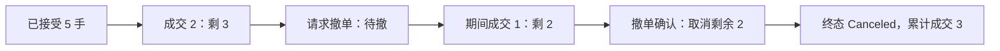

# 订单回报状态与撤单竞态

← [[学习/2026-10-29/04-下单前风控与重复请求|上一节]] · [[学习/2026-10-29/06-批量成交分配|下一节]] · [[八股测试/2026-10-29|今日自测]]

> [!abstract] 这节要回答
> 订单已部分成交，客户端发送撤单后又收到一笔成交回报；能否把“撤单请求已发送”直接视为 Canceled？该如何维护累计成交、剩余量与状态？

## 先把业务和术语说清楚

10/20 的对象生命周期不是交易订单生命周期。订单从本地发出到对端接受、部分成交、撤单，跨网络会有时延，多个事件可能交错。开发者若把“我发了取消”当“已取消”，就可能把后来合法到达的成交漏算。

| 术语 | 初学者先这样理解 |
| --- | --- |
| 执行报告 | 券商/交易场所返回的订单状态变化或成交事件。 |
| OrdStatus | 当前订单状态；与本条事件类型不是同一个字段。 |
| ExecType | 这条执行报告表示的事件原因或类型。 |
| CumQty/LeavesQty | 累计已成交数量 / 仍可成交的剩余数量。 |

## 从具体例子理解机制

订单管理器需要保留原始委托量、累计成交、剩余量、是否处于待撤。成功成交是一个事件，撤单受理是另一个事件。FIX 文档明确 Pending Cancel 不表示已取消；取消请求等待期间的 fill 仍需处理。处理执行报告时，先用 ExecID 或对接协议规定的唯一键排除重复，再更新数量与状态；最终撤成时取消真正剩下的量。对账时还要考虑新单被拒、撤单被拒、连接中断和回报重放。

**手推一遍：**原委托 5，先成交 2，CumQty=2、LeavesQty=3。发撤单后状态待撤。此时再成交 1，CumQty=3、LeavesQty=2；收到取消确认后，最终 Canceled，未成交的 2 不再有效。若同一成交回报重放，累计仍必须保持 3。简单的“接到任何撤单相关消息就把 Leaves 置 0”会漏掉中间成交。



图中是本题选择的单一路径。**完整回答：**不能。发送撤单或收到 Pending Cancel 仅表示请求处理中，不等于剩余量已取消。FIX 的执行报告区分当前 OrdStatus 与此次事件 ExecType，撤单期间仍可能收到成交；用唯一成交标识去重，按回报增加 CumQty、减少 LeavesQty，最终以明确的 Canceled/Fill 等回报确定状态。若撤单后剩余 2 手却又成交 1 手，最后撤掉的是当时真正剩余的 1 手。状态、数量和事件去重应作为同一条受控更新处理。

## 带中文注释的完整 C++17 示例

代码阅读版：[[学习/2026-10-29/示例代码/05_order_state|05_order_state]]；保存的 `.cpp` 为实际编译对象。先读关键状态，再逐步追踪每一次更新。

```cpp
// 目的：展示待撤期间继续成交、执行 ID 去重与最终取消剩余量。
// 前置：这只是 FIX 状态机的教学子集，不覆盖全部事件和字段。
// 步骤：5 手单先成 2，待撤又成 1，最后撤掉余下 2。
#include <iostream>      // 打印最终累计成交与剩余量。
#include <unordered_set> // 保存已处理的执行 ID，避免回报重放重复计数。

class OrderState {
    int original_ = 5; // 原始委托数量。
    int cum_ = 0;      // 累计已经成交的数量。
    int leaves_ = 5;   // 当前还能继续成交的数量。
    bool pending_cancel_ = false; // 已请求撤单，但未确认撤成。
    bool canceled_ = false;       // 收到明确取消确认后才为 true。
    std::unordered_set<int> exec_ids_;
public:
    bool on_fill(int exec_id, int qty) {
        if (canceled_ || qty <= 0 || qty > leaves_ || exec_ids_.count(exec_id))
            return false; // 重复、越量或终态后的异常输入都拒绝。
        exec_ids_.insert(exec_id);
        cum_ += qty; leaves_ -= qty; // 成交同时改两个数量字段。
        return true;
    }
    void request_cancel() { pending_cancel_ = true; } // 不直接清零 leaves。
    bool on_cancel_ack() {
        if (!pending_cancel_ || canceled_ || leaves_ == 0) return false;
        // 若待撤期间已全部成交，真实对端不会再把剩余量成功撤销。
        leaves_ = 0; canceled_ = true; pending_cancel_ = false;
        return true; // 仅教学：真实回报还需核对订单与请求 ID。
    }
    int cum() const { return cum_; }
    int leaves() const { return leaves_; }
    int original() const { return original_; }
};

int main() {
    OrderState order;
    order.on_fill(101, 2);  // 已成交 2，余 3。
    order.request_cancel(); // 发请求不等于撤成。
    order.on_fill(102, 1);  // 待撤期间仍可能成交，余 2。
    order.on_fill(102, 1);  // 同一执行 ID 重放，不能再加一。
    order.on_cancel_ack();  // 确认取消当时真正剩下的 2。
    std::cout << order.original() << ',' << order.cum() << ','
              << order.leaves() << std::endl; // 5,3,0。
}
```

### 按源码顺序读

1. `on_fill` 对 exec ID 去重并拒绝超过剩余量的输入。
2. `request_cancel` 只把 pending 标记设为真，不能直接减少 leaves。
3. `on_cancel_ack` 才把仍未成交的 leaves 置 0，状态设为 Canceled。
4. 示例按单线程顺序喂事件；网络乱序还需要对接协议的序号、重放和查询机制。

## 与真实 C++ 项目怎样连接

看交易网关代码时先找订单 ID 与执行 ID 的映射、回报去重、状态转换和数量不变量。策略可能只关心“是否还活跃”，但风险模块更需知道在途剩余量。重连时恢复执行报告并与券商状态对账，不靠进程内布尔值猜测订单已撤。

### 前提、边界与容易说错的地方

FIX 规范允许的状态比示例更多，如 Pending New、Replace、Expired、Rejected；有的场所接口不使用 FIX。`OrderQty = CumQty + LeavesQty` 只在特定活动状态和口径下适用；撤单后 LeavesQty 为 0、CumQty 可小于原委托量。真实系统需按对端规范解释各字段。

FIX 的状态优先级与字段约束取决于版本、对手方配置；示例只演示一个受控子集，不要把任意状态序列套进全部协议。

## 面试口述与自检

**30–90 秒口述：**撤单请求不等于撤成；待撤期间照收成交，按执行 ID 去重并更新累计与剩余；收到明确取消确认才终结剩余量，并说明重连对账。

**自己再推一遍：**5 手单先成交 2，待撤期间又成交 1，撤成后 CumQty 和 LeavesQty 各是多少？重复的成交报告到来应怎样处理？

**继续追问：**追问：相同 ExecID 的回报重放两次可否累计两次成交？不能；应对执行 ID 去重并核对会话/业务范围。撤单拒绝也要保留或恢复订单真实活动状态。

技术依据：[FIX Business Area Trade：Order State Changes](https://www.fixtrading.org/wp-content/uploads/download-manager-files/FIX-Latest-Specification-Trade.pdf)。题型来源见 [[八股测试/2026-10-29|今日测试]]，候选人/岗位材料只帮助定位练习目标，不替代协议或规则原文；本页资料访问于 2026-10-29。
