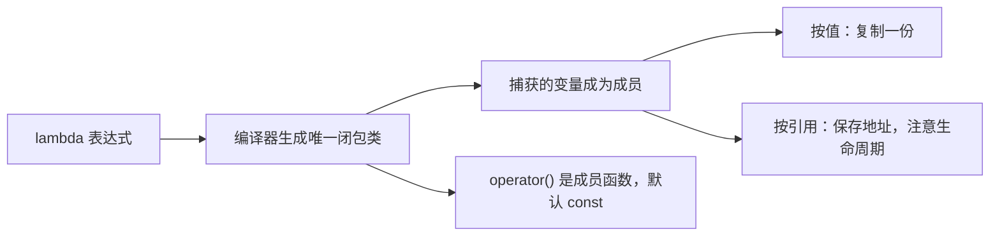

# lambda 到底是什么类型

← [[学习/学习导航/2026-10-30-学习导航|今日导航]] · [[八股测试/2026-10-30#GEN-LAMBDA-001|回到测试题]] · 代码：[[学习/2026-10-30/示例代码/01_lambda_function|01_lambda_function 阅读版]]

## 先把词说清楚

**lambda 表达式**：写一个“就地定义的可调用对象”的语法。

**闭包类型（closure type）**：编译器为每个 lambda 生成的唯一类类型，`operator()` 是它的成员函数。

**捕获（capture）**：把外部变量带进这个类，作为成员保存（按值）或保存引用。

**捕获列表**：`[=]` 默认按值、`[&]` 默认按引用、`[x]`、`[&x]`、`[this]`、`[*this]`（C++17）、初始化捕获 `[p = std::move(p)]`。

## 它解决什么问题

以前写回调要单独定义一个函数对象类，或者用 `std::bind` 拼参数。lambda 让“一小段逻辑 + 它需要的上下文”写在一起，读起来是连续的。

## 本质：一个匿名类

```cpp
int threshold = 10;
auto is_big = [threshold](int value) { return value > threshold; };
```

编译器大致生成：

```cpp
class __Lambda {
public:
    explicit __Lambda(int threshold) : threshold_(threshold) {}
    bool operator()(int value) const { return value > threshold_; }   // 默认 const
private:
    int threshold_;
};
```

所以：

- **有捕获就有状态**，lambda 对象的大小约等于捕获成员的大小；
- **没有捕获的 lambda** 可以隐式转换成函数指针；
- `operator()` 默认是 `const`，要在里面改按值捕获的变量得加 `mutable`。

## 三种捕获的差别

| 写法 | 含义 | 风险 |
| --- | --- | --- |
| `[=]` | 按值复制用到的变量 | 复制开销；对象大时贵 |
| `[&]` | 按引用保存 | 被引用对象销毁后悬垂 |
| `[x = std::move(x)]` | 初始化捕获，移动进闭包 | C++14 起支持，适合转移所有权 |

`[this]` 捕获的是指针，不是对象本身；对象销毁后调用就悬垂。C++17 的 `[*this]` 复制整个对象，适合异步场景。

## 图示



## 生命周期：最常见的事故

```cpp
std::function<void()> callback;
{
    int local = 42;
    callback = [&local] { std::cout << local; };   // 捕获引用
}                                                   // local 销毁
callback();                                         // 悬垂：未定义行为
```

修法：按值捕获，或用 `shared_ptr` 持有需要延长生命周期的数据。

## 边界与常见误解

**“lambda 是函数指针？”** 不是。无捕获的 lambda 可以转换，有捕获的不行。

**“`[=]` 捕获所有变量？”** 只捕获 lambda 体内用到的，且 `this` 在成员函数里仍按指针捕获。

**“lambda 里能改按值捕获的变量吗？”** 需要 `mutable`；但改的是闭包内副本，不影响外部。

**“lambda 的性能一定比函数指针差？”** 直接调用 lambda（不经过 `std::function`）通常能被内联，反而更快；经过类型擦除才有开销。

## 使用场景

- **STL 算法**：`std::sort(v.begin(), v.end(), [](auto& a, auto& b){...})`。
- **回调注册**：事件处理器、定时器。
- **异步任务**：把上下文按值或 `shared_ptr` 捕获，避免悬垂。

## 变式与口述总结

> lambda 是编译器生成的闭包类对象，捕获的变量变成它的成员，`operator()` 默认 const。按值捕获复制一份，按引用捕获保存地址、要注意生命周期；`[this]` 捕获的是指针。无捕获的 lambda 可以转成函数指针，有捕获的不行。直接调用 lambda 能被内联，经过 `std::function` 才有类型擦除的开销。

**变式：**

1. `[&]` 捕获的变量在 lambda 执行前被销毁，会怎样？
2. `mutable` 改变了什么？
3. 为什么无捕获的 lambda 能转函数指针？

## 来源

- 题型来源：[声网 Linux 流媒体 C++ 面经](https://www.nowcoder.com/feed/main/detail/38a87df1514f48b187cc7e2234656b73)（2023-12-20，候选人自述）记有 lambda 捕获方式、lambda 与 `std::function` 的区别。
- 标准依据：[N4659 expr.prim.lambda](https://timsong-cpp.github.io/cppwp/n4659/expr.prim.lambda)。
