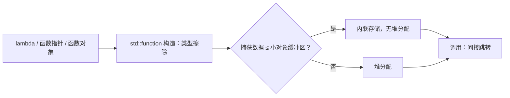

# std::function：为什么它能装下任何可调用对象

← [[学习/学习导航/2026-10-30-学习导航|今日导航]] · [[八股测试/2026-10-30#GEN-FUNCTION-001|回到测试题]] · 代码：[[学习/2026-10-30/示例代码/01_lambda_function|01_lambda_function 阅读版]]

## 先把词说清楚

**可调用对象（callable）**：能加括号调用的东西——函数、函数指针、lambda、`std::bind` 的结果、重载了 `operator()` 的类。

**类型擦除（type erasure）**：对外只暴露统一接口，内部隐藏具体类型，通常用虚函数或函数指针表实现。

**`std::function<Sig>`**：一个类型擦除的容器，能存放任何“签名兼容 `Sig`”的可调用对象。

## 它解决什么问题

模板参数要求编译期知道类型：

```cpp
template <typename Fn> void set_callback(Fn fn);   // 每个 lambda 都是不同类型
```

如果你要把回调存进成员变量、放进容器、跨模块传递，模板就不够用了（每个类型都要生成一份）。`std::function` 提供统一的运行时类型：

```cpp
std::function<void(int)> handler;   // 一个变量，能接收各种可调用对象
```

## 它怎么做到的

常见实现是一个“小对象 + 虚表指针”的结构：

```text
std::function<void(int)>
+---------------------+
| 调用器指针（虚表）    | → 指向真正的 lambda 类型
| 存储区（小对象优化）  | → 小 lambda 直接放这里
| 或 堆指针            | → 大 lambda 放堆上
+---------------------+
```

- 调用时通过函数指针/虚表间接跳到实际 `operator()`；
- 小对象（常见阈值 16 字节左右，取决于实现）直接存在内部缓冲区，避免堆分配；
- 超过阈值就堆分配。

`sizeof(std::function)` 是固定值，本机实测见代码输出；不要背，不同标准库不同。

## 代价

| 代价 | 原因 |
| --- | --- |
| 间接调用，通常无法内联 | 具体类型被擦除，编译器看不到 |
| 可能堆分配 | 捕获数据大于小对象缓冲区 |
| 复制成本 | 复制 `std::function` 要复制内部对象；捕获了 `unique_ptr` 就复制不了 |
| 空调用抛异常 | 空 `std::function` 调用抛 `std::bad_function_call` |

## 什么时候不该用

- **热路径**：每条消息都经过 `std::function` 间接调用，延迟和指令缓存都不友好。
- **编译期已知**：直接用模板参数或函数指针，编译器可内联。
- **需要移动语义**：C++17 的 `std::function` 要求可复制；只能移动的回调要用 `std::move_only_function`（C++23）或自定义封装。

## 图示



## 边界与常见误解

**“`std::function` 很慢？”** 一次间接调用 + 可能的分配；普通业务可忽略，纳秒级热路径要小心。

**“`sizeof(lambda)` 和 `sizeof(std::function)` 一样？”** 不一样。`std::function` 是固定大小的容器。

**“存 `unique_ptr` 的 lambda 能放进 `std::function` 吗？”** C++17 不行，`std::function` 要求可复制；要在 lambda 里用 `shared_ptr`，或换 `move_only_function`。

**“空 `std::function` 调用会崩？”** 抛 `std::bad_function_call`，不是段错误；调用前应判空。

## 使用场景

- **事件总线**：`unordered_map<EventType, vector<std::function<void(const Event&)>>>`。
- **插件接口**：模块间传递回调，不需要共享头文件里的模板。
- **延迟队列**：存任务闭包，稍后执行。

## 变式与口述总结

> `std::function` 是类型擦除的可调用对象容器，内部用函数指针或虚表转发调用，小对象存在内部缓冲区，大的堆分配。代价是一次间接调用、可能分配、不可内联，C++17 还要求可复制。热路径用模板或函数指针，需要存储和跨模块传递时才用它。

**变式：**

1. 为什么 `std::function` 通常无法内联？
2. 捕获了大对象的 lambda 放进 `std::function` 会发生什么？
3. 空 `std::function` 调用会怎样？

## 来源

- 题型来源：[声网 Linux 流媒体 C++ 面经](https://www.nowcoder.com/feed/main/detail/38a87df1514f48b187cc7e2234656b73)（2023-12-20）记有 lambda 与 `std::function` 的区别；[字节存储 C++ 实习面经](https://www.nowcoder.com/discuss/753649991486279680)（2025-05-18）搜索索引列有 `sizeof(std::function)` 追问（本次未加载全文）。
- 标准依据：[N4659 func.wrap.func](https://timsong-cpp.github.io/cppwp/n4659/func.wrap.func)。
