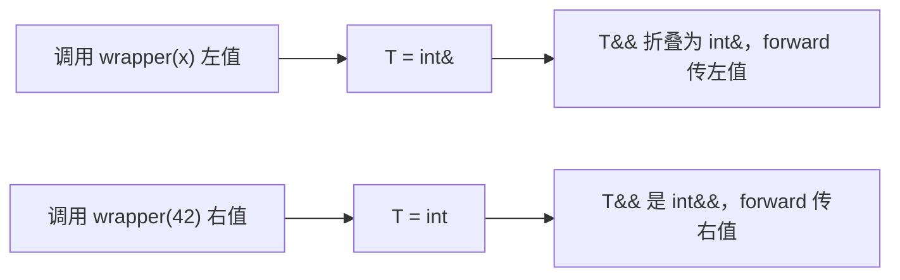

# 完美转发：让参数原样传下去

← [[学习/学习导航/2026-10-30-学习导航|今日导航]] · [[八股测试/2026-10-30#GEN-FORWARD-001|回到测试题]] · 代码：[[学习/2026-10-30/示例代码/03_forwarding|03_forwarding 阅读版]]

## 先把词说清楚

**左值 / 右值**：有名字、能取地址的是左值；临时对象、字面量是右值。

**转发引用（forwarding reference）**：形如 `T&&` 且 `T` 是模板参数、由调用处推导——它能接左值也能接右值。

**引用折叠（reference collapsing）**：类型里出现 `&` 与 `&&` 组合时，规则是“只要有一个 `&`，结果就是 `&`”。

**`std::forward<T>(arg)`**：按 `T` 记录的原类型转发——原来是什么值类别，转出去还是什么。

## 它解决什么问题

```cpp
template <typename T>
void wrapper(T&& value) {
    inner(value);            // 无论传进来是什么，value 本身都是左值
}
```

函数参数一旦有了名字，就是左值。直接传给下一层，右值会退化成左值拷贝，移动语义失效。`std::forward` 就是用来保留“它本来是不是右值”的信息。

## 引用折叠规则

| 外层 | 内层 | 结果 |
| --- | --- | --- |
| `T&` | `&` | `&` |
| `T&` | `&&` | `&` |
| `T&&` | `&` | `&` |
| `T&&` | `&&` | `&&` |

推导规则：

- 传左值 `int x` → `T` 推成 `int&`，`T&&` 折叠成 `int&`；
- 传右值 `42` → `T` 推成 `int`，`T&&` 就是 `int&&`。

## 一个工厂

```cpp
template <typename T, typename... Args>
std::unique_ptr<T> make(Args&&... args) {
    return std::unique_ptr<T>(new T(std::forward<Args>(args)...));
}
```

- `Args&&...` 每个参数都能接左值或右值；
- `std::forward<Args>(args)...` 把每个参数按原值类别转给构造函数；
- 效果：`make<Order>(1, "abc")` 与 `make<Order>(std::move(other))` 都只做该做的构造/移动。

`std::make_unique`、`vector::emplace_back` 都是这个模式。

## 图示



## 三个坑

**1. 同一个参数只能 forward 一次**

`std::forward` 可能把对象移走；之后再 forward 或读取同一参数，得到的是“被移走”的状态。

**2. 万能引用会抢重载**

```cpp
template <typename T> void log(T&& value);   // 几乎什么都能匹配
void log(int value);                         // 传 int 左值时，模板更匹配
```

需要时用 `std::enable_if` / concepts 或重载顺序来约束。

**3. 花括号初始化无法推导**

`wrapper({1, 2, 3})` 无法推导 `T`，要用 `std::initializer_list` 重载或显式指定类型。

## 边界与常见误解

**“`T&&` 都是万能引用？”** 只有“模板参数 + 参与推导”才是。`void f(int&& x)` 是普通右值引用，只接右值。

**“`std::move` 和 `std::forward` 一样？”** `move` 无条件转成右值；`forward` 按记录的 `T` 有条件转发。

**“构造函数里用万能引用会导致拷贝构造被抢？”** 会。经典坑：模板构造函数比拷贝构造函数更匹配非 const 左值，需要 `enable_if` 排除自身类型。

## 使用场景

- **工厂 / emplace**：把参数原样传给目标构造函数。
- **包装器**：日志、计时、重试包装，不改变被包装函数的语义。
- **泛型库**：`std::make_shared`、`std::optional::emplace` 等。

## 变式与口述总结

> 转发引用是模板里的 `T&&`，能接左值也能接右值；引用折叠让 `T&&` 在传左值时变成 `T&`。`std::forward<T>` 按推导出的 `T` 把参数原值类别传给下一层，从而让移动语义在包装层不丢失。注意一个参数只能 forward 一次，万能引用还会抢重载。

**变式：**

1. 传左值给 `T&&`，`T` 推成什么？
2. 为什么 `std::move` 之后不能再 forward 同一个参数？
3. 模板构造函数为什么会抢拷贝构造？

## 来源

- 题型来源：[快手游戏服务端一面](https://www.nowcoder.com/discuss/620359211850977280)（2024-05-15）记有模板函数、完美转发；[快手 C++ 开发一面](https://www.nowcoder.com/feed/main/detail/1a21d6c707fc428e929a03cf1dfeebfe)（页面 04-24，面试日期 2026-04-21）记有“完美转发如何实现”。
- 标准依据：[N4659 temp.deduct.call](https://timsong-cpp.github.io/cppwp/n4659/temp.deduct.call)、[forward](https://timsong-cpp.github.io/cppwp/n4659/forward)。
