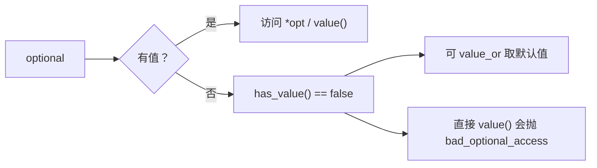

# optional：把“没有值”写进类型里

← [[学习/学习导航/2026-10-30-学习导航|今日导航]] · [[八股测试/2026-10-30#GEN-OPTIONAL-001|回到测试题]] · 代码：[[学习/2026-10-30/示例代码/02_optional_variant|02_optional_variant 阅读版]]

## 先把词说清楚

**`std::optional<T>`**：要么存着一个 `T`，要么什么都没有；没有堆分配，值语义。

**空状态（disengaged）**：没有值。用 `has_value()` 判断，或直接 `if (opt)`。

**`value_or(default)`**：有值返回它，没有返回默认值。

## 它解决什么问题

“查不到”这件事以前靠约定表达：

```cpp
int find_price(OrderId id);       // 返回 -1 表示没找到？如果 -1 是合法价格呢？
```

或者用指针：

```cpp
const Price* find_price(OrderId id);   // nullptr 表示没有，但谁拥有它？会不会悬垂？
```

两种都不理想：魔法值污染值域，指针引入所有权与生命周期问题。`optional` 把“可能没有”变成类型的一部分，编译器和调用方都得处理。

## 三个 API 走一遍

```cpp
std::optional<double> lookup(OrderId id);

if (auto price = lookup(id)) {          // 隐式转 bool：有值
    use(*price);                        // operator* 不检查，空时是未定义行为
}

double p = lookup(id).value_or(0.0);    // 没有就用默认值
double q = lookup(id).value();          // 没有会抛 std::bad_optional_access
```

## 与指针、智能指针的区别

| 维度 | `const T*` | `std::unique_ptr<T>` | `std::optional<T>` |
| --- | --- | --- | --- |
| 表示“没有” | 空指针 | 空指针 | 空状态 |
| 内存 | 指向别处 | 堆分配 | 内联存储（无堆） |
| 所有权 | 不表达 | 表达 | 值语义，自己就是值 |
| 多态 | 可以 | 可以 | 不行（需要固定类型） |
| 大小 | 一个指针 | 一个指针 | `sizeof(T)` + 标志位 + 对齐 |

**怎么选**：只是“可能没有值”→ `optional`；需要堆上生命周期或运行时多态 → 智能指针；需要表示“失败原因” → 用 `expected`/`variant` 或返回错误码。

## 大小

`std::optional<T>` 通常比 `T` 大一个标志位，并按 `T` 的对齐补齐。例如本机 `optional<double>` 是 16 字节（8 字节值 + 1 字节标志 + 7 字节补齐），`optional<char>` 是 2 字节。具体看代码输出。

## 图示



## 边界与常见误解

**“`optional` 能存引用？”** 不能，`optional<T&>` 不合法；需要时用指针或 `reference_wrapper`。

**“`optional<bool>` 有两个状态？”** 三个：有 true、有 false、没有。别用 `false` 同时表示“没有”。

**“对空 optional 解引用会抛异常？”** `operator*` 不做检查，是未定义行为；会抛的是 `value()`。

**“optional 能代替异常或错误码？”** 它只表达“有没有”，不表达“为什么没有”。需要错误信息就用 `expected`（C++23）或自定义 `Result`。

## 使用场景

- **查找接口**：`optional<Order>` 表示可能查不到。
- **可选配置**：`optional<int> max_retries`，没配置就用默认行为。
- **解析结果**：`optional<double> parse_price(string_view)`，解析失败返回空。

## 变式与口述总结

> `optional<T>` 用类型表达“可能有值也可能没有”，没有堆分配、值语义。用 `has_value` 或 `if (opt)` 判断，`value_or` 给默认值，`value()` 在空时抛异常，`operator*` 不检查。它适合“查不到”，不适合表达错误原因，也不支持引用。

**变式：**

1. 什么场景该用 `optional`，什么场景该用 `unique_ptr`？
2. 为什么 `optional<bool>` 容易出 bug？
3. 对空 `optional` 解引用会怎样？

## 来源

- 题型来源：[影石 Insta360 C++ 一面](https://www.nowcoder.com/feed/main/detail/753bcacd2c7c45b0aa5ba80af8b7fe3c)（2025-07-15）搜索索引列有 optional 的使用场景与智能指针对比；[某量化公司实习一面](https://www.nowcoder.com/discuss/473626483991281664)（2023-09-13）索引在 C++ 问题列表里直接列出 optional。两帖全文本次未加载。
- 标准依据：[N4659 optional](https://timsong-cpp.github.io/cppwp/n4659/optional)。
