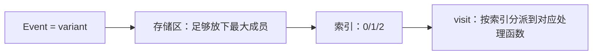

# variant：用值语义表达“几种之一”

← [[学习/学习导航/2026-10-30-学习导航|今日导航]] · [[八股测试/2026-10-30#GEN-VARIANT-001|回到测试题]] · 代码：[[学习/2026-10-30/示例代码/02_optional_variant|02_optional_variant 阅读版]]

## 先把词说清楚

**`std::variant<Ts...>`**：类型安全的联合体，任意时刻要么存第一个类型，要么第二个……要么第 n 个，且知道自己存的是哪个。

**`std::visit`**：对 variant 当前持有的值调用一个可调用对象，通常配合重载的 lambda。

**`holds_alternative<T>`**：判断当前是不是 `T`。

**`get<T>` / `get<index>`**：按类型或下标取值，类型不符抛 `std::bad_variant_access`。

## 它解决什么问题

线程间传消息时，一条消息可能是行情、成交、订单回报之一：

```cpp
struct Message {
    enum class Kind { Quote, Trade, Ack };
    Kind kind;
    Quote quote;     // 三个字段同时存在，浪费空间
    Trade trade;
    Ack ack;
};
```

用一个 `enum` + 多个字段，要么浪费内存，要么类型不安全（靠 `kind` 强制转换）。`variant` 让“同一时刻只有一个是有效的”由类型系统保证。

## 用法

```cpp
using Event = std::variant<QuoteEvent, TradeEvent, AckEvent>;

Event event = QuoteEvent{100.5, 200};

std::visit([](const auto& e) {
    using T = std::decay_t<decltype(e)>;
    if constexpr (std::is_same_v<T, QuoteEvent>) {
        handle_quote(e);
    } else if constexpr (std::is_same_v<T, TradeEvent>) {
        handle_trade(e);
    } else {
        handle_ack(e);
    }
}, event);
```

另一种常见写法是“重载集合”：

```cpp
template <class... Ts> struct overloaded : Ts... { using Ts::operator()...; };
template <class... Ts> overloaded(Ts...) -> overloaded<Ts...>;

std::visit(overloaded{
    [](const QuoteEvent& e) { handle_quote(e); },
    [](const TradeEvent& e) { handle_trade(e); },
    [](const AckEvent& e)   { handle_ack(e); }
}, event);
```

**优点**：漏处理某个类型会编译报错（没有匹配的重载）。

## 与继承多态的对比

| 维度 | 继承 + 虚函数 | `variant` |
| --- | --- | --- |
| 类型集合 | 开放（可随时新增子类） | 封闭（编译期确定） |
| 内存 | 堆分配 + 指针 | 内联存储（大小为最大成员） |
| 分派开销 | 虚调用 | 一次 switch/index 跳转，可内联 |
| 值语义 | 需要 clone | 天然可复制/移动 |
| 扩展性 | 加子类不改调用方 | 加类型要改所有 visit |

**量化场景**：消息类型固定、追求低延迟 → `variant` 更合适；插件式策略、类型会扩展 → 继承更合适。

## 大小与存储

`sizeof(std::variant<Ts...>)` 通常是“最大成员大小 + 索引 + 对齐”。例如 `variant<char, double>` 在本机是 16 字节。它不做堆分配，但会浪费一些空间。

`valueless_by_exception()`：如果某次赋值时构造新值抛异常，variant 可能进入“无值”状态；只有在这种极端情况下才需要检查。

## 图示



## 边界与常见误解

**“variant 可以存同类两次？”** 不行。`variant<int, int>` 第二个 `int` 永远选不到，应改用不同的包装类型。

**“get<T> 取错类型会返回空？”** 不会，抛 `std::bad_variant_access`。

**“variant 一定比继承快？”** 少了堆分配和虚调用，但 `visit` 的代码可能膨胀；极端热路径要实测。

**“variant 能存引用？”** 不能，需要 `std::reference_wrapper`。

## 使用场景

- **行情/交易事件**：固定几种消息类型，值语义传递。
- **解析结果**：`variant<Value, ParseError>`。
- **状态机**：每个状态是不同的数据结构。

## 变式与口述总结

> `variant` 是类型安全的联合体，同一时刻只持有一种类型，并记录当前索引。用 `visit` 分派，漏处理会编译报错；`get<T>` 类型不符会抛异常。它适合类型集合封闭、追求值语义与低开销的场景，比如行情事件；类型需要开放扩展时用继承多态。

**变式：**

1. `variant<A, B>` 与“基类指针 + 虚函数”各自适合什么场景？
2. `visit` 漏了一个类型会怎样？
3. `variant` 的大小由什么决定？

## 来源

- 题型来源：[某量化公司实习一面](https://www.nowcoder.com/discuss/473626483991281664)（2023-09-13）搜索索引在 C++ 问题清单中直接列出 variant；本次未加载全文。
- 标准依据：[N4659 variant](https://timsong-cpp.github.io/cppwp/n4659/variant)。
