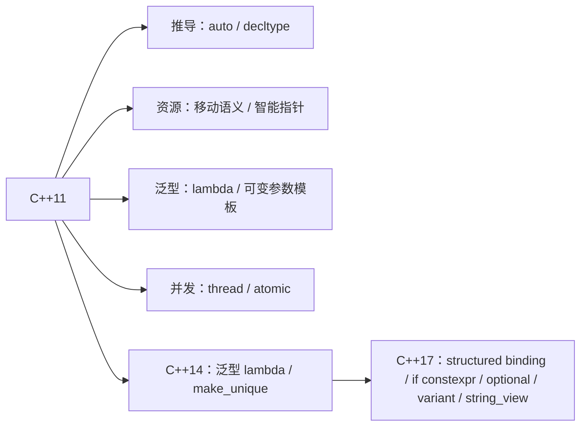

# “说说 C++11 新特性”怎么答得不空

← [[学习/学习导航/2026-10-30-学习导航|今日导航]] · [[八股测试/2026-10-30#CPP11-FEATURES-001|回到测试题]]

## 先把词说清楚

这道题不是背清单，而是展示“你知道哪些特性改变了写法、各自解决什么问题、有什么坑”。下面按四组组织，每组挑两三个能展开的。

## 第一组：类型推导与语法

**`auto`**：让编译器推导类型，减少冗长（迭代器、lambda 返回值）。坑：`auto` 会丢掉引用和顶层 `const`，`auto&`/`const auto&` 才是保留引用的写法。

**范围 `for`**：`for (const auto& item : container)`。坑：`for (auto item : container)` 是拷贝；要修改元素用 `auto&`。

**`nullptr`**：有独立类型 `std::nullptr_t`，避免 `0`/`NULL` 的重载歧义。

**`enum class`**：强类型枚举，不隐式转 int，作用域受限。

**统一初始化 `{}`**：避免窄化转换；坑：有 `initializer_list` 构造函数时优先匹配它。

## 第二组：对象与资源

**移动语义**：右值引用 + 移动构造/赋值，把资源“偷”过来，避免深拷贝。10-20 已详细讲过。

**智能指针**：`unique_ptr`、`shared_ptr`、`weak_ptr`，用所有权表达生命周期。

**`= default` / `= delete`**：显式要求或禁止编译器生成特殊成员函数。

**`override` / `final`**：让覆盖错误变成编译错误；`final` 还能帮编译器去虚化。

## 第三组：泛型与编译期

**lambda**：就地定义可调用对象（见 [[学习/2026-10-30/01-lambda的本质与捕获|lambda 专题]]）。

**`constexpr`**：编译期求值，把计算从运行期移到编译期。

**可变参数模板**：`template <typename... Args>`，实现 `make_unique`、`emplace_back` 这类转发工厂。

**类型别名 `using`**：比 `typedef` 可读，支持模板别名。

## 第四组：并发与标准库

**`std::thread` / `mutex` / `condition_variable` / `atomic`**：标准库层面的并发原语。

**`chrono`**：类型安全的时间与时长。

**无序容器、`tuple`、`regex`、`function`**：标准库扩充。

## C++14 与 C++17 的增量

| 版本 | 常用特性 |
| --- | --- |
| C++14 | 泛型 lambda（`auto` 参数）、函数返回类型推导、变量模板、`std::make_unique` |
| C++17 | 结构化绑定、`if constexpr`、`optional`/`variant`/`any`、`string_view`、`filesystem`、`inline` 变量、折叠表达式、`std::byte`、类模板实参推导（CTAD） |

面试里被追问“你实际用过哪些”，挑两三个讲清楚场景，比背二十个名字有效。

## 图示



## 三个真实坑

```cpp
std::vector<int> values;
for (auto value : values) { value *= 2; }        // 改的是副本

for (auto& value : values) { value *= 2; }       // 正确

auto it = values.begin();                        // it 是迭代器
auto&& alias = values[0];                        // 转发引用，绑定到左值
```

**结构化绑定（C++17）**：

```cpp
for (const auto& [key, value] : map_items) { ... }
```

注意：C++17 的结构化绑定变量**不能被 lambda 捕获**（C++20 起可以）。

## 边界与常见误解

**“auto 一定更好？”** 接口边界、需要明确类型时不要用；`auto` 也会让读者需要回看初始化表达式。

**“C++11 特性只能在新项目用？”** 老项目通常也开了 `-std=c++11` 以上；关键是团队约定与编译器支持。

**“特性越多越好？”** 不是。用能表达意图的最简单写法；`variant` 能替代继承，但也会让调用方必须处理所有分支。

## 使用场景

- **代码评审**：看到裸 `new`、看到 `NULL`、看到没有 `override` 的虚函数，都是可以升级的点。
- **迁移**：先开 `-std=c++17`，逐步用 `auto`、`unique_ptr`、`optional` 替换老写法。
- **面试**：挑“移动语义 + 智能指针 + lambda”三件套讲，足够撑起五分钟。

## 变式与口述总结

> C++11 的核心是四件事：类型推导（auto、decltype）、资源管理（移动语义、智能指针）、泛型与编译期（lambda、constexpr、可变参数模板）、并发（thread、atomic）。C++14 补了泛型 lambda 和 make_unique；C++17 补了结构化绑定、if constexpr、optional/variant/string_view。回答时讲清“解决什么问题、有什么坑”，比列清单有用。

**变式：**

1. `auto` 在什么情况下会丢掉引用？
2. 范围 `for` 里 `auto` 与 `auto&` 的区别？
3. `if constexpr` 与普通 `if` 的区别？

## 来源

- 题型来源：[京东 C++ 面经](https://www.iamshuaidi.com/31040.html) 一面原问“C++11 新特性”“右值引用”“智能指针”，二面追问“move 语义”。镜像页未标发布日期，本次访问 2026-10-30。
- 标准依据：各特性对应 N4659 条款，例如 [dcl.type.auto](https://timsong-cpp.github.io/cppwp/n4659/dcl.type.auto.deduct)、[stmt.ranged](https://timsong-cpp.github.io/cppwp/n4659/stmt.ranged)、[dcl.constexpr](https://timsong-cpp.github.io/cppwp/n4659/dcl.constexpr)。
