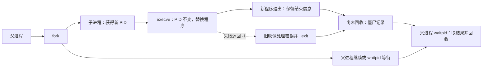

# 子进程、程序替换与退出回收

← [[学习/学习导航/2026-10-31-学习导航]] · [[八股测试/2026-10-31#OS-LIFECYCLE-001 · 子进程退出后为什么还要 wait|回到自测]]

本节新增目标：区分“创建进程”“替换程序”“程序已经结束”和“父进程回收结果”。[[学习/2026-10-24/01-进程与线程|10-24 的 fork 与内存隔离]]已经讲过 fork 返回值、写时复制和基础 waitpid；这些只作先修，本节不把旧内容换标题计为新题。

## 从启动一个外部工具说起

假设行情服务要调用一个独立校验程序。服务希望自己继续运行，另一个进程负责校验，结束后把成功或失败告诉服务。完整责任链是：

1. 创建执行者：`fork`。
2. 让它运行目标程序：`exec` 系列接口。
3. 执行者报告结束：正常退出或被信号终止。
4. 创建它的一方领取结果并完成回收：`wait` 系列接口。

少了第 2 步，子进程仍在运行原来的程序；少了错误分支，exec 失败后可能误入父进程业务；少了第 4 步，在通常的回收设置下可能留下僵尸进程。

## 名词与两个“结束”

| 名词 | 普通解释 | 准确含义 |
| --- | --- | --- |
| 进程 / PID | 一次正在运行或等待回收的程序实例及其编号 | 程序文件可以被多个进程运行；PID 标识实例 |
| 父进程 / 子进程 | 谁创建了谁 | fork 在父进程中返回子 PID，在子进程中返回 0 |
| 程序映像 | 当前进程正在运行的那套程序内容 | 包含代码、数据及运行时地址空间；exec 可以替换它 |
| 退出码 | 正常结束时交给父方的小整数结果 | 通过 wait 的宏读到低 8 位，不适合传大批业务数据 |
| 退出状态字 | 内核交给 wait 的编码结果 | 不只是退出码，还要区分正常退出或信号终止 |
| 回收（reap） | 领取退出信息并让内核去掉剩余记录 | 不是让仍在执行的子进程“强行停止” |
| 僵尸进程 | 已结束，但退出记录还没被领取的子进程 | 通常只保留 PID、退出状态、资源统计等必要记录，已不执行用户代码 |
| 孤儿进程 | 原父进程先退出，子进程的父子关系需重新安排 | 可以仍在正常运行；“孤儿”不是一种 CPU 调度状态 |

**进程退出与记录回收是两件事。** 子进程退出时，其用户地址空间等主体资源已经释放；为让父进程知道它怎么结束，内核暂留退出信息。不能说“僵尸还占着退出前的全部内存”，也不能说“僵尸完全不占资源”。很多僵尸长期积累会占据进程表记录。[wait(2) NOTES](https://man7.org/linux/man-pages/man2/waitpid.2.html#NOTES)

## fork、exec、wait 分别改变了什么

### 1. fork：多出一个进程实例

父子都有后续执行路径，谁先运行不能靠源码先后推断。默认普通内存逻辑上隔离；Linux 用写时复制减少立即复制的成本。写时复制是旧课先修：父子刚开始可以共享物理页，写入时再建立独立副本。[fork(2)](https://man7.org/linux/man-pages/man2/fork.2.html)

### 2. exec：原有进程改为运行另一个程序

`execve(path, argv, envp)` 把当前程序替换为目标程序，**PID 保持不变**。成功时不会返回到下一行旧代码，而是开始新程序的执行；普通失败返回 -1 并设置 `errno`，此时调用者需要明确处理失败。

`argv` 是字符串指针数组，最后一个元素为 `nullptr`，表示参数列表结束；它不同于每个字符串自己的 `'\0'`。`envp` 同样是一组以空指针结尾的环境变量字符串指针。本例传空环境，避免引入与教学目标无关的环境依赖。[execve(2)](https://man7.org/linux/man-pages/man2/execve.2.html)、[credentials(7)](https://man7.org/linux/man-pages/man7/credentials.7.html)

### 3. wait：取得结束原因并回收

`waitpid(child, &status, 0)` 等指定的子进程终止。子进程早已结束则通常立即得到结果；尚未结束则调用线程阻塞。成功返回子 PID 后，先用 `WIFEXITED(status)` 判断是否正常退出，只有为真才能读 `WEXITSTATUS(status)`；若是信号终止，用 `WIFSIGNALED` 和 `WTERMSIG`。

等待被信号打断、返回 -1 且 `errno == EINTR` 时，孩子的回收责任并未消失，应按程序策略重新等待。`wait(&status)` 等价于 `waitpid(-1, &status, 0)`，可等待任意子进程；明确指定 PID 则便于把结果交给对应任务。[wait(2)](https://man7.org/linux/man-pages/man2/waitpid.2.html)、[PR_SET_CHILD_SUBREAPER](https://man7.org/linux/man-pages/man2/PR_SET_CHILD_SUBREAPER.2const.html)



如果父进程已经在等待，退出和回收可以紧接着发生，不必有一个容易被 `ps` 观察到的长期 Z 状态。图中的僵尸阶段以默认的子进程回收设置为前提。

## 孤儿与僵尸不能互相替代

若父进程先退出，子进程会被重新收养：Linux 中可以由最近的、设置过子进程收养职责的祖先进程（subreaper）接管，否则由所在 PID 命名空间的 init 接管。收养关系变化后，子进程可以继续执行；之后仍要由合适的父方处理退出回收。不要把它简化成“永远由宿主机上的 systemd PID 1 接管”。[_exit(2)](https://man7.org/linux/man-pages/man2/_exit.2.html)、[wait(2)](https://man7.org/linux/man-pages/man2/waitpid.2.html)、[PR_SET_CHILD_SUBREAPER](https://man7.org/linux/man-pages/man2/PR_SET_CHILD_SUBREAPER.2const.html)

| 对比 | 僵尸 | 孤儿 |
| --- | --- | --- |
| 子进程是否已退出 | 是 | 不要求已退出，常见情况是仍运行 |
| 核心问题 | 结束记录还没回收 | 原父进程已退出，父子关系改变 |
| 是否继续执行用户代码 | 否 | 可以 |
| 应如何处理 | 修正父进程的 wait 回收逻辑 | 由收养者承担后续管理和回收 |
| 对它发 kill -9 | 不能让一条已结束记录再次退出 | 对仍活着的进程是信号终止问题，且终止后仍有回收责任 |

“杀父进程让 init 接管”可能终止重要服务，应当先修正父方的回收逻辑。教材中的孤儿示例常故意让父进程提前退出；本示例不这样做，避免留下外部进程供读者手工清理。

## 完整示例：同一个 PID 运行新映像，父进程负责回收

阅读版：[[学习/2026-10-31/示例代码/02_process_lifecycle|02_process_lifecycle.md]]；源码：[02_process_lifecycle.cpp](示例代码/02_process_lifecycle.cpp)。

```cpp
// Linux + C++17 教学示例：fork 创建子进程，execve 替换程序，waitpid 回收结果。
// 前置：fork 返回值见 2026-10-24；本例新增程序替换、退出状态与回收责任。
// 运行条件：Linux 已挂载 /proc，允许执行 /proc/self/exe；以单线程方式运行。
// 步骤：成功 exec 自身并返回 42；再演示 exec 失败，以约定的 127 退出。
// 每轮只创建一个子进程，并在开始下一轮前回收；没有 sleep、后台任务或文件写入。
#include <cerrno>   // errno、EINTR、ENOENT、ECHILD：分辨中断和真正错误。
#include <cstddef>  // std::size_t：记录错误提示已经输出的字节数。
#include <cstdio>   // printf、fflush、perror：父进程与 exec 后的新程序输出。
#include <cstring>  // strcmp：识别 --child，防止 exec 后再次创建子进程。
#include <sys/types.h> // pid_t：进程编号类型。
#include <sys/wait.h>  // waitpid 和 WIFEXITED/WEXITSTATUS/WIFSIGNALED 等状态宏。
#include <unistd.h>    // fork、execve、getpid、write、_exit。

bool run_child(const char* executable, int expected_exit) {
    // execve 的 argv 是以空指针结束的“字符串指针数组”。
    // 先准备可修改字符数组，匹配 API 的 char* 类型，不强转字符串字面量。
    char name[] = "process_lifecycle";
    char mode[] = "--child";
    char* arguments[] = {name, mode, nullptr};
    char* environment[] = {nullptr}; // 教学程序不依赖环境变量，传空环境。

    // 先冲刷已有 stdio 缓冲，避免 fork 复制未输出文本后父子重复冲刷。
    if (std::fflush(nullptr) != 0) {
        std::perror("fflush before fork");
        return false; // 此时尚未创建子进程，不存在回收义务。
    }
    const pid_t child = ::fork();
    if (child == -1) {
        std::perror("fork");
        return false;
    }
    if (child == 0) {
        // 此分支只由子进程执行。成功后从新程序入口开始，绝不会执行下一行。
        ::execve(executable, arguments, environment);

        // 走到这里说明 execve 失败，原程序映像还在，errno 说明失败原因。
        const int exec_error = errno;
        const char message[] = "child: execve failed; exiting without continuing parent logic\n";
        // fork 后仅做简单系统接口调用；错误提示失败也不能阻止子进程退出。
        std::size_t offset = 0;
        while (offset < sizeof(message) - 1) {
            const ssize_t n = ::write(STDERR_FILENO, message + offset,
                                      sizeof(message) - 1 - offset);
            if (n > 0) {
                offset += static_cast<std::size_t>(n);
            } else if (n == -1 && errno == EINTR) {
                continue;
            } else {
                break;
            }
        }
        // 127/126 是本例选择的报告约定，不是 execve 自动生成的退出码。
        // _exit 不冲刷复制来的 stdio 缓冲，也不回到父进程那段业务逻辑。
        ::_exit(exec_error == ENOENT ? 127 : 126);
    }

    // 父进程只等待刚创建的这一个子进程；&status 是把结果写入的位置。
    int status = 0; // 编码后的状态字，不能直接把它当成子进程返回值。
    pid_t waited;
    do {
        waited = ::waitpid(child, &status, 0);
    } while (waited == -1 && errno == EINTR); // 信号打断等待后，回收义务仍在。
    if (waited == -1) {
        std::perror("waitpid");
        return false;
    }

    // waitpid 成功返回后，本子进程已被回收；先判断退出类别，再解码。
    if (!WIFEXITED(status)) {
        if (WIFSIGNALED(status)) {
            std::fprintf(stderr, "child terminated by signal %d\n", WTERMSIG(status));
        }
        return false;
    }
    const int exit_code = WEXITSTATUS(status);
    std::printf("parent reaped pid=%ld, exit=%d\n", static_cast<long>(child), exit_code);
    if (exit_code != expected_exit) {
        return false;
    }

    // 再等待同一已回收子进程应得到 ECHILD，证明“读取结果”和“回收”已完成。
    errno = 0;
    const pid_t again = ::waitpid(child, &status, WNOHANG);
    if (again != -1 || errno != ECHILD) {
        std::fprintf(stderr, "unexpected second waitpid result\n");
        return false;
    }
    std::puts("second waitpid: ECHILD (already reaped)");
    return true;
}

int main(int argc, char* argv[]) {
    if (argc == 2 && std::strcmp(argv[1], "--child") == 0) {
        // 这是 exec 成功后的新程序，PID 沿用 fork 子进程的 PID。
        std::printf("exec child pid=%ld, returning 42\n", static_cast<long>(::getpid()));
        return 42; // 正常从 main 返回，父进程通过 WEXITSTATUS 取得 42。
    }
    if (!run_child("/proc/self/exe", 42)) {
        return 1;
    }
    // 空路径在 Linux 上不能指向可执行文件：明确演示 ENOENT 失败分支。
    if (!run_child("", 127)) {
        return 1;
    }
    return 0; // 两个子进程都已经回收，没有特意留下僵尸或孤儿。
}
```

## 逐段追踪源码

**参数准备。** `name`、`mode` 是父进程中的可修改字符数组，`arguments` 里的元素是指向它们的指针。fork 后子进程有对应的地址空间；execve 在成功替换映像前消费这些参数。空指针只是数组的结束标记，不能漏写。

**创建前清空输出缓冲。** `fflush(nullptr)` 冲刷当前进程的所有 stdio 输出流。由于缓冲也属于用户内存，未冲刷的文本可能随 fork 复制；父子之后都冲刷它会产生重复输出。这一步不是“刷新磁盘保证持久化”。

**子进程的成功分支。** Linux 的 `/proc/self/exe` 指向当前正在运行的可执行文件。子进程 exec 自己的新映像，带上 `--child` 参数；新程序从入口运行后，`main` 识别参数，打印自己的 PID，再正常返回 42。父进程输出的子 PID 应与这一次新映像打印的 PID 相同，说明 exec 没有再创建第三个进程。

**子进程的失败分支。** 第二轮给 execve 空路径，调用返回失败，子进程保存 `errno`、尽力写出短诊断、使用 `_exit` 退出。`_exit` 不执行 `atexit` 回调，也不冲刷复制来的 stdio 缓冲；它不会像 C++ 栈展开那样依次执行局部对象的析构。这里 127 表示找不到目标，是本例约定，不是内核替程序自动决定的退出码。[_exit(2)](https://man7.org/linux/man-pages/man2/_exit.2.html)

**父进程的等待循环。** `&status` 表示传入状态变量的地址，让接口把结果写进它。`EINTR` 只表示此次等待被打断；其他错误报告出来。当前示例没有其它回收者、没有忽略 SIGCHLD、参数固定有效，所以成功路径不会丢失回收责任。

**解码而非猜数字。** 父进程读到的 `status` 不是 42 或 127 本身。先看退出类型，再用宏取出退出码，才能区分“主动返回”与“收到致命信号”。最后再次等待同一已回收子进程，得到 `ECHILD`，验证退出结果不能重复领取。

## 编译与观察

在 Linux 的示例代码目录中执行：

```bash
g++ -std=c++17 -Wall -Wextra -Wpedantic 02_process_lifecycle.cpp -o /tmp/02_process_lifecycle
/tmp/02_process_lifecycle
```

成功路径的预期信息：

- 第一轮，新映像打印自己的 PID，父进程随后报告回收同一 PID，退出码为 42。
- 第二轮，子进程打印 exec 失败提示，父进程报告退出码 127。
- 两轮都出现 `second waitpid: ECHILD`；主程序最终返回 0。
- PID 数字不固定。标准输出与标准错误是不同流，显示或重定向后的相对顺序不作为判断条件。

这是**按接口推导的预期行为**，实际验证见 [[学习/2026-10-31/示例验证]]。示例没有睡眠或持续任务；正常 Linux 环境中应很快结束。若 /proc 不可用、禁止执行该路径或系统资源不足，会报告失败，不能把环境错误当成已验证成功。

## 边界、追问与场景

**WNOHANG 的 0 是什么？** 它表示当前有匹配子进程，但暂时没有可返回的终止状态，不是“子进程退出码为 0”，也不是已经回收。代码中的第二次等待面对的是已回收子进程，因此预期 -1 / ECHILD。[wait(2)](https://man7.org/linux/man-pages/man2/waitpid.2.html)、[PR_SET_CHILD_SUBREAPER](https://man7.org/linux/man-pages/man2/PR_SET_CHILD_SUBREAPER.2const.html)

**所有结束的子进程都会留下僵尸吗？** 不绝对。显式把 `SIGCHLD` 设为 `SIG_IGN`，或使用 `SA_NOCLDWAIT` 等设置，会改变回收行为，通常不能再通过 wait 取得正常退出结果。默认处置显示为“忽略”与显式设置 `SIG_IGN` 在这个问题上不能混为一谈。需要退出码的任务管理器应保留明确的回收流程。[wait(2) NOTES](https://man7.org/linux/man-pages/man2/waitpid.2.html#NOTES)

**多线程程序能直接照抄吗？** 本例是单线程。多线程进程 fork 后，子进程只有调用 fork 的那个线程，却继承了其他线程可能持有的锁状态。exec 成功之前只能安全使用异步信号安全的接口集合；不要随意调用可能分配内存或加内部锁的复杂 C++ 代码。源码的 fork 后子分支只用 execve、write、_exit 一类简单接口；其使用边界由 [fork(2)](https://man7.org/linux/man-pages/man2/fork.2.html) 说明。

**看到退出码 127，就能确定 exec 失败吗？** 在本例受控逻辑中可以用来验证预期，但通用进程管理器不能这样推断：目标程序也可能自行返回 127。若必须区分“启动失败”和“目标程序正常运行后失败”，应设计独立的启动错误报告协议，例如专用管道；这只是本库工程扩展，本页不展开管道实现。

**适用场景。** 外部数据校验、压缩、批处理任务和进程监督器需要完整的启动／回收协议。高频行情热路径一般不适合每条消息都 fork 一个进程，但是否拆进程首先取决于故障隔离、资源管理和部署边界，再测量开销。

## 约 60 秒口述

fork 创建子进程，父子从返回点继续；exec 替换当前进程运行的程序，PID 不变，成功不返回。子进程结束后通常留下少量退出记录，父进程通过 wait 或 waitpid 获取结束原因并回收；长期不回收就可能积累僵尸。孤儿是原父进程先结束后被重新收养的进程，它可能还在运行，与僵尸不同。实现时要处理 fork 和 exec 失败，对 waitpid 的 EINTR 正确重试，先用 WIFEXITED 判断退出类别，再读取 WEXITSTATUS；不能把状态字直接当成退出码。

## 原帖实际考点与本库扩展

本次访问日期：**2026-10-31**。作者自述只作为选题依据，技术判断另以 Linux man-pages 为准。

| 原帖与作者 | 岗位、日期与访问状态 | 原帖能核对到的考点 |
| --- | --- | --- |
| [《C++后台腾讯WXG实习面经（已拿offer）》— 叫小丁不叫小丁丁](https://www.nowcoder.com/discuss/353154352829374464) | 腾讯 WXG，C/C++ 后台开发（Linux）；文内面试日 2018-04-16；页面显示 2019-09-24 09:39，标“已编辑”，不能当成首次发布日期；全文可读 | 一面前 3 项询问 fork 流程、fork/vfork/clone 区别、僵尸进程及避免方式 |
| [《记录21届校招211渣硕秋招的辛酸历程，附上面经》— 记忆的林荫路](https://www.nowcoder.com/discuss/353157399269810176) | C++ 求职个人复盘，奇虎 360 一面；页面 2020-12-05 21:11，已编辑；面试日为文内 12-02；全文可读 | 子进程创建、fork 返回值、僵尸如何处理、wait 与 waitpid 区别 |

**本库扩展：** 本题用程序替换、孤儿收养、状态字解码、EINTR 和 exec 失败路径补全“创建—运行—结束—回收”链路；完整 C++17 程序及 42/127 数据由本库设计。原帖包含候选人当时不完整或可能错误的答案，本页不沿用其中关于资源复制、SIGCHLD/SIGCLD 或收养者的未经核实表述。
