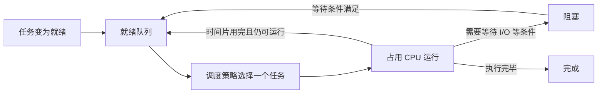

# CPU 调度：先看目标，再选谁运行

入口：[[学习/学习导航/2026-10-31-学习导航|当天导航]] · [[八股测试/2026-10-31#OS-SCHED-001 · CPU 调度策略怎样取舍|返回自测]] · [[学习/2026-10-31/示例代码/05_scheduler|源码阅读版]]

今天新增的是**比较调度策略，并把首次响应、完成时间和等待时间算清楚**。10 月 24 日的[[学习/2026-10-24/01-进程与线程|进程与线程]]是先修；今天不会把“线程共享哪些资源”重复算成新题。

## 1 原帖到底问了什么

主来源：[offers快到怀里来《游戏客户端开发秋招面经》](https://ac.nowcoder.com/discuss/703198)，牛客，发布于 **2021-08-10 22:51**，本次访问 **2026-10-31**，**全文可读**。岗位为游戏客户端开发，字节游戏客户端技术中台的“字节二面”第 5 项记录进程调度算法，并以问号注明对多队列优先级的回忆。不能据此断言面试官指定了下面的 RR 数据。

交叉来源：[I-U《C++面经合集》](https://ac.nowcoder.com/discuss/334298)，作者自述汇总个人 C++ 开发秋招经历，页面标记 **2019-11-04 14:49 编辑**，未把编辑时间冒充首发时间；2026-10-31 **全文可读**。网易互娱一面第 15–16 项问抢占/非抢占及 sleep 后的调度，Shopee 第 11 项问调度算法。两名候选人的自述支持考点确实出现过，不能证明现在的题库或出现频率。

**本库扩展**：FCFS/SJF/RR 对照、固定 A/B/C 数据、指标计算、饥饿反例、C++ 模拟器和 Linux 版本边界。技术依据单独见各节。

## 2 CPU 为什么要“挑下一位”

假设只有一个 CPU 执行位置，却有三件工作都想计算。它们不能在同一个瞬间都占用这个位置。调度策略要回答：**在当前有资格运行的任务里，接下来轮到谁、运行多久？**

这里的“任务”是便于讲解的统一名字。Linux 的 CPU 调度落实到可运行线程，不能把一个多线程进程理解为只有一个调度位置。[Linux sched(7)：Scheduling policies](https://man7.org/linux/man-pages/man7/sched.7.html)

| 词 | 普通解释 | 这里的准确含义 |
| --- | --- | --- |
| 就绪 | 活能干，正在排队 | 除 CPU 外，继续执行所需的条件已满足 |
| 运行 | 轮到自己实际干活 | 正在使用 CPU |
| 阻塞 | 先等别的条件 | 例如等 I/O 或同步条件，不能仅靠分到 CPU 就继续 |
| CPU burst | 一段连续计算量 | 示例把每个任务简化为一整段已知 CPU 需求 |
| 抢占 | 没做完也能被请下来 | 系统在适当时机收回 CPU，让另一就绪任务运行 |
| 非抢占 | 不强制打断当前这一段 | 通常等任务阻塞、退出或主动让出后再换人 |
| 时间片 quantum | 这一次最多干多久 | 到期而未完成时，RR 把任务放回队尾 |
| 上下文切换 | 保存现场再恢复别人的现场 | 是执行切换的机制；调度策略决定选择谁，两者不是同一个问题 |

`sleep` 期间线程通常不可运行；时间到只表示可以重新竞争 CPU，不承诺精确在某一纳秒开始执行。本篇模拟里**没有 sleep、没有真实线程**，每个整数都是我们主动推进的模拟时刻。



## 3 先选评价指标，再谈“哪个更好”

设到达时刻为 `arrival`，首次拿到 CPU 的时刻为 `first`，完成时刻为 `finish`。

- **响应时间**：`first - arrival`。本篇采用调度教材定义，问“等多久才第一次轮到我”，不是业务请求得到完整返回的端到端延迟。
- **周转时间**：`finish - arrival`。问“从进入系统到全部做完用了多久”。
- **等待时间**：在就绪队列里排队的累计时间。只有本文“无 I/O、无其他停顿”的模型中，才直接等于 `周转时间 - CPU 需求`。
- **吞吐量**：单位时间完成多少任务；**公平性**：某个任务能否长期得不到相应份额。两者都不能仅靠第一响应时间推出。

这些基础指标和 FCFS/SJF/RR 的教学假设见 [OSTEP 第 7 章：Scheduling: Introduction，§7.1–7.7](https://pages.cs.wisc.edu/~remzi/OSTEP/cpu-sched.pdf)。下面的三任务数据和推演是本库自行设计。

| 策略 | 下一位怎么选 | 主要用途或直觉 | 必须说出的边界 |
| --- | --- | --- | --- |
| FCFS，先来先服务 | 按进入队列顺序 | 规则简单，适合先理解排队 | 长任务在前会让后面的短任务等待；本文是非抢占模型 |
| SJF，短作业优先 | 从已就绪任务选需求最短的 | 在全部同时到达、长度已知等前提下减小平均周转 | 系统一般不知道准确的未来计算量；持续有短任务时长任务可能饥饿 |
| RR，时间片轮转 | 队头执行最多一片，未完回队尾 | 给同级任务轮流得到执行的机会 | 时间片小会更频繁切换；不保证平均周转最好 |
| 优先级调度 | 优先级高者先运行 | 表达某类工作更紧急或更重要 | 持续有高优先级任务时低优先级可能饥饿；“优先级”不等于截止时间保证 |

**饥饿**就是有任务一直符合运行条件，却长期轮不到资源。例如每当低优先级日志任务准备运行，总有新高优先级任务到来。提高等待者优先级的“老化”或周期性优先级提升可缓解这类问题；具体保证取决于规则和工作负载。多级反馈队列 MLFQ 按运行行为调整队列，用历史行为估计短任务与交互需求，且需要防止低层饥饿。这里解释它在解决什么问题，不把所有 MLFQ 参数再拆成新题。[OSTEP 第 8 章：MLFQ，§8.1–8.3](https://pages.cs.wisc.edu/~remzi/OSTEP/cpu-sched-mlfq.pdf)

## 4 手算一次：A=5，B=3，C=1

约定：单 CPU；全部在时刻 0 到达；同到达顺序为 A、B、C；全是计算；不计切换成本；RR 的时间片为 2。数字单位只叫“时间单位”，不是对某台机器的毫秒测量。

| 步骤 | RR 运行区间 | 这一片结束后的剩余 A/B/C | 接下来就绪顺序 |
| --- | --- | --- | --- |
| 1 | A `[0,2)` | 3 / 3 / 1 | B、C、A |
| 2 | B `[2,4)` | 3 / 1 / 1 | C、A、B |
| 3 | C `[4,5)` | 3 / 1 / 0 | A、B |
| 4 | A `[5,7)` | 1 / 1 / 0 | B、A |
| 5 | B `[7,8)` | 1 / 0 / 0 | A |
| 6 | A `[8,9)` | 0 / 0 / 0 | 空 |

`[4,5)` 表示从 4 开始，到 5 之前都由 C 使用，区间长度为 1。C 不必“把剩下一个时间片浪费完”。

| 任务 | 首次运行 | 完成 | 响应 | 周转 | 等待 |
| --- | --- | --- | --- | --- | --- |
| A | 0 | 9 | 0 | 9 | 4 |
| B | 2 | 8 | 2 | 8 | 5 |
| C | 4 | 5 | 4 | 5 | 4 |

A 的等待不是 `首次运行 - 到达 = 0`。它后来还在队列里等过：`[2,5)` 和 `[7,8)`，总共 4 个单位。**响应只看第一次，等待要累计所有排队。**

用相同数据比较：

| 策略 | 时间线 | 平均响应 | 平均周转 |
| --- | --- | --- | --- |
| FCFS | A 0–5，B 5–8，C 8–9 | 13/3 | 22/3 |
| SJF | C 0–1，B 1–4，A 4–9 | 5/3 | 14/3 |
| RR，q=2 | 上表的六片 | 2 | 22/3 |

这个例子直接说明：**RR 不保证比任何策略的平均响应都好**。它相对本例 FCFS 提前了 B/C 的首次执行，但 SJF 在这一组已知长度上平均响应还更低。比较时必须说明任务集合、指标和假设，不能只背“RR 最好”。

## 5 完整注释源码与分段阅读

文件：[[学习/2026-10-31/示例代码/05_scheduler|Markdown 阅读版]] · [[学习/2026-10-31/示例代码/05_scheduler.cpp|可编译源码]]。基线 C++17，保存源码与下方代码块逐字一致。

```cpp
// 用途：用整数时钟模拟 RR（时间片轮转），看“首次运行”和“完成”怎样不同。
// 先修：vector 保存对象；deque 在两端入队/出队；const & 表示只读借用。
// 模型：单 CPU，任务全在时刻 0 到达，只计算 CPU 时间，不含 I/O 或切换成本。
// 本程序没有创建线程、没有设置 OS 调度策略，不是实际 Linux 调度器。
// 步骤：建立就绪队列 -> 每次取队头运行一片 -> 未完成者回到队尾 -> 输出指标。
// 观察：A/B/C 的首次运行是 0/2/4，完成时刻却是 9/8/5。

#include <algorithm>  // std::min：本次最多运行一个时间片，也不能超过剩余量。
#include <cassert>    // assert：教学核对；编译时不要定义 NDEBUG，否则断言会关闭。
#include <cstddef>    // std::size_t：容器下标的无符号整数类型。
#include <cstdint>    // std::int64_t：用较宽整数记录累计模拟时刻。
#include <deque>      // std::deque：保存“下一位轮到谁”的下标队列。
#include <iostream>   // std::cout：输出模拟时间线，并非真实运行耗时。
#include <stdexcept>  // std::invalid_argument：拒绝不合法的教学输入。
#include <vector>     // std::vector<T>：尖括号中的 T 指容器保存的元素类型。

struct Job {
    char name;   // 仅供显示的任务名；调度时用下标区分任务。
    int burst;   // 总共需要多少单位 CPU 时间，必须大于 0。
};

struct Slice {
    std::size_t task;       // 本片属于 jobs 中的哪个任务。
    std::int64_t begin;     // 半开时间区间 [begin, end) 的开始。
    std::int64_t end;       // 到达 end 时，这一片已经运行完毕。
};

struct Result {
    std::vector<std::int64_t> first;   // -1 表示这个任务还从未运行。
    std::vector<std::int64_t> finish;  // -1 表示这个任务尚未完成。
    std::vector<Slice> timeline;       // 依次保存每一片，便于手算核对。
};

// jobs 是只读引用，不复制输入；quantum 是每次最多使用的 CPU 时间。
// 返回值拥有结果数据。函数只适合规模很小的教学模拟，不用于生产调度。
Result round_robin(const std::vector<Job>& jobs, int quantum) {
    if (quantum <= 0) {
        throw std::invalid_argument("quantum must be positive");
    }
    Result result;
    result.first.assign(jobs.size(), -1);  // 每个任务都分到一个初始标记。
    result.finish.assign(jobs.size(), -1);
    std::vector<int> remaining;           // 剩余 CPU 时间，与 jobs 的下标对应。
    std::deque<std::size_t> ready;        // 队列中只放下标，不复制整个任务。
    for (std::size_t i = 0; i < jobs.size(); ++i) {
        if (jobs[i].burst <= 0) {
            throw std::invalid_argument("burst must be positive");
        }
        remaining.push_back(jobs[i].burst);
        ready.push_back(i);  // 同时到达时，用输入顺序 A、B、C 打破平局。
    }

    std::int64_t now = 0;    // 模拟时钟；没有调用 sleep，也不读取墙上时钟。
    while (!ready.empty()) {
        const std::size_t i = ready.front();
        ready.pop_front();  // 当前任务先离开就绪队列，转成“正在运行”。
        if (result.first[i] == -1) {
            result.first[i] = now;  // 只记第一次；后续轮转不能覆盖它。
        }
        const int run = std::min(quantum, remaining[i]);
        result.timeline.push_back({i, now, now + run});  // 花括号按成员顺序初始化。
        now += run;          // 时间只增加真正执行的量，最后一片可能不足 quantum。
        remaining[i] -= run;
        if (remaining[i] == 0) {
            result.finish[i] = now;  // 完成者不再入队，否则会永远转下去。
        } else {
            ready.push_back(i);     // 没做完：让其他已就绪任务先轮到 CPU。
        }
    }
    return result;
}

int main() {
    const std::vector<Job> jobs{{'A', 5}, {'B', 3}, {'C', 1}};
    const Result result = round_robin(jobs, 2);

    // 先核对手算结果，再打印。双括号使 assert 宏不会误分 initializer_list 中的逗号。
    assert((result.first == std::vector<std::int64_t>{0, 2, 4}));
    assert((result.finish == std::vector<std::int64_t>{9, 8, 5}));
    const std::vector<Slice> expected{{0, 0, 2}, {1, 2, 4}, {2, 4, 5},
                                      {0, 5, 7}, {1, 7, 8}, {0, 8, 9}};
    assert(result.timeline.size() == expected.size());
    for (std::size_t i = 0; i < expected.size(); ++i) {
        assert(result.timeline[i].task == expected[i].task);
        assert(result.timeline[i].begin == expected[i].begin);
        assert(result.timeline[i].end == expected[i].end);
    }
    assert(round_robin({}, 2).timeline.empty());       // 没任务时应立刻结束。
    assert(round_robin({{'X', 1}}, 5).finish[0] == 1); // 不足一个时间片也只运行 1。
    bool rejected = false;
    try {
        round_robin(jobs, 0);  // 零时间片会让模拟无法前进，所以明确拒绝。
    } catch (const std::invalid_argument&) {  // const & 只读借用异常对象。
        rejected = true;
    }
    assert(rejected);

    std::cout << "RR quantum=2\n";
    for (const Slice& slice : result.timeline) {  // & 借用已有片段，避免逐项复制。
        std::cout << jobs[slice.task].name << " [" << slice.begin
                  << "," << slice.end << ")\n";
    }
    std::cout << "task response turnaround waiting\n";
    for (std::size_t i = 0; i < jobs.size(); ++i) {
        // 全部到达时刻为 0，因此 response=first、turnaround=finish。
        // 只有“无 I/O、无切换成本”的本模型里，waiting=turnaround-burst。
        std::cout << jobs[i].name << ' ' << result.first[i] << ' '
                  << result.finish[i] << ' ' << result.finish[i] - jobs[i].burst << '\n';
    }
    std::cout << "checks passed\n";
}
```

读代码分五步，不必一次背完：

1. **输入和结果分开。** `Job` 是原始需求；`remaining[i]` 才会递减。输入形参 `const std::vector<Job>&` 中的 `&` 表示借用整个数组，`const` 表示函数不能通过该引用改原需求。这样输出等待时间时仍能读到原来的 5/3/1。
2. **队列存下标。** `ready` 中的 0/1/2 分别指向 A/B/C。`pop_front()` 只让任务离开排队状态，不会删除 `jobs` 或 `remaining` 的元素，因此下标含义一直稳定。
3. **首次执行只记一次。** `first` 的 -1 是“未开始”标记；如果每轮都覆盖它，打印出的会是最后一次开始时刻，响应时间就算错了。
4. **运行量先取最小值。** `min(quantum, remaining[i])` 防止最后一片超量。完成者不再排队，未完者去队尾，这两个分支就是 RR 的核心。
5. **用手算值校验。** 断言同时检查首次运行、完成时刻、六段时间线、空任务、短任务和零时间片拒绝。它验证这些固定用例，不能证明任意规模算法或实际 Linux 调度行为。

### 预期输出

以下由固定输入和确定性规则推出；是否已实际编译运行，统一看当天的 `示例验证.md`。不是操作系统随机调度的观测值。

```text
RR quantum=2
A [0,2)
B [2,4)
C [4,5)
A [5,7)
B [7,8)
A [8,9)
task response turnaround waiting
A 0 9 4
B 2 8 5
C 4 5 4
checks passed
```

## 6 对 C++ 开发有什么用，哪些说法要避免

**线程池排队也是调度问题。** 一个慢任务占住单工作者，后面的短请求都等着。你可以考虑任务分类、优先级、限流或拆分大任务，但应先量排队时间和业务延迟。线程池内部队列的策略只决定哪项业务进入工作者，OS 仍要决定工作者线程何时得到 CPU。

**量化服务要看尾延迟。** 本地计算只花 50 微秒，不代表端到端延迟只有 50 微秒；线程可能等待 CPU、锁或 I/O。不能直接把所有后台线程升到实时优先级来声称问题解决，应该先确认延迟来源与资源竞争。

**课堂 FCFS 不等于 Linux `SCHED_FIFO` 的全部语义。** 后者是带静态优先级的实时策略，同优先级不使用时间片轮转，但更高优先级可运行线程仍可抢占它；Linux `SCHED_RR` 在这套优先级框架内加入时间片。这些 API 规则以 [sched(7) 的 SCHED_FIFO/SCHED_RR 节](https://man7.org/linux/man-pages/man7/sched.7.html)为准。

**不能把“Linux 普通线程一直用 CFS”当成跨版本结论。** 内核文档说明 Linux 从 6.6 开始向 EEVDF 过渡。它在公平份额基础上考虑可选资格和虚拟截止时间；本篇不实现它。判断某台机器时要结合其内核版本、调度类和配置，旧教材里的 RR 时间线不能替代真实内核行为。[Linux EEVDF Scheduler](https://docs.kernel.org/scheduler/sched-eevdf.html)，访问 2026-10-31。

## 7 边界、自测与口述

- 时间片为 0 会使计算无法推进，本实现抛异常；负数需求或 0 需求也被拒绝。合法的空任务集合直接返回空结果。
- 若时间片大到每个任务一次就完成，本文同时到达、固定队列的 RR 就退化为 FCFS 顺序。
- 如果要加入不同到达时刻，必须维护“尚未到达”和“已就绪”，还要处理 CPU 空闲；不能继续初始化时把所有任务入队。
- 如果加入 I/O，等待 CPU 和等待 I/O 要分别记录，不能继续用本程序简化的等待公式。
- 真实切换有成本，频繁切换还可能影响缓存局部性。本程序没有计入成本，不能拿输出推断最优真实时间片。

> [!question] 先自己回答
> 为什么 A 的响应时间是 0，等待时间却是 4？把 q 改为 10 后，C 的响应时间是多少？

> [!tip]- 核对
> A 第一次立刻开始，但中间被抢占后累计排队 4。q=10 时 A、B 都一次做完，C 到 8 才第一次运行，响应时间为 8；不是 10，也不是 20。

**约 60 秒口述：** CPU 调度决定从就绪任务里选谁执行，先要说清目标。FCFS 简单但长任务可能拖住后面的短任务；SJF 在全部同时到达、长度已知等条件下能减小平均周转，但很难准确预知长度，也要考虑长任务饥饿。RR 用时间片轮流执行，照顾首次响应和公平，时间片过短会增加切换成本。优先级调度体现紧急程度，但低优先级可能饥饿，可通过老化等规则缓解。响应是首次运行减到达，周转是完成减到达。课堂策略不是某版 Linux 的完整实现，回答 Linux 时要区分普通与实时调度类并核对版本。

状态：资料已生成，未自测；未推断用户已学会。
