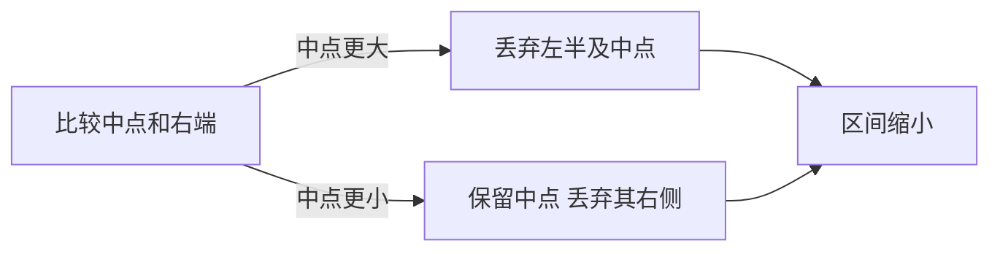

# 旋转数组中的最小值

← [[学习/学习导航/2026-11-01-学习导航|今日导航]] · [[八股测试/2026-11-01|今日测试]] · [[学习/2026-11-01/示例代码/01-旋转数组二分|注释代码阅读版]]

## 1. 这题从哪里来

[C++面经合集](https://ac.nowcoder.com/discuss/334298)（I-U / 牛客，页面编辑于 2019-11-04；首发未显示，作者所投基本为 C++ 开发；对应百度、猿辅导场次；2026-11-01 访问：全文可读）记录的考点是“百度一面：旋转数组找最小值（手撕）”。本文的精确输入约束、数字、边界追问与代码均是**本库扩展**，不说成面试官原话。候选人自述只用于确认题型，不作为算法正确性的证明。

## 2. 先把词说清楚

旋转数组：把有序数组末尾若干项搬到开头；断点：从大值跳回小值的位置；闭区间：[left,right] 两端都可能是答案。

**要解决的问题：**非空、原先严格递增、旋转后的数组，怎样用二分找到最小值？为什么可以排除一半？

## 3. 为什么这样做

循环不变量：最小值始终在闭区间 [left,right]。当 a[mid]>a[right] 时，mid 不可能是最小值，右半段必包含断点；否则右端可删除而 mid 保留。每轮至少删除一个位置。



上图只表达关键数据关系。请先用纸跟踪最小示例，再看下面完整源码；代码行内注释解释每次指针/下标/状态的变化。

### 手动走一遍：`[4,5,1,2,3]`

| 轮次 | left / mid / right | 比较 | 下一段仍可能包含最小值 |
| --- | --- | --- | --- |
| 初始 | 0 / 2 / 4 | `1 < 3` | `[0,2]`，中点 1 不可丢 |
| 第二轮 | 0 / 1 / 2 | `5 > 1` | `[2,2]`，中点 5 可丢 |

返回下标 2 的值 1。**判断依据是与右端比，不是看左半是否整体有序。**有重复元素时 `a[mid]==a[right]` 无法判别哪半有断点，故严格对数时间的结论不适用。这里的 `left` 和 `right` 是下标，既不是指针，也不是内存地址。

## 4. C++17 可运行示例（完整源码）

```cpp
// 目的：在互不相同的旋转有序数组中找最小值，演示闭区间二分。
// 前置：原数组严格递增，旋转后仍非空；此算法不直接处理重复元素。
// 步骤：比较中点和右端，缩小答案所在区间；观察每轮区间都变短。
#include <cassert>    // assert：检查本地示例是否得到预期答案。
#include <stdexcept>  // invalid_argument：清楚报告不符合前提的输入。
#include <vector>     // vector：存放按下标访问的数组。

int rotated_min(const std::vector<int>& a) { // const&：只读借用数组，不复制。
    if (a.empty()) throw std::invalid_argument("empty array");
    std::size_t left = 0;             // left/right 是仍可能有最小值的闭区间两端。
    std::size_t right = a.size() - 1; // 空数组已在上方排除，所以减一安全。
    while (left < right) {            // 两端重合时答案已确定。
        const std::size_t mid = left + (right - left) / 2; // 避免 left+right 溢出。
        if (a[mid] > a[right]) left = mid + 1; // 最小值必在 mid 右边。
        else right = mid;                      // mid 自身仍可能是最小值。
    }
    return a[left]; // 循环不变量保证它是原数组的最小值。
}

int main() {
    assert(rotated_min({4, 5, 1, 2, 3}) == 1);
    assert(rotated_min({1, 2, 3}) == 1); // 未旋转也成立。
    assert(rotated_min({7}) == 7);       // 单元素无需循环。
}
```

同一份注释源码：[[学习/2026-11-01/示例代码/01-旋转数组二分|Obsidian 阅读版]] · [[学习/2026-11-01/示例代码/01-旋转数组二分.cpp|原始 cpp]]。`assert` 成功时程序通常无输出；它检查指定样例，不能代替形式化证明或大规模测试。

## 5. 场景、边界与复杂度

- **什么时候用：**在按某个位置循环移动但仍保留局部有序的数据中找边界；实际行情价格序列并非总是有序，不能直接套此法。
- **前提和反例：**空输入由本示例抛异常；未旋转时返回首项；单元素直接返回；重复元素需要另一套相等分支。
- **成本：**时间 O(log n)，额外空间 O(1)，仅在元素互异与题面前提成立时。
- **常见追问：**如果允许相同元素，中点等于右端时怎么办？答：只能安全地把 right 减一；例如全相同元素会退化到 O(n)。

## 6. 可以口述的完整回答

比较 a[mid] 与 a[right]。若前者大，断点在右侧，令 left=mid+1；否则最小值仍在 [left,mid]，令 right=mid。区间每轮缩小，最后 left 指向最小值。前提是元素互异；有重复值时相等不能直接判断方向，最坏可能退化到线性。

## 7. 事实依据与适用范围

- [亲历面经：C++面经合集](https://ac.nowcoder.com/discuss/334298)：只支持“被问到什么”的候选人记录。
- [题目/算法依据](https://leetcode.com/problems/find-minimum-in-rotated-sorted-array/)：核对题目输入约束、目标或算法结构。代码与复杂度推导为本库独立编写。

