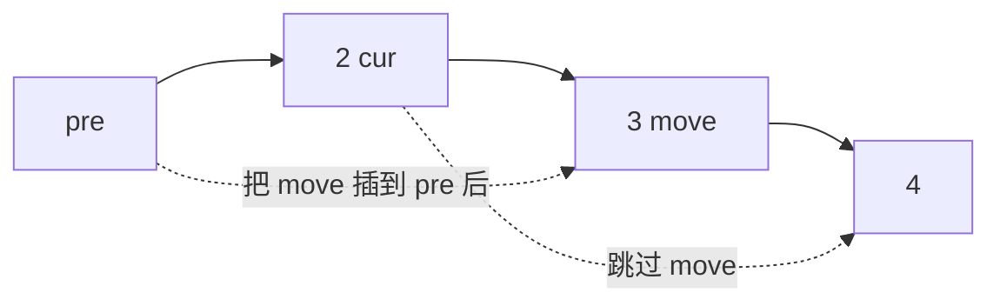

# 链表区间反转

← [[学习/学习导航/2026-11-01-学习导航|今日导航]] · [[八股测试/2026-11-01|今日测试]] · [[学习/2026-11-01/示例代码/02-链表区间反转|注释代码阅读版]]

## 1. 这题从哪里来

[C++面经合集](https://ac.nowcoder.com/discuss/334298)（I-U / 牛客，页面编辑于 2019-11-04；首发未显示，作者所投基本为 C++ 开发；对应百度、猿辅导场次；2026-11-01 访问：全文可读）记录的考点是“猿辅导一面：链表第 m 到第 n 个反转”。本文的精确输入约束、数字、边界追问与代码均是**本库扩展**，不说成面试官原话。候选人自述只用于确认题型，不作为算法正确性的证明。

## 2. 先把词说清楚

单链表：每个结点只保存下一结点的地址；前驱：紧挨区间前面的结点；虚拟头结点：临时局部结点，使头部操作与中间操作统一。

**要解决的问题：**给定单链表和有效的 1 起始位置 left、right，原地反转该区间；如何处理从头结点开始反转？

## 3. 为什么这样做

每轮中，pre->next 已是反转区间当前首项；cur 是反转区间当前尾项；cur->next 是下一个待搬的结点。先保存 move=cur->next，再跳过它，最后把它接到 pre 后。



上图只表达关键数据关系。请先用纸跟踪最小示例，再看下面完整源码；代码行内注释解释每次指针/下标/状态的变化。

### 用五个结点跟踪指针

目标：`1→2→3→4→5` 的第 2 到第 4 个反转。`pre` 指向 1，`cur` 指向 2。第一轮取出 3，先让 2 指向 4，再把 3 插到 1 后，得到 `1→3→2→4→5`。第二轮取出 4，得到 `1→4→3→2→5`。`cur` 始终是 2，因为它是已反转区间的尾。

| 名字 | 表示什么 | 为什么不能丢 |
| --- | --- | --- |
| `pre` | 区间前面的结点 | 决定新结点插入的位置 |
| `cur` | 已反转区间尾结点 | 它的 `next` 是下一待搬结点 |
| `move` | 本轮摘下的结点 | 要重新连接到 `pre` 后面 |

虚拟头 `dummy` 是栈上局部对象；返回 `dummy.next` 指向原链表结点。不要返回 `&dummy`，函数退出后它就不存在了。

## 4. C++17 可运行示例（完整源码）

```cpp
// 目的：原地反转单链表中从 left 到 right 的结点（位置从 1 开始）。
// 前置：链表无环，且 1 <= left <= right <= 链表长度。
// 步骤：定位区间前驱，每次把当前结点后面的一个结点搬到区间前部。
#include <cassert> // assert：验证结点顺序和新链表头。

struct Node { int value; Node* next; }; // next 保存下一结点地址；nullptr 表示结尾。

Node* reverse_between(Node* head, int left, int right) {
    Node dummy{0, head}; // 虚拟头只在函数调用期间存在，不属于返回链表。
    Node* pre = &dummy;  // * 表示指针变量；&dummy 取得局部对象的地址。
    for (int pos = 1; pos < left; ++pos) pre = pre->next; // -> 访问指针所指结点。
    Node* cur = pre->next; // cur 始终是已经反转部分的尾结点。
    for (int i = 0; i < right - left; ++i) {
        Node* move = cur->next;   // 先保存要搬的结点，否则改指针后会丢链。
        cur->next = move->next;   // 从原位置摘掉 move。
        move->next = pre->next;   // move 指向当前区间首结点。
        pre->next = move;         // 区间首结点改为 move。
    }
    return dummy.next; // 返回的是实际结点地址，不是 dummy 地址。
}

int main() {
    Node e{5, nullptr}, d{4, &e}, c{3, &d}, b{2, &c}, a{1, &b};
    Node* head = reverse_between(&a, 2, 4);
    assert(head == &a && a.next == &d && d.next == &c);
    assert(c.next == &b && b.next == &e && e.next == nullptr);
    head = reverse_between(head, 1, 2); // 覆盖“头结点改变”的边界。
    assert(head == &d && d.next == &a);
}
```

同一份注释源码：[[学习/2026-11-01/示例代码/02-链表区间反转|Obsidian 阅读版]] · [[学习/2026-11-01/示例代码/02-链表区间反转.cpp|原始 cpp]]。`assert` 成功时程序通常无输出；它检查指定样例，不能代替形式化证明或大规模测试。

## 5. 场景、边界与复杂度

- **什么时候用：**链式结构调整顺序时不用复制载荷；订单簿同价链表若改指针，必须同步维护外部索引，不能只改 next。
- **前提和反例：**left=right 不动；left=1 通过 dummy 更新新头；题目保证位置有效，本例用异常显示无效位置。链表带环不满足输入前提。
- **成本：**访问前缀及区间共 O(n) 时间，额外 O(1) 空间。
- **常见追问：**为什么不能先改 move->next 再保存 cur->next？答：会丢失原后继，甚至形成错误环。

## 6. 可以口述的完整回答

先定位区间前驱 pre 和区间第一个结点 cur。循环将 cur 后面的结点摘出并插在 pre 后，做 right-left 次。虚拟头结点统一处理 left=1。结点对象未复制，只改变 next 指向；原输入头指针可能不再是新头。

## 7. 事实依据与适用范围

- [亲历面经：C++面经合集](https://ac.nowcoder.com/discuss/334298)：只支持“被问到什么”的候选人记录。
- [题目/算法依据](https://leetcode.com/problems/reverse-linked-list-ii/)：核对题目输入约束、目标或算法结构。代码与复杂度推导为本库独立编写。

