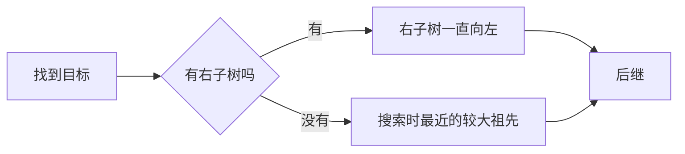

# 二叉搜索树的中序后继

← [[学习/学习导航/2026-11-01-学习导航|今日导航]] · [[八股测试/2026-11-01|今日测试]] · [[学习/2026-11-01/示例代码/03-二叉搜索树中序后继|注释代码阅读版]]

## 1. 这题从哪里来

[C++面经合集](https://ac.nowcoder.com/discuss/334298)（I-U / 牛客，页面编辑于 2019-11-04；首发未显示，作者所投基本为 C++ 开发；对应百度、猿辅导场次；2026-11-01 访问：全文可读）记录的考点是“猿辅导三面：求二叉树中序遍历的后继结点”。本文的精确输入约束、数字、边界追问与代码均是**本库扩展**，不说成面试官原话。候选人自述只用于确认题型，不作为算法正确性的证明。

## 2. 先把词说清楚

二叉搜索树：左子树键都小于本结点，右子树键都大于本结点；中序遍历：左、根、右；后继：中序序列里紧随目标的结点。

**要解决的问题：**若树满足二叉搜索树、键唯一且给定键一定存在，如何找到该键中序遍历后的下一个结点？

## 3. 为什么这样做

向左搜索目标时，当前结点比目标大且可能是最小的大值；越往下出现的合格祖先越接近目标。若目标有右子树，它的最小键优先于所有祖先。



上图只表达关键数据关系。请先用纸跟踪最小示例，再看下面完整源码；代码行内注释解释每次指针/下标/状态的变化。

### 先写出中序顺序，再找后继

示例树 `4` 的左子树是 `2(1,3)`，右孩子是 `5`，中序顺序为 `1,2,3,4,5`。结点 2 有右子树，后继取右子树最左的 3；结点 3 没有右子树，向上看最近的较大祖先 4；结点 5 最大，没有后继。

普通二叉树也有中序遍历顺序，但键值不一定按大小排列。原帖问的是普通“二叉树”后继，本库为演示高效的按键搜索，**增加了二叉搜索树和键唯一前提**。若去掉 BST 前提，不能依据 `key < cur->key` 向左剪枝；可在有父指针时按结构上溯，或整体中序遍历。

## 4. C++17 可运行示例（完整源码）

```cpp
// 目的：在键互异的二叉搜索树中找中序后继。
// 前置：key 确实在树中；每个结点左子树的键小、右子树的键大。
// 步骤：搜索时记较大的祖先；目标若有右子树，改取右子树最左结点。
#include <cassert> // assert：验证后继及最大键无后继的边界。

struct Node { int key; Node* left; Node* right; }; // 左右指针指向孩子或 nullptr。

const Node* successor(const Node* root, int key) { // const Node*：只读结点，不修改树。
    const Node* candidate = nullptr; // 搜索路径上比 key 大的最近祖先。
    const Node* cur = root;
    while (cur && cur->key != key) {
        if (key < cur->key) { candidate = cur; cur = cur->left; }
        else cur = cur->right;
    }
    if (!cur) return nullptr; // 本例顺带为不存在的 key 返回空，但不作通用约定。
    if (cur->right) {          // 右子树所有键都大于目标。
        cur = cur->right;
        while (cur->left) cur = cur->left; // 取其中最小的键。
        return cur;
    }
    return candidate; // 没有右子树，取最近的较大祖先。
}

int main() {
    Node n1{1, nullptr, nullptr}, n3{3, nullptr, nullptr};
    Node n2{2, &n1, &n3}, n5{5, nullptr, nullptr};
    Node n4{4, &n2, &n5}; // 中序序列是 1,2,3,4,5。
    assert(successor(&n4, 2) == &n3);      // 有右子树。
    assert(successor(&n4, 3) == &n4);      // 没有右子树。
    assert(successor(&n4, 5) == nullptr);  // 最大键无后继。
}
```

同一份注释源码：[[学习/2026-11-01/示例代码/03-二叉搜索树中序后继|Obsidian 阅读版]] · [[学习/2026-11-01/示例代码/03-二叉搜索树中序后继.cpp|原始 cpp]]。`assert` 成功时程序通常无输出；它检查指定样例，不能代替形式化证明或大规模测试。

## 5. 场景、边界与复杂度

- **什么时候用：**维护有序集合时查找紧邻键，如下一个价位；真实 std::map 迭代器提供后继能力，不必重新手写树。
- **前提和反例：**目标是最大键则无后继；本示例要求键存在且不重复，普通二叉树不具备按键剪枝前提；退化链形树的高度为 n。
- **成本：**时间 O(h)、额外 O(1)，h 为树高；未平衡树最坏 O(n)。
- **常见追问：**若只是普通二叉树而非搜索树呢？答：不能按键大小剪枝，可带父指针寻找祖先，或从根做中序遍历定位。

## 6. 可以口述的完整回答

从根找目标：若 key 小于当前键，当前结点是一个可能的后继，记下后走左边；若 key 大，走右边。找到目标后，若有右子树，后继是右子树最左结点；否则返回搜索路径上最后记住的候选。没有候选则没有后继。

## 7. 事实依据与适用范围

- [亲历面经：C++面经合集](https://ac.nowcoder.com/discuss/334298)：只支持“被问到什么”的候选人记录。
- [题目/算法依据](https://live.ocw.mit.edu/courses/6-006-introduction-to-algorithms-spring-2020/376714cc85c6c784d90eec9c575ec027_MIT6_006S20_lec6.pdf)：核对题目输入约束、目标或算法结构。代码与复杂度推导为本库独立编写。

