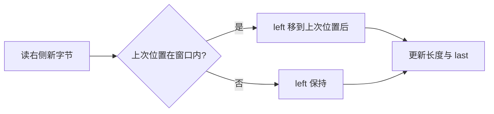

# 最长无重复子串

← [[学习/学习导航/2026-11-01-学习导航|今日导航]] · [[八股测试/2026-11-01|今日测试]] · [[学习/2026-11-01/示例代码/04-最长无重复子串|注释代码阅读版]]

## 1. 这题从哪里来

[非科班转码：211化学本→985材料硕→字节后端开发](https://ac.nowcoder.com/discuss/1626909)（匿名牛油 / 牛客，页面编辑于 04-05 10:38；年份及首发日未显示，字节后端一面；2026-11-01 访问：正文搜索索引可读，完整页面访问未成功）记录的考点是“字节后端一面：最长不重复子串的长度”。本文的精确输入约束、数字、边界追问与代码均是**本库扩展**，不说成面试官原话。候选人自述只用于确认题型，不作为算法正确性的证明。

## 2. 先把词说清楚

子串：原字符串连续的一段；滑动窗口：左右边界都只向右移动的连续区间；last：某字节最近出现的位置，-1 表示没出现。

**要解决的问题：**给定字节字符串，求没有重复字节的最长连续片段长度；遇到重复字符时左边界为什么不能后退？

## 3. 为什么这样做

处理每个 right 后，窗口内字节两两不同，left 从不后退。旧重复在窗口左边时不影响当前窗口。



上图只表达关键数据关系。请先用纸跟踪最小示例，再看下面完整源码；代码行内注释解释每次指针/下标/状态的变化。

### 为什么 `abba` 是反例

处理前三个字节 `abb` 后，窗口为第二个 `b`，`left=2`。读到最后的 `a` 时，它上次出现于下标 0，已经在窗口外。若盲目设置 `left=0+1=1`，窗口变成 `bba`，含重复 `b`，错误地得到长度 3。用 `max(left,last[a]+1)` 保持 `left=2`，窗口是 `ba`，正确长度 2。

本代码把 `std::string` 当字节串，因此长度是字节数。若业务要求“汉字字符数”或用户可见字符数，需要先明确是 Unicode 码点还是字形簇，再用相应的解码与分段流程；直接把 `char` 当汉字会答错。

## 4. C++17 可运行示例（完整源码）

```cpp
// 目的：按“字节”计算最长无重复连续子串；不把 UTF-8 字节等同字符。
// 前置：输入为 std::string；此函数对所有 256 种字节值都能索引。
// 步骤：右边界逐字节前进；若重复字节在当前窗口内，左边界移到其后。
#include <algorithm> // std::max：保证左边界不会后退。
#include <array>     // 固定 256 项，保存每种字节最近出现的位置。
#include <cassert>   // assert：覆盖空串和 abba 边界。
#include <string>    // std::string：字节序列。

std::size_t longest_unique_bytes(const std::string& s) { // const&：只读借用。
    std::array<std::size_t, 256> last; // 下标对应 unsigned char 的 0..255。
    last.fill(s.size());              // 合法位置只到 size-1，size 代表尚未出现。
    std::size_t left = 0, best = 0;
    for (std::size_t right = 0; right < s.size(); ++right) {
        const auto byte = static_cast<unsigned char>(s[right]); // 避免 char 为负时越界。
        if (last[byte] != s.size()) left = std::max(left, last[byte] + 1);
        best = std::max(best, right - left + 1); // 当前窗口保证没有重复字节。
        last[byte] = right; // 用 size_t 保存位置，与 string::size() 的类型一致。
    }
    return best;
}

int main() {
    assert(longest_unique_bytes("") == 0);
    assert(longest_unique_bytes("abcabcbb") == 3);
    assert(longest_unique_bytes("abba") == 2); // left 不能从 2 倒退到 1。
}
```

同一份注释源码：[[学习/2026-11-01/示例代码/04-最长无重复子串|Obsidian 阅读版]] · [[学习/2026-11-01/示例代码/04-最长无重复子串.cpp|原始 cpp]]。`assert` 成功时程序通常无输出；它检查指定样例，不能代替形式化证明或大规模测试。

## 5. 场景、边界与复杂度

- **什么时候用：**连续日志标记、协议字节流中寻找不重复片段；本例按字节处理，UTF-8 中文“字符”需先定义编码单元。
- **前提和反例：**空串返回 0；abba 返回 2；本例按 unsigned char 归一到 0..255，避免有符号 char 做数组下标。
- **成本：**时间 O(n)，固定 256 个整数作额外空间，即相对输入 O(1)。
- **常见追问：**输入若是 UTF-8 中文怎么办？答：本代码按字节定义重复；按 Unicode 码点需要先解码，复杂度依然可按码点数分析。

## 6. 可以口述的完整回答

用 [left,right] 表示当前无重复窗口。若当前字节上次出现位置在窗口内，left 移到其后；若在窗口外则不动。每次用 right-left+1 更新答案。比如 abba 处理最后的 a 时不能把 left 从 2 倒退至 1。

## 7. 事实依据与适用范围

- [亲历面经：非科班转码：211化学本→985材料硕→字节后端开发](https://ac.nowcoder.com/discuss/1626909)：只支持“被问到什么”的候选人记录。
- [题目/算法依据](https://leetcode.com/problems/longest-substring-without-repeating-characters/)：核对题目输入约束、目标或算法结构。代码与复杂度推导为本库独立编写。

