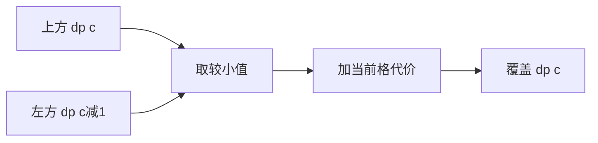

# 网格最小路径和

← [[学习/学习导航/2026-11-01-学习导航|今日导航]] · [[八股测试/2026-11-01|今日测试]] · [[学习/2026-11-01/示例代码/05-网格最小路径和|注释代码阅读版]]

## 1. 这题从哪里来

[腾讯 光子工作室游戏客户端开发面经（一二三面已）](https://ac.nowcoder.com/discuss/569983)（Eugenie / 牛客，页面编辑于 2021-03-14；首发未显示，游戏客户端 C++ 开发；2026-11-01 访问：全文可读）记录的考点是“腾讯光子游戏客户端一面：候选人自选 LeetCode 64 最小路径和编码”。本文的精确输入约束、数字、边界追问与代码均是**本库扩展**，不说成面试官原话。候选人自述只用于确认题型，不作为算法正确性的证明。

## 2. 先把词说清楚

动态规划：利用重叠子问题的已算答案求更大问题；状态：存储的子问题答案；转移：由较小子问题推新答案；滚动数组：复用一维空间。

**要解决的问题：**非空、非负、矩形网格，只能向右或向下；求左上到右下最小路径和。状态、转移和初值是什么？

## 3. 为什么这样做

按行从左到右，处理 (r,c) 前，dp[c] 保存上方的最优和；处理后保存当前格最优和，dp[c-1] 已是当前行左方的最优和。



上图只表达关键数据关系。请先用纸跟踪最小示例，再看下面完整源码；代码行内注释解释每次指针/下标/状态的变化。

### 把二维表压成一维表

以 `[[1,3,1],[1,5,1],[4,2,1]]` 为例。第一行处理后 `dp=[1,4,5]`。第二行处理后 `dp=[2,7,6]`：其中格子 `(1,1)` 的上方代价 4、左方代价 2，选 2 再加本格 5，得到 7。第三行处理后 `dp=[6,8,7]`，终点为 7。

| 更新第 r 行第 c 列时 | `dp[c]` | `dp[c-1]` |
| --- | --- | --- |
| 覆盖前 | 上一行同列的最小和 | 当前行前一列的最小和 |
| 覆盖后 | 当前格最小和 | 保持当前行左边答案 |

“最优子结构”在这里是：到某格的最优路径，最后一步只能从上或左来，所以上/左的前缀也必须各自最优。若允许向四方走，可能有环，这个递推顺序不再直接成立。

## 4. C++17 可运行示例（完整源码）

```cpp
// 目的：求只可向右、向下移动的非负矩形网格最小路径和。
// 前置：网格非空、每行等长且非空；用 long long 避免一般小输入的 int 溢出。
// 步骤：一维 dp[c] 在覆盖前代表上方，dp[c-1] 已代表左方。
#include <algorithm> // std::min：在上方和左方路径中选较小值。
#include <cassert>   // assert：验证多行、单行边界。
#include <stdexcept> // invalid_argument：报告无效网格。
#include <vector>    // vector：保存输入和一维动态规划数组。

long long min_path_sum(const std::vector<std::vector<int>>& grid) {
    if (grid.empty() || grid[0].empty()) throw std::invalid_argument("empty grid");
    const std::size_t cols = grid[0].size();
    std::vector<long long> dp(cols, 0); // dp[c] 存到当前格的最优和。
    for (std::size_t r = 0; r < grid.size(); ++r) {
        if (grid[r].size() != cols) throw std::invalid_argument("ragged grid");
        for (std::size_t c = 0; c < cols; ++c) {
            const long long cost = grid[r][c]; // 一格的代价。
            if (r == 0 && c == 0) dp[c] = cost; // 起点无前驱。
            else if (r == 0) dp[c] = dp[c - 1] + cost; // 首行只能从左来。
            else if (c == 0) dp[c] += cost;            // 首列只能从上来。
            else dp[c] = std::min(dp[c], dp[c - 1]) + cost;
        }
    }
    return dp[cols - 1]; // 终点的最优和。
}

int main() {
    assert(min_path_sum({{1,3,1},{1,5,1},{4,2,1}}) == 7);
    assert(min_path_sum({{1,2,3}}) == 6); // 单行只有一条路径。
}
```

同一份注释源码：[[学习/2026-11-01/示例代码/05-网格最小路径和|Obsidian 阅读版]] · [[学习/2026-11-01/示例代码/05-网格最小路径和.cpp|原始 cpp]]。`assert` 成功时程序通常无输出；它检查指定样例，不能代替形式化证明或大规模测试。

## 5. 场景、边界与复杂度

- **什么时候用：**二维规则路网的最低成本规划；有负值但只允许右/下时仍无环，递推仍成立，不过本题与代码按原题非负约束。
- **前提和反例：**单行/单列各只有一条路径；网格为空或行长不同由本例抛异常；本例用 long long 存和，仍须由应用约束确认不会溢出。
- **成本：**时间 O(RC)，额外空间 O(C)。
- **常见追问：**能否用 BFS 求最小路径和？答：普通 BFS 保证最少边数，不保证非等权网格的最小权重；此题右/下无环，用动态规划。

## 6. 可以口述的完整回答

令 dp[c] 表示当前处理行到第 c 列的最小和。更新前 dp[c] 是上方答案，dp[c-1] 是本行左方答案；取两者较小者加当前格子值。首行只能从左来，首列只能从上来，起点单独初始化。

## 7. 事实依据与适用范围

- [亲历面经：腾讯 光子工作室游戏客户端开发面经（一二三面已）](https://ac.nowcoder.com/discuss/569983)：只支持“被问到什么”的候选人记录。
- [题目/算法依据](https://leetcode.com/problems/minimum-path-sum/)：核对题目输入约束、目标或算法结构。代码与复杂度推导为本库独立编写。
- [MIT 6.006 动态规划子问题讲义](https://www.ocw.mit.edu/courses/6-006-introduction-to-algorithms-spring-2020/resources/mit6_006s20_lec16/)：状态与子问题的构造。
