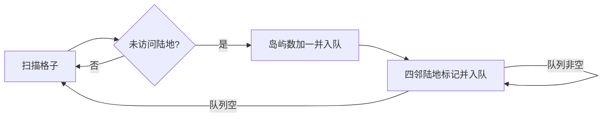

# 岛屿数量与连通块

← [[学习/学习导航/2026-11-01-学习导航|今日导航]] · [[八股测试/2026-11-01|今日测试]] · [[学习/2026-11-01/示例代码/06-岛屿数量|注释代码阅读版]]

## 1. 这题从哪里来

[面试复盘 | 百度提前批四轮面经(已意向)](https://ac.nowcoder.com/discuss/710719)（金基德深港 / 牛客，发布于 2021-08-18，百度提前批 C++ 技术栈；2026-11-01 访问：正文搜索索引可读，完整页面访问未成功）记录的考点是“百度 C++ 提前批二面：岛屿数量（LC200）”。本文的精确输入约束、数字、边界追问与代码均是**本库扩展**，不说成面试官原话。候选人自述只用于确认题型，不作为算法正确性的证明。

## 2. 先把词说清楚

连通块：相互可通过允许方向到达的一组格子；BFS：用队列逐层探索；visited：标记已经发现、无需再次入队的格子。

**要解决的问题：**由 0/1 组成的矩形网格，陆地上下左右相连；如何数出岛屿数量？

## 3. 为什么这样做

每个未访问陆地只会在某次 BFS 发现并标记；一个岛屿的所有陆地互相可达，因此同一轮会全部覆盖；不同岛屿无法互相到达。



上图只表达关键数据关系。请先用纸跟踪最小示例，再看下面完整源码；代码行内注释解释每次指针/下标/状态的变化。

### 为什么数 BFS 次数就是岛屿数

示例 `110 / 000 / 011` 中，上方两个 1 相连，下方两个 1 相连，二者被整行 0 隔开。扫描到 `(0,0)` 开启第一轮 BFS，队列最终处理上方全部陆地；扫描到 `(2,1)` 再开启第二轮，处理下方全部陆地，所以答案是 2。

把每个陆地格看作图上的一个点，上下左右相邻的陆地间连边。BFS 是“从一个点出发，把可到达的点全找出”，一次 BFS 就是一块连通区域。`seen` 的作用不是记录出队次数，而是记录**已经发现/入队**，因此一个陆地只入队一次。与最小路径和的加权优化问题不同，岛屿题只关心能否连接。

## 4. C++17 可运行示例（完整源码）

```cpp
// 目的：对 0/1 网格按上下左右连接关系计算岛屿数量。
// 前置：每行等长；本实现只读输入，以 visited 记录已入队格子。
// 步骤：外层发现未访问陆地就加一；BFS 用队列标记该岛全部陆地。
#include <cassert>   // assert：核对两个岛及全水情况。
#include <queue>     // queue：先进先出，供广度优先搜索使用。
#include <stdexcept> // invalid_argument：报告不规则网格。
#include <utility>   // pair：保存行列坐标。
#include <vector>    // vector：输入与访问标记。

int count_islands(const std::vector<std::vector<char>>& grid) {
    if (grid.empty()) return 0;
    const int rows = static_cast<int>(grid.size());
    const int cols = static_cast<int>(grid[0].size());
    for (const auto& row : grid) { // 先检查所有行，BFS 才能安全访问任意相邻行。
        if (static_cast<int>(row.size()) != cols) throw std::invalid_argument("ragged grid");
    }
    std::vector<std::vector<bool>> seen(rows, std::vector<bool>(cols, false));
    int count = 0;
    const int dr[4]{-1, 1, 0, 0}, dc[4]{0, 0, -1, 1}; // 四个正交邻居。
    for (int r = 0; r < rows; ++r) {
        for (int c = 0; c < cols; ++c) {
            if (grid[r][c] != '1' || seen[r][c]) continue;
            ++count; // 一个尚未归属的陆地，开启一个新连通块。
            std::queue<std::pair<int,int>> pending;
            pending.push({r, c}); seen[r][c] = true; // 入队即标记，防止重复入队。
            while (!pending.empty()) {
                const auto [x, y] = pending.front(); pending.pop(); // C++17 结构化绑定。
                for (int k = 0; k < 4; ++k) {
                    const int nx = x + dr[k], ny = y + dc[k];
                    if (nx < 0 || nx >= rows || ny < 0 || ny >= cols) continue;
                    if (grid[nx][ny] == '1' && !seen[nx][ny]) {
                        seen[nx][ny] = true; pending.push({nx, ny});
                    }
                }
            }
        }
    }
    return count;
}

int main() {
    assert(count_islands({{'1','1','0'},{'0','0','0'},{'0','1','1'}}) == 2);
    assert(count_islands({{'0','0'}}) == 0);
}
```

同一份注释源码：[[学习/2026-11-01/示例代码/06-岛屿数量|Obsidian 阅读版]] · [[学习/2026-11-01/示例代码/06-岛屿数量.cpp|原始 cpp]]。`assert` 成功时程序通常无输出；它检查指定样例，不能代替形式化证明或大规模测试。

## 5. 场景、边界与复杂度

- **什么时候用：**网格版的连通分组；例如识别二维占用图中独立区域。不是网络最短路径或交易网络拓扑的直接实现。
- **前提和反例：**对角线不算相邻；全水返回 0；本例校验矩形，队列迭代避免递归深度问题。
- **成本：**R 行 C 列时间 O(RC)，visited 与队列额外 O(RC)。
- **常见追问：**为什么入队时就标记而不是出队时？答：多个相邻结点可能把同一格重复入队，虽可再检查，但会增加无谓工作。

## 6. 可以口述的完整回答

逐格扫描，遇到未访问的陆地就把答案加一，再用 BFS 从它出发扩展所有四邻陆地。新陆地入队时立即标记，避免同一格重复入队。一轮 BFS 对应一个连通块。

## 7. 事实依据与适用范围

- [亲历面经：面试复盘 | 百度提前批四轮面经(已意向)](https://ac.nowcoder.com/discuss/710719)：只支持“被问到什么”的候选人记录。
- [题目/算法依据](https://leetcode.com/problems/number-of-islands/)：核对题目输入约束、目标或算法结构。代码与复杂度推导为本库独立编写。
- [MIT 6.006 BFS 课程讲义](https://www.ocw.mit.edu/courses/6-006-introduction-to-algorithms-spring-2020/resources/mit6_006s20_lec9/)：队列、可达性与遍历思想。
