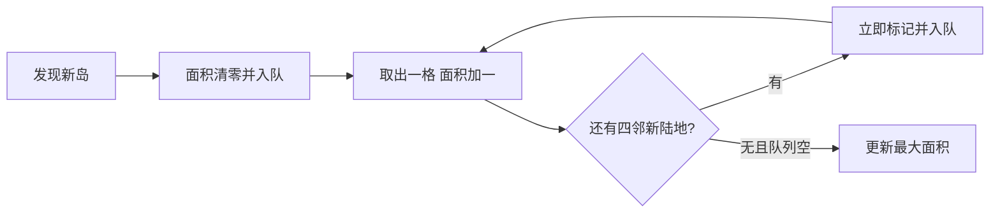

# 小练习：岛屿数量之外，再求最大面积

← [[学习/学习导航/2026-11-01-学习导航|今日导航]] · [[八股测试/2026-11-01#EX-20261101-001 · 岛屿数量之外，再求最大面积|先做题]]

“面积”在本练习中只是一个连通块包含的陆地格数。沿用 [[学习/2026-11-01/06-岛屿数量]] 的 BFS：发现新的未访问陆地时，开启一轮队列搜索，岛数加一，`area=0`；每从队列取出一格，面积加一；队列清空后用 `max_area=max(max_area,area)` 更新答案。



对 `110 / 010 / 101`，第一块面积 3，另两块各 1，所以结果 `(3,3)`。请在原 `06-岛屿数量.cpp` 副本中把返回值改为 `std::pair<int,int>`，每轮 BFS 新增 `area`，在 `pending.pop()` 后累加；不要把本库提供的原始示例误当成这个练习已经写好的答案。空网格返回 `(0,0)`，对角线不相连。技术题面依据：[LeetCode LC200](https://leetcode.com/problems/number-of-islands/)；面积定义是本库扩展。

## 参考实现（完整源码）

```cpp
// 目的：在岛屿数量之外，求最大岛屿面积；面积是陆地格子的个数。
// 前置：字符网格只含 '0' 和 '1'，每行长度相同；四方向相邻才算连通。
// 步骤：每次发现新岛就 BFS；出队一格，当前岛面积加一。
#include <algorithm> // std::max：保存到目前为止最大的岛面积。
#include <cassert>   // assert：核对样例及空网格。
#include <queue>     // queue：BFS 的待处理队列。
#include <stdexcept> // invalid_argument：报告不规则网格。
#include <utility>   // pair：同时保存两个返回值及坐标。
#include <vector>    // vector：网格和已访问标记。

std::pair<int,int> island_stats(const std::vector<std::vector<char>>& grid) {
    if (grid.empty()) return {0, 0}; // 没有格子，自然没有岛与面积。
    const int rows = static_cast<int>(grid.size());
    const int cols = static_cast<int>(grid[0].size());
    for (const auto& row : grid) { // 先整体检查，避免 BFS 访问短行时越界。
        if (static_cast<int>(row.size()) != cols) throw std::invalid_argument("ragged grid");
    }
    std::vector<std::vector<bool>> seen(rows, std::vector<bool>(cols, false));
    const int dr[4]{-1, 1, 0, 0}, dc[4]{0, 0, -1, 1};
    int islands = 0, largest = 0;
    for (int r = 0; r < rows; ++r) {
        for (int c = 0; c < cols; ++c) {
            if (grid[r][c] != '1' || seen[r][c]) continue;
            ++islands; // 发现一个尚未归属的连通块。
            int area = 0; // 只统计本轮 BFS 的面积，不累计上一个岛。
            std::queue<std::pair<int,int>> pending;
            pending.push({r,c}); seen[r][c] = true;
            while (!pending.empty()) {
                const auto [x,y] = pending.front(); pending.pop();
                ++area; // 每格只入队一次，所以每格只计一次面积。
                for (int k = 0; k < 4; ++k) {
                    const int nx = x + dr[k], ny = y + dc[k];
                    if (nx < 0 || nx >= rows || ny < 0 || ny >= cols) continue;
                    if (grid[nx][ny] == '1' && !seen[nx][ny]) {
                        seen[nx][ny] = true; pending.push({nx,ny});
                    }
                }
            }
            largest = std::max(largest, area); // 一轮 BFS 结束后才有完整面积。
        }
    }
    return {islands, largest}; // pair.first 是数量，pair.second 是最大面积。
}

int main() {
    assert((island_stats({{'1','1','0'},{'0','1','0'},{'1','0','1'}})
            == std::pair<int,int>{3,3})); // assert 宏遇到模板逗号，外层再包一层括号。
    assert((island_stats({}) == std::pair<int,int>{0,0}));
}
```

同名 [[学习/2026-11-01/示例代码/07-岛屿面积练习|Obsidian 阅读版]] 与 [[学习/2026-11-01/示例代码/07-岛屿面积练习.cpp|cpp 源码]] 保持同步。`std::pair<int,int>` 是同时返回两个整数的类型，`.first` 是数量，`.second` 是面积。
