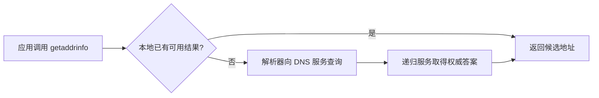

# 域名怎样变成可连接的地址

← [[学习/学习导航/2026-11-02-学习导航|今日导航]] · [[八股测试/2026-11-02|今日测试]] · [[学习/2026-11-02/示例代码/01-DNS解析与缓存|注释代码阅读版]]

## 1. 原帖考点与本库边界

[字节懂车帝后台一面](https://www.nowcoder.com/discuss/353159577019555840)：YuYoung32 / 牛客，2022-04-20 发布，C++ 后台岗位；搜索索引可读，原页本次未能取得正文。原帖明确提到“DNS 如何查找 www.xx.com”。本文的输入条件、追问、图、代码与场景是本库教学扩展，不冒称面试官原话。面经只用于选题，不作为技术答案依据。

## 2. 先把词说清楚

域名是给人用的名字；A/AAAA 记录分别给出 IPv4/IPv6 地址；解析器把名字查询转换为地址；TTL 是记录在缓存中可保留的时间上限。

**今天要解决的问题：**输入一个域名，程序在 connect 之前怎样得到候选地址？缓存命中与权威答案有什么区别？

## 3. 机制、关系与例子

应用调用 getaddrinfo 获取候选 socket 地址，可能先命中本地配置或缓存，也可能由解析器向 DNS 服务器查询。递归解析器可代应用继续查询；权威服务器负责自己管理的区域。返回多个地址时，程序还需按连接策略尝试，不保证第一个总能连通。



**手动走一遍：**例：请求 api.example.test。先查可用缓存；若无答案，解析器向配置的递归服务请求；递归服务必要时沿委派链找到权威服务器，取 A/AAAA 等记录并按 TTL 缓存。示例代码只调用系统解析 localhost，不发明固定的公网查询路径。

## 4. C++17 可运行示例（完整注释源码）

```cpp
// 目的：通过系统接口取得域名对应的候选 socket 地址，不自行实现 DNS。
// 前置：POSIX/Linux，localhost 在本机解析配置中可用；不依赖公网。
// 步骤：设置地址提示，调用 getaddrinfo，遍历结果，最后释放系统分配的链表。
#include <cassert>      // assert：检查至少取得一个候选地址。
#include <netdb.h>      // getaddrinfo/freeaddrinfo/gai_strerror 的声明。
#include <sys/socket.h> // AF_UNSPEC 与 SOCK_STREAM 的定义。

int main() {
    addrinfo hints{};              // 零初始化：没有额外限制的字段保持 0。
    hints.ai_family = AF_UNSPEC;   // 同时接受 IPv4 和 IPv6 候选项。
    hints.ai_socktype = SOCK_STREAM; // 只要适合流式 socket 的地址。
    addrinfo* result = nullptr;   // 系统会把结果链表的首地址写到这里。
    const int rc = getaddrinfo("localhost", "80", &hints, &result);
    if (rc != 0) return 1;        // 解析失败时不能继续解引用 result。
    int count = 0;
    for (addrinfo* p = result; p != nullptr; p = p->ai_next) {
        assert(p->ai_addr != nullptr); // 每项包含可供 connect 使用的地址结构。
        ++count;                      // 地址可能不止一个，顺序也不作保证。
    }
    freeaddrinfo(result);         // 释放整个链表，不能用普通 delete。
    assert(count > 0);
}
```

同一份源码：[[学习/2026-11-02/示例代码/01-DNS解析与缓存|Markdown 阅读版]] · [[学习/2026-11-02/示例代码/01-DNS解析与缓存.cpp|原始 cpp]]。`assert` 成功一般不输出；示例只验证自身给出的样例，不是完整协议实现。

## 5. 用途、边界与口述

- **使用场景：**交易网关连接配置的是域名时，重连必须处理地址变化、解析失败与超时；不能把一次解析所得 IP 永久视为不变。
- **重要边界：**hosts 文件、缓存、DNS64、多个地址及系统解析配置都会改变观察结果。DNS 查到地址不代表服务可连接，也不代表远端身份已验证。
- **追问：**问：DNS 一定每次都从根服务器查起吗？答：不一定，本地/递归缓存可能直接给出答案，解析器配置也因系统而异。

**30–90 秒口述：**先通过系统解析接口把域名转换为候选地址，结果可能来自本地配置或缓存，也可能经过递归 DNS 查询；缓存受 TTL 等策略约束。随后对候选地址建连，连接成功和 TLS 身份验证是后续独立步骤。

## 6. 事实依据

- [字节懂车帝后台一面](https://www.nowcoder.com/discuss/353159577019555840)：只支持搜索索引中明确可见的题型与作者自述信息；YuYoung32 / 牛客，2022-04-20 发布，C++ 后台岗位；搜索索引可读，原页本次未能取得正文。原帖明确提到“DNS 如何查找 www.xx.com”。
- [RFC 1034 §4–5：权威、缓存与解析器](https://www.rfc-editor.org/rfc/rfc1034.html)（2026-11-02 核对）。
- [Linux getaddrinfo(3)](https://man7.org/linux/man-pages/man3/getaddrinfo.3.html)（2026-11-02 核对）。
