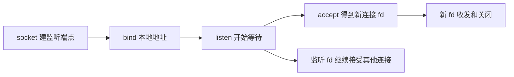

# 服务器怎样接入一条 TCP 连接

← [[学习/学习导航/2026-11-02-学习导航|今日导航]] · [[八股测试/2026-11-02|今日测试]] · [[学习/2026-11-02/示例代码/02-socket服务端链路|注释代码阅读版]]

## 1. 原帖考点与本库边界

[招银网络技术一面](https://www.nowcoder.com/discuss/872488632311939072)：英俊的小松鼠面试中 / 牛客，页面显示 04-11，年份与首发时间未显示，C++ 岗；搜索索引可读，原页本次未能取得正文。原帖明确写“TCP 三次握手流程，对应的 socket API”。本文的输入条件、追问、图、代码与场景是本库教学扩展，不冒称面试官原话。面经只用于选题，不作为技术答案依据。

## 2. 先把词说清楚

socket 是内核提供的通信端点；fd 是进程用来引用端点的整数；bind 设本地地址；listen 使流式 socket 等待连接；accept 取出已建立的连接并返回新 fd。

**今天要解决的问题：**服务端要按什么顺序调用 socket、bind、listen、accept？监听 fd 与连接 fd 分别做什么？

## 3. 机制、关系与例子

服务端先 socket，再 bind 到本地地址与端口，listen 标记为被动监听，accept 从待接受队列取得一条连接。监听 fd 继续接受后续连接，新连接 fd 用于这位客户端的收发。客户端走 socket → connect。应用 API 顺序与 TCP 报文握手是不同层次。



**手动走一遍：**示例在 127.0.0.1 上绑定端口 0，让系统选空闲端口；getsockname 查实际端口；客户端 connect 后服务端 accept，再通过新 fd 收一个字节。单进程局部回环演示 API 关系，不代表可承受高并发。

## 4. C++17 可运行示例（完整注释源码）

```cpp
// 目的：在本机回环地址演示监听 fd、客户端 fd 与 accept 返回的连接 fd。
// 前置：Linux/POSIX 允许本机 TCP loopback；此处使用阻塞 API，只服务一个客户端。
// 步骤：绑定随机端口，监听，客户端连接，接受并收取一个字节，最后分别关闭三个 fd。
#include <arpa/inet.h>  // htons：把端口转换为网络字节序。
#include <cassert>      // assert：检查这个教学示例的系统调用结果。
#include <sys/socket.h> // socket、bind、listen、connect、accept、send、recv。
#include <unistd.h>     // close：释放文件描述符。

int main() {
    int listener = socket(AF_INET, SOCK_STREAM, 0); // 用于监听，尚未代表某个客户端。
    assert(listener >= 0);
    sockaddr_in addr{};                 // IPv4 地址结构清零。
    addr.sin_family = AF_INET;
    addr.sin_addr.s_addr = htonl(INADDR_LOOPBACK); // 只允许本机连接。
    addr.sin_port = htons(0);          // 0 表示让内核挑一个可用端口。
    assert(bind(listener, reinterpret_cast<sockaddr*>(&addr), sizeof(addr)) == 0);
    assert(listen(listener, 4) == 0);   // 开始监听，4 是队列参数而非用户上限。
    socklen_t length = sizeof(addr);
    assert(getsockname(listener, reinterpret_cast<sockaddr*>(&addr), &length) == 0);
    int client = socket(AF_INET, SOCK_STREAM, 0);
    assert(client >= 0);
    assert(connect(client, reinterpret_cast<sockaddr*>(&addr), sizeof(addr)) == 0);
    int peer = accept(listener, nullptr, nullptr); // 新 fd 对应刚建立的这条连接。
    assert(peer >= 0 && peer != listener);
    const char sent = 'A';
    assert(send(client, &sent, 1, 0) == 1);
    char received = 0;
    assert(recv(peer, &received, 1, 0) == 1 && received == 'A');
    close(peer);   // 只关闭这一位客户端的服务端连接端点。
    close(client); // 关闭客户端端点。
    close(listener); // 最后关闭监听端点。
}
```

同一份源码：[[学习/2026-11-02/示例代码/02-socket服务端链路|Markdown 阅读版]] · [[学习/2026-11-02/示例代码/02-socket服务端链路.cpp|原始 cpp]]。`assert` 成功一般不输出；示例只验证自身给出的样例，不是完整协议实现。

## 5. 用途、边界与口述

- **使用场景：**行情接入服务监听固定端口，accept 后为每个连接建立状态对象；对端断开时关闭连接 fd，服务退出时再关闭监听 fd。
- **重要边界：**Linux listen 的 backlog 主要限制完成握手后等待 accept 的队列长度，受 somaxconn 等限制；不应把它直接等同于并发连接总数。示例未实现错误重试、非阻塞 I/O 或多客户端服务。
- **追问：**问：listen backlog 等于最大在线用户数吗？答：不是，它限制等待 accept 的已建立连接队列，具体上限还受系统配置影响。

**30–90 秒口述：**服务端 socket、bind、listen、accept；客户端 socket、connect。accept 返回独立的已连接 fd，原监听 fd 仍可接别的连接。三次握手由 TCP 栈处理，accept 的语义是取得已到达的连接，不能把 connect 写成服务端接收操作。

## 6. 事实依据

- [招银网络技术一面](https://www.nowcoder.com/discuss/872488632311939072)：只支持搜索索引中明确可见的题型与作者自述信息；英俊的小松鼠面试中 / 牛客，页面显示 04-11，年份与首发时间未显示，C++ 岗；搜索索引可读，原页本次未能取得正文。原帖明确写“TCP 三次握手流程，对应的 socket API”。
- [Linux listen(2)](https://man7.org/linux/man-pages/man2/listen.2.html)（2026-11-02 核对）。
- [Linux accept(2)](https://man7.org/linux/man-pages/man2/accept.2.html)（2026-11-02 核对）。
