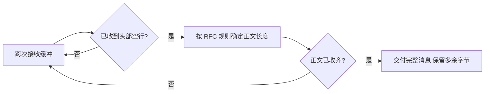

# HTTP/1.1 怎样知道一条消息结束了

← [[学习/学习导航/2026-11-02-学习导航|今日导航]] · [[八股测试/2026-11-02|今日测试]] · [[学习/2026-11-02/示例代码/03-HTTP报文边界|注释代码阅读版]]

## 1. 原帖考点与本库边界

[字节懂车帝后台一面](https://www.nowcoder.com/discuss/353159577019555840)：YuYoung32 / 牛客，2022-04-20 发布，C++ 后台岗位；搜索索引可读，原页本次未能取得正文。原帖明确问“怎么知道 HTTP 内容传完了没”。本文的输入条件、追问、图、代码与场景是本库教学扩展，不冒称面试官原话。面经只用于选题，不作为技术答案依据。

## 2. 先把词说清楚

起始行写请求方法、目标与版本，或响应版本与状态；字段是元信息；CRLF 是规范行结束；Content-Length 以八位字节计正文长度；分块传输是另一种定界方式。

**今天要解决的问题：**HTTP/1.1 报文的起始行、字段、空行和正文怎样分开？看到 Content-Length=5 时已收到 3 字节怎么办？

## 3. 机制、关系与例子

先找到 CRLF CRLF 才能确定字段区结束，再按报文类型与字段确定正文长度。没有 Transfer-Encoding 时，合法 Content-Length 指定八位字节数；若正文尚未达到长度，就继续读取。响应的 HEAD、1xx、204、304 等有特殊无正文规则；chunked 以结束块定界。不能仅靠一次 recv 的返回判断 HTTP 消息结束。



**手动走一遍：**`POST /x HTTP/1.1` 带 `Content-Length: 5`，头后先收到 `abc`，仍缺两个字节；再收到 `de` 才完整。若本次读取还有下一条消息的字节，解析器应保留给下一轮。代码只演示固定长度请求的一小部分，并显式拒绝不支持的 Transfer-Encoding。

## 4. C++17 可运行示例（完整注释源码）

```cpp
// 目的：只演示 HTTP/1.1 固定 Content-Length 请求在分批到达时的完成判断。
// 前置：教学用严格子集；输入恰有一个规范字段，不支持 chunked、重复字段和完整 HTTP 语法。
// 步骤：找头部结束位置，读十进制长度，判断正文是否收齐；多余字节仍留在缓冲中。
#include <cassert>    // assert：验证半条与完整两种状态。
#include <cctype>     // isdigit：只接受十进制长度字符。
#include <stdexcept>  // invalid_argument：拒绝本示例不支持的格式。
#include <string>     // string：保存跨次读取的字节。

std::size_t complete_prefix(const std::string& bytes) {
    const auto end = bytes.find("\r\n\r\n"); // 字段区与正文之间的空行。
    if (end == std::string::npos) return 0;  // 头还没收齐。
    const std::string header = bytes.substr(0, end + 4);
    if (header.find("Transfer-Encoding:") != std::string::npos)
        throw std::invalid_argument("unsupported transfer coding");
    const std::string key = "\r\nContent-Length: ";
    const auto start = header.find(key);
    if (start == std::string::npos) throw std::invalid_argument("missing length");
    const auto value = start + key.size();
    const auto line_end = header.find("\r\n", value);
    if (line_end == value || line_end == std::string::npos)
        throw std::invalid_argument("bad length");
    std::size_t length = 0;
    for (auto i = value; i < line_end; ++i) {
        if (!std::isdigit(static_cast<unsigned char>(header[i])))
            throw std::invalid_argument("non-decimal length");
        const auto digit = static_cast<std::size_t>(header[i] - '0');
        if (length > (1024 - digit) / 10) throw std::invalid_argument("too large");
        length = length * 10 + digit; // 教学示例把正文上限设为 1024 字节。
    }
    const auto total = end + 4 + length; // 消息总长度 = 头部加正文。
    return bytes.size() >= total ? total : 0;
}

int main() {
    std::string buffer = "POST /x HTTP/1.1\r\nHost: example.test\r\nContent-Length: 5\r\n\r\nabc";
    assert(complete_prefix(buffer) == 0); // 只收到 3/5 个正文八位字节。
    buffer += "deNEXT";                  // 下一次还可能带来下条消息开头。
    const auto n = complete_prefix(buffer);
    assert(n > 0 && buffer.substr(n) == "NEXT"); // 多余字节不能丢。
}
```

同一份源码：[[学习/2026-11-02/示例代码/03-HTTP报文边界|Markdown 阅读版]] · [[学习/2026-11-02/示例代码/03-HTTP报文边界.cpp|原始 cpp]]。`assert` 成功一般不输出；示例只验证自身给出的样例，不是完整协议实现。

## 5. 用途、边界与口述

- **使用场景：**网关或订单 API 服务若把半条请求当完整处理，会错误执行；如果盲信互相冲突的长度字段，还会出现前后端解释不一致的风险。生产环境应使用成熟 HTTP 实现。
- **重要边界：**完整 HTTP 解析还要处理大小写不敏感的字段名、重复字段、chunked、方法/响应特例、头部长度上限及恶意输入。本例绝不是可上网部署的服务器。
- **追问：**问：Content-Length 与 Transfer-Encoding 同时出现怎么办？答：发送方不得这样发送，接收方需按 RFC 的优先级与错误处理规则处置，不能随意挑一个信。

**30–90 秒口述：**HTTP/1.1 报文先由起始行和字段区组成，空行后才是可能存在的正文。正文是否完成按 RFC 9112 的定界规则判断，固定长度时数够 Content-Length 指定的八位字节；一次 recv 可能不足，也可能多出下一条消息。

## 6. 事实依据

- [字节懂车帝后台一面](https://www.nowcoder.com/discuss/353159577019555840)：只支持搜索索引中明确可见的题型与作者自述信息；YuYoung32 / 牛客，2022-04-20 发布，C++ 后台岗位；搜索索引可读，原页本次未能取得正文。原帖明确问“怎么知道 HTTP 内容传完了没”。
- [RFC 9112 §2、§6：消息语法与定界](https://www.rfc-editor.org/rfc/rfc9112.html)（2026-11-02 核对）。
