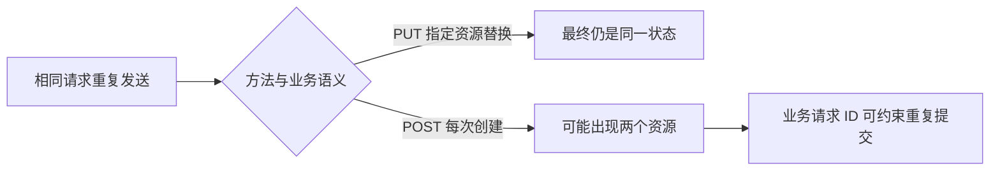

# GET、POST、PUT 的语义和幂等性

← [[学习/学习导航/2026-11-02-学习导航|今日导航]] · [[八股测试/2026-11-02|今日测试]] · [[学习/2026-11-02/示例代码/04-HTTP方法与幂等|注释代码阅读版]]

## 1. 原帖考点与本库边界

[猿辅导 C++ 后端一面](https://www.nowcoder.com/discuss/353156713845039104)：WenKoKu / 牛客，2020-08-07 编辑，C++ 后端岗位；全文可读。原帖列出 HTTP 请求方式、GET/POST 区别及各方法的幂等性。本文的输入条件、追问、图、代码与场景是本库教学扩展，不冒称面试官原话。面经只用于选题，不作为技术答案依据。

## 2. 先把词说清楚

安全方法指请求的目标语义是只读；幂等方法指多次相同请求的预期服务端效果与一次相同；资源是 URI 标识的对象；超时表示客户端不知道服务端是否已经处理。

**今天要解决的问题：**“安全”与“幂等”分别是什么意思？GET、POST、PUT 在一次超时重试中应怎样判断风险？

## 3. 机制、关系与例子

RFC 9110 定义 GET 等为安全方法，PUT、DELETE 及安全方法为幂等方法。POST 的语义由目标资源决定，默认不能假定幂等。幂等说的是预期业务效果，不要求每次响应码或日志完全一样。重复提交订单这类动作即便走 POST，也可由业务幂等键防重。



**手动走一遍：**同样的 `PUT /state/7` 两次都把值替换成 9，最终仍是 9；`POST /orders` 两次若每次创建新订单，就会有两单。代码只模拟这个预期效果，不是在实现 HTTP 服务。

## 4. C++17 可运行示例（完整注释源码）

```cpp
// 目的：用状态变化说明“重复请求的预期效果”与“每次响应相同”是两回事。
// 前置：这里只模拟 HTTP 方法的一个业务例子，不解析或发送任何 HTTP 报文。
// 步骤：重复 PUT 替换同一资源；重复 POST 新建两条资源。
#include <cassert> // assert：核对重复执行后的状态。
#include <map>     // map：保存资源 ID 与数值。

struct Store {
    std::map<int, int> values; // key 是资源 ID，value 是资源状态。
    int next_id = 1;           // POST 示例由服务端分配新 ID。

    void put(int id, int value) { values[id] = value; } // 目标 ID 相同就替换。
    int post(int value) {            // 此业务定义为“每次创建新资源”。
        const int id = next_id++;
        values[id] = value;
        return id;
    }
};

int main() {
    Store s;
    s.put(7, 9);               // 第一次把资源 7 写成 9。
    s.put(7, 9);               // 同一请求重复，最终仍只有资源 7。
    assert(s.values.size() == 1 && s.values.at(7) == 9);
    const int a = s.post(9);   // 第一次创建。
    const int b = s.post(9);   // 超时后盲目重试，会再创建一条。
    assert(a != b && s.values.size() == 3);
}
```

同一份源码：[[学习/2026-11-02/示例代码/04-HTTP方法与幂等|Markdown 阅读版]] · [[学习/2026-11-02/示例代码/04-HTTP方法与幂等.cpp|原始 cpp]]。`assert` 成功一般不输出；示例只验证自身给出的样例，不是完整协议实现。

## 5. 用途、边界与口述

- **使用场景：**下单 API 超时后，不能因为 TCP 连接断开就认定订单没提交。客户端应携带业务请求 ID，服务端记录处理结果并按协议提供查询/去重。
- **重要边界：**若服务端违背方法语义，GET 也可能产生副作用；规范定义与实际实现需分别检查。POST 可以被应用设计成幂等，但 HTTP 方法名本身不保证。
- **追问：**问：DELETE 第二次得到 404，是否说明它不幂等？答：不说明。资源最终已被删除，响应可以不同。

**30–90 秒口述：**安全是约定不会请求改变服务端状态；幂等是相同请求重复执行后的预期效果与一次相同。GET 安全且幂等，PUT/DELETE 幂等，POST 默认不能假定幂等。超时重试要同时看方法语义和业务侧请求 ID。

## 6. 事实依据

- [猿辅导 C++ 后端一面](https://www.nowcoder.com/discuss/353156713845039104)：只支持原帖出现此考点及作者自述的岗位信息；WenKoKu / 牛客，2020-08-07 编辑，C++ 后端岗位；全文可读。原帖列出 HTTP 请求方式、GET/POST 区别及各方法的幂等性。
- [RFC 9110 §9.2–9.3：安全、幂等与方法语义](https://www.rfc-editor.org/rfc/rfc9110.html)（2026-11-02 核对）。
