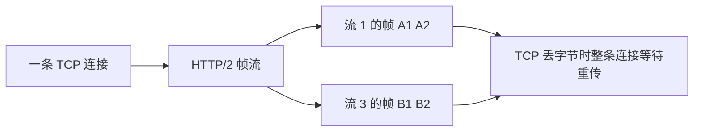

# HTTP 长连接与 HTTP/2 多路复用

← [[学习/学习导航/2026-11-02-学习导航|今日导航]] · [[八股测试/2026-11-02|今日测试]] · [[学习/2026-11-02/示例代码/05-连接复用与HTTP2|注释代码阅读版]]

## 1. 原帖考点与本库边界

[美团一面凉经](https://www.nowcoder.com/discuss/353158512492617728)：尘埃飞舞 / 牛客，2021-09-14 编辑，C++ 相关开发面试；搜索索引可读，原页本次未能取得正文。原帖明确列“HTTP 1.0/1.1 长短连接、2.0 新特性、怎么实现长连接”。本文的输入条件、追问、图、代码与场景是本库教学扩展，不冒称面试官原话。面经只用于选题，不作为技术答案依据。

## 2. 先把词说清楚

长连接指完成一个请求/响应后保留传输连接供后续使用；流是 HTTP/2 中一组独立请求/响应帧；帧是带类型与流 ID 的协议单元；多路复用可在一条连接上交错传不同流的帧。

**今天要解决的问题：**HTTP/1.1 的连接复用与 HTTP/2 的多路复用各解决什么问题？为什么一条 TCP 上的不同流仍会互相影响？

## 3. 机制、关系与例子

HTTP/1.1 默认可保持连接，前提是消息自身有正确的长度界定，双方也可以决定关闭。HTTP/2 把请求/响应分成帧并用流 ID 交错传输，减少同一连接上应用层请求串行等待；但 HTTP/2 通常仍在 TCP 上，TCP 丢包影响整条连接的有序字节交付。



**手动走一遍：**HTTP/1.1 在同一连接先发请求 A，完整读完 A 响应，再继续使用连接发 B。HTTP/2 的帧可以 A1、B1、A2、B2 交错，每帧带流 ID，接收方分别归属 A 与 B。示例代码只模拟流 ID 分桶，未实现 HTTP/2 线协议。

## 4. C++17 可运行示例（完整注释源码）

```cpp
// 目的：用流 ID 归属演示 HTTP/2 交错传帧的概念，不实现 HTTP/2 协议。
// 前置：输入帧已被可信协议栈校验和解码；真实帧格式、流控、HPACK 均未实现。
// 步骤：按到达顺序接收帧，再按 stream_id 归入各自请求/响应。
#include <cassert> // assert：检查交错帧重组后的概念结果。
#include <map>     // map：按流 ID 找到对应的逻辑消息。
#include <string>  // string：示例载荷，仅用于说明归属。
#include <vector>  // vector：模拟接收顺序。

struct Frame {
    int stream_id;      // 真实 HTTP/2 帧有自己的流标识字段。
    std::string payload; // 教学字符串，不是实际 wire format。
};

int main() {
    const std::vector<Frame> incoming{{1, "A1"}, {3, "B1"}, {1, "A2"}, {3, "B2"}};
    std::map<int, std::string> streams; // 每个流维护各自的已到达内容。
    for (const Frame& frame : incoming) {
        streams[frame.stream_id] += frame.payload; // 只追加到对应流。
    }
    assert(streams.at(1) == "A1A2"); // 流 1 内保持自身顺序。
    assert(streams.at(3) == "B1B2"); // 流 3 可以与流 1 交错到达。
}
```

同一份源码：[[学习/2026-11-02/示例代码/05-连接复用与HTTP2|Markdown 阅读版]] · [[学习/2026-11-02/示例代码/05-连接复用与HTTP2.cpp|原始 cpp]]。`assert` 成功一般不输出；示例只验证自身给出的样例，不是完整协议实现。

## 5. 用途、边界与口述

- **使用场景：**C++ API 网关面对多并发请求时，复用连接可减少反复建连成本；HTTP/2 可让同一连接承载多流，但还要观察服务端限流、流控、TCP 丢包和真实延迟。
- **重要边界：**HTTP/1.1 不是强制永远不断开，HTTP/2 也不是零延迟。HTTP/2 的旧版优先级树细节已被 RFC 9113 修订，不宜照旧资料背诵。不能把 HTTP keep-alive 与 TCP SO_KEEPALIVE 混为一谈。
- **追问：**问：HTTP/2 为什么还可能有队头阻塞？答：它消除了 HTTP/1.1 级别的一部分串行阻塞，但底层 TCP 丢字节时后续字节仍需等待重传。

**30–90 秒口述：**HTTP/1.1 的持久连接复用一条 TCP 连接做多个请求，减少重复连接；HTTP/2 则在一条连接内用流 ID 与二进制帧交错传输多个请求/响应，缓解应用层串行等待。不过底层 TCP 仍要求有序交付，丢包会影响该连接上的流。

## 6. 事实依据

- [美团一面凉经](https://www.nowcoder.com/discuss/353158512492617728)：只支持搜索索引中明确可见的题型与作者自述信息；尘埃飞舞 / 牛客，2021-09-14 编辑，C++ 相关开发面试；搜索索引可读，原页本次未能取得正文。原帖明确列“HTTP 1.0/1.1 长短连接、2.0 新特性、怎么实现长连接”。
- [RFC 9112 §9：HTTP/1.1 连接管理](https://www.rfc-editor.org/rfc/rfc9112.html)（2026-11-02 核对）。
- [RFC 9113 §5、§9：流与持久连接](https://www.rfc-editor.org/rfc/rfc9113.html)（2026-11-02 核对）。
