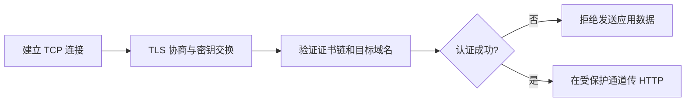

# HTTPS 怎样建立加密且可认证的连接

← [[学习/学习导航/2026-11-02-学习导航|今日导航]] · [[八股测试/2026-11-02|今日测试]] · [[学习/2026-11-02/示例代码/06-HTTPS与TLS握手|注释代码阅读版]]

## 1. 原帖考点与本库边界

[招银网络 C++ 后端一面](https://www.nowcoder.com/feed/main/detail/fa03b7d8938540c09d5442b60b758ef0)：吃西瓜的飞象 / 牛客，2024-09-06 编辑，C++ 后端岗位；搜索索引可读，原页本次未能取得正文。原帖明确列“HTTP 和 HTTPS 的区别，HTTPS 怎么建立加密传输”。本文的输入条件、追问、图、代码与场景是本库教学扩展，不冒称面试官原话。面经只用于选题，不作为技术答案依据。

## 2. 先把词说清楚

TLS 是保护传输的协议；证书把公钥与身份联系起来；信任链把服务端证书连到受信任根；临时密钥交换产生本次会话的共享秘密；对称加密用于后续数据保护。

**今天要解决的问题：**HTTPS 中 TLS 握手解决什么？为什么拿到证书还要验证域名与信任链？TLS 1.3 可以简化成“公钥加密对称密钥”吗？

## 3. 机制、关系与例子

TLS 1.3 客户端发送支持的参数与密钥份额，服务端选择参数并给出自己的密钥份额和认证材料；双方经密钥交换和密钥派生取得会话密钥。客户端验证证书链、目标域名和握手证明后才能把远端视为已认证。后续应用数据用认证加密保护。不能沿用“客户端直接用证书公钥加密一个对称密钥交给服务器”描述 TLS 1.3 的一般流程。



**手动走一遍：**连接 api.example.test 时，DNS 取得地址、TCP 建立连接，接着 TLS ClientHello/ServerHello、证书与 Finished 等消息完成协商与认证，最后在受保护通道内传 HTTP。代码只表达“验证成功前不允许应用发送”这一状态门槛，不实现 TLS 密码学。

## 4. C++17 可运行示例（完整注释源码）

```cpp
// 目的：仅演示“认证完成才放行 HTTP 数据”的应用状态门槛。
// 前置：真实证书、密钥交换和加解密必须交给成熟 TLS 库；本代码绝不执行密码学操作。
// 步骤：先检查协商与身份验证状态，再允许调用方进入发送阶段。
#include <cassert>   // assert：验证失败状态不会被误当作可发送。
#include <stdexcept> // logic_error：阻止未认证连接承载请求。

struct TlsState {
    bool handshake_finished = false; // TLS 库报告握手已经完成。
    bool certificate_valid = false;  // TLS 库报告链与有效期核验成功。
    bool hostname_matches = false;   // TLS 库报告证书身份匹配目标域名。

    bool authenticated() const {
        return handshake_finished && certificate_valid && hostname_matches;
    }
    void require_before_http() const {
        if (!authenticated()) throw std::logic_error("TLS peer not authenticated");
    }
};

int main() {
    TlsState state;
    bool blocked = false;
    try { state.require_before_http(); } // 握手前不得发应用请求。
    catch (const std::logic_error&) { blocked = true; }
    assert(blocked);
    state.handshake_finished = true; // 这里只模拟 TLS 库回报，不是假装自己握手。
    state.certificate_valid = true;
    state.hostname_matches = true;
    state.require_before_http();     // 三项都满足后才通过。
}
```

同一份源码：[[学习/2026-11-02/示例代码/06-HTTPS与TLS握手|Markdown 阅读版]] · [[学习/2026-11-02/示例代码/06-HTTPS与TLS握手.cpp|原始 cpp]]。`assert` 成功一般不输出；示例只验证自身给出的样例，不是完整协议实现。

## 5. 用途、边界与口述

- **使用场景：**交易后台或管理 API 若跳过证书验证，即使流量被加密，也可能与冒充的服务器通信；应使用成熟 TLS 库并正确配置服务器名验证。
- **重要边界：**TLS 只保护端点间的传输，不能自动保证业务请求被正确执行。证书有信任链、有效期、名称匹配等多个检查。0-RTT 的重放边界不在本日示例内；不要手写生产 TLS。
- **追问：**问：证书验证失败还能继续发敏感请求吗？答：应拒绝该连接或按明确的测试环境策略处理，生产客户端不能静默忽略。

**30–90 秒口述：**HTTPS 通常是在 TCP 上先完成 TLS，再传 HTTP。TLS 1.3 用密钥交换与派生建立会话密钥，证书和握手证明用于认证服务器；客户端还要核对证书链与目标域名。此后用认证加密保护应用数据。加密连接不等于业务提交成功。

## 6. 事实依据

- [招银网络 C++ 后端一面](https://www.nowcoder.com/feed/main/detail/fa03b7d8938540c09d5442b60b758ef0)：只支持搜索索引中明确可见的题型与作者自述信息；吃西瓜的飞象 / 牛客，2024-09-06 编辑，C++ 后端岗位；搜索索引可读，原页本次未能取得正文。原帖明确列“HTTP 和 HTTPS 的区别，HTTPS 怎么建立加密传输”。
- [RFC 8446 §2、§4：TLS 1.3 握手](https://www.rfc-editor.org/rfc/rfc8446.html)（2026-11-02 核对）。
- [RFC 9525：TLS 服务身份校验](https://www.rfc-editor.org/rfc/rfc9525.html)（2026-11-02 核对）。
